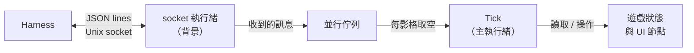

import { Aside, Badge, FileTree } from '@astrojs/starlight/components';

Mod 是 AI 在真實遊戲裡的宿主。它由遊戲自帶的 Mod 載入器載入進遊戲行程，透過 GameBridge 觀測遊戲，經本機 socket 向 Harness（在獨立的決策行程裡）請求推薦，然後要麼把答案顯示給玩家（輔助模式，見[輸出層](/zh-tw/arch/output/)），要麼直接執行（自動遊玩），每一步都記入日誌。搜尋、學習和策略都在決策行程裡；Mod 只負責把遊戲和它連起來。

<Aside title="狀態">

輔助模式已經在兩種環境下覆蓋所有決策介面：`src/Sts2Ai.Mod` 能載入進真實遊戲（v0.111.0，從 Steam 啟動），連上大腦，在最上層的畫面空閒時對每個決策發出詢問（戰鬥、選牌提示、地圖、獎勵、卡牌獎勵、卡包、事件、商店、休息處、財寶房、水晶球），並在一個文字面板裡用遊戲裡的名字顯示答案（[§3](#sec-3)、[§5](#sec-5)）。面板上有一個核取方塊，選 SL 輔助還是 NoSL 輔助。SL 下 Mod 會發送節點的檢查點和節點內的每一步，大腦因此在節點的複本上規劃每場戰鬥（[§6](#sec-6)）；在真實遊戲裡，90 個 SL 決策放到各自的複本上重播，89 個問出同一個決策，剩下那個的原因已經修好（[§12](#sec-12)）。還沒有在真實遊戲裡看它跑完一整局。規劃中：執行轉接器（[§4](#sec-4)）、自動開局驅動（[§7](#sec-7)）和決策日誌（[§8](#sec-8)）。之前的調查見本地筆記 `tmp/notes/mod-research.md` 和 `tmp/notes/output-design.md`。

</Aside>

## 1. 職責

Mod 是真實遊戲裡的一個薄宿主，只做四件事：觀測遊戲（透過 GameBridge）、經 socket 詢問 Harness、渲染答案（[輸出層](/zh-tw/arch/output/)）和/或執行它、記日誌。遊戲行程裡不做搜尋、不做學習、不含策略。只支援單人模式，多人模式下停用。

專案是 `src/Sts2Ai.Mod`。它針對遊戲 DLL（外加 Godot 引擎的 C# API 組件 GodotSharp）編譯，並把 GameBridge 和 Protocol 的原始碼一起編譯進來（[§2](#sec-2)），不引用 Brain。

## 2. 載入

遊戲如何發現並啟動一個 Mod。本節內容都在遊戲原始碼裡讀過，並且在本機的遊戲裡對這個 Mod 成立 <Badge text="已核實" variant="success" />。

遊戲遞迴掃描自己的 `mods/` 目錄尋找清單（manifest），並載入每個清單旁邊名為 `<id>.dll` 的 DLL（`Modding/ModManager.cs`）。本機的遊戲目錄是 `~/.local/share/Steam/steamapps/common/Slay the Spire 2`，其中：

<FileTree>

- mods/
  - Sts2Ai/
    - Sts2Ai.json 清單
    - Sts2Ai.dll Mod 本體（`<id>.dll`），GameBridge 和 Protocol 都在裡面

</FileTree>

- **清單**欄位：`id`、`version`、`has_dll:true`、`has_pck:false`（沒有 Godot 資源包）、`affects_gameplay:false`、`min_game_version:"0.111.0"`。`affects_gameplay` 只在多人模式握手時起作用，而 Mod 本來就拒絕多人模式。
- **同意**：玩家需要在遊戲裡點一次，同意載入 Mod。這個選擇 `PlayerAgreedToModLoading` 存在 `settings.save` 的 `mods_enabled` 裡。Mod 只在啟動時載入。
- **玩家檔案**：帶 Mod 的局使用單獨的玩家檔案目錄 `modded/`，第一次使用時從原版（不帶 Mod）的玩家檔案複製而來。
- **入口**：一個標了 `[ModInitializer(nameof(Init))]` 的靜態方法。它在 `ModelDb.Init` 之前執行，所以凡是要碰遊戲模型的工作，都推遲到第一個影格或 `RunStarted` 再做。
- **版本守衛**：遊戲版本與固定版本不同時，Mod 拒絕啟用，並在面板上顯示原因。
- **單個 DLL**：載入器在呼叫入口之前先列出 Mod 的全部型別（`Assembly.GetTypes`），而遊戲的組件載入上下文（AssemblyLoadContext，.NET 裡決定去哪裡找組件依賴的機制）不會去 Mod 的目錄裡找。只要有一個型別依賴放在 `Sts2Ai.dll` 旁邊的 DLL，這一步就會失敗，Mod 不被載入；在 `Init` 裡裝解析器也來不及。所以 Mod 專案把 GameBridge 和 Protocol 的原始碼編譯進 `Sts2Ai.dll`。
- **安裝**：`dotnet build src/Sts2Ai.Mod/Sts2Ai.Mod.csproj -t:Install` 建置 Mod，並把 `Sts2Ai.json` 和 `Sts2Ai.dll` 複製到 `mods/Sts2Ai/`。遊戲下次啟動時發現新 Mod，預設啟用。

## 3. 主執行緒迴圈與空閒檢測

**遊戲只認一個執行緒**。Godot 和大多數遊戲引擎一樣，要求遊戲狀態和 UI 節點只在主執行緒上存取。所以所有對遊戲的讀寫都放在一個每影格回呼 `Tick` 裡，用 `GetTree().ProcessFrame += Tick` 掛上。`ProcessFrame` 是一個普通的 C# 事件，每影格觸發一次，因此不需要 Godot 的原始碼生成器。等待 socket 會卡住這一個影格，所以 socket 讀寫放在背景執行緒上，收到的訊息放進一個並行佇列，由 `Tick` 每影格取空。這是 STS2MCP（MIT 授權，[§11](#sec-11)）的做法。



**迴圈**。決策介面（surface）指當前顯示的決策畫面的種類：戰鬥、地圖、商店、選牌提示等。每一個影格，`Tick` 按三條規則行事：

| 本影格情況 | Mod 的動作 |
|---|---|
| 當前決策介面已連續空閒至少 3 個影格，且 `obs_hash` 變了 | 傳送 `decision` |
| 收到一個 `recommendation`，其雜湊與當前一致 | 渲染和/或執行它（[§4](#sec-4)） |
| 雜湊變了 | 傳送 `cancel`（狀態已經往前走了，大腦放棄那次搜尋） |

`obs_hash` 是觀測的雜湊（對觀測的規範化 JSON 取 FNV-1a 64，[協定 §2](/zh-tw/arch/protocol/#sec-2)），所以雜湊變了就說明畫面上能看到的東西變了。

**同時只有一個決策在途**。大腦按順序逐個回答決策。所以 Mod 最多只開著一個決策：如果答案到達之前狀態就往前走了，它傳送 `cancel`，並等那個答案到達（然後丟掉），才詢問新的狀態。這樣即使玩家出手比大腦思考快，慢的大腦也不會越積越落後。

**空閒**。「空閒」指遊戲畫面真正準備好接受玩家輸入：遊戲邏輯在等輸入，沒有排隊中的動作，沒有還在演出的東西，也沒有別的畫面擋在要決策的畫面上面。如果提前發出決策，它描述的狀態馬上就會變，點選也可能落空。無頭（headless）執行時，GameBridge 的 `CombatActions.WaitingForInput` 就夠了；在真實遊戲裡不夠（[GameBridge §2](/zh-tw/arch/gamebridge/#sec-2)）。所以 Mod 用遊戲自己的 `ActiveScreenContext.GetCurrentScreen()` 讀出玩家正在看的畫面：開啟的模態視窗、開啟著的地圖、覆蓋層堆疊頂端，否則就是當前房間。由它的型別決定決策介面 <Badge text="已核實" variant="success" />。之後這個決策還必須連續成立至少 3 個影格，這樣一閃而過的「看似空閒」不算數。

| 最上層的畫面 | 決策介面 | 何時算空閒 |
|---|---|---|
| `NCombatRoom`（也包括事件裡的戰鬥） | 戰鬥 | `CombatActions.WaitingForInput`、`ActionQueueSet.IsEmpty`、`Hand.CurrentMode == Play && !InCardPlay` |
| `NCombatRoom`，手牌處於選擇模式 | 選牌提示 | `NPlayerHand.IsInCardSelection` |
| 網格選牌畫面、`NCombatPileCardSelectScreen`、`NChooseACardSelectionScreen` | 選牌提示 | 在最上層：遊戲在某個動作內部等它，所以不檢查佇列 |
| `NCardRewardSelectionScreen`、`NChooseABundleSelectionScreen` | 卡牌獎勵、卡包 | 在最上層 |
| `NRewardsScreen`、`NCrystalSphereScreen`、可以移動時的 `NMapScreen` | 獎勵、水晶球、地圖 | 在最上層，且 `ActionQueueSet.IsEmpty` |
| `NEventRoom`（以及假商人的畫面）、`NMerchantRoom` 或它的貨架、`NRestSiteRoom`、已經亮出遺物的 `NTreasureRoom` | 事件、商店、休息處、財寶房 | 在最上層，且 `ActionQueueSet.IsEmpty` |

每個決策介面的詢問方式和模擬器（`RunSession`）一樣，用的是同樣的 GameBridge 呼叫，所以大腦在兩邊看到的觀測和合法動作相同。藥水欄的動作也在同樣的畫面上提供：除了卡牌獎勵、卡包和選牌提示之外都有。畫面提供了什麼，從畫面節點的私有欄位裡讀取，這些欄位裝的正是它顯示的東西：獎勵組、卡牌獎勵的卡和按鈕、卡包、提示的卡和 `CardSelectorPrefs`。手牌的選擇模式和戰鬥牌堆提示則是對一個牌堆做篩選，所以 Mod 把它們的篩選條件用在那個牌堆上。

**選牌提示**。提示的選項按規範順序排列（`CardChoices.Canonical`），平局用固定的種子打破，所以觀測和它的雜湊每影格都保持不變。它的上下文來自 `ChoiceContexts.Last`（[GameBridge §5](/zh-tw/arch/gamebridge/#sec-5)）：畫面在入口第一次 await 之後才打開，那時 `Current` 已經沒了。每個提示（一個新的畫面節點，或一次新的手牌選擇）取一次最新的上下文。如果那個上下文已經被之前的提示用過，說明這個提示沒有帶上下文：Mod 記一條日誌，把這個提示留給玩家。

**答案**。一個答案對應一個觀測雜湊加一組合法動作：休息處在用過一個選項之後，觀測不變也可能允許離開。戰鬥裡面板只列出到本回合結束為止的計畫；SL 規劃器規劃的是整場戰鬥，後面幾回合要打的牌還沒抽到，所以只報回合數。面板用遊戲本地化表裡的名字（卡牌、遺物、藥水、怪物、事件選項、休息處選項、地圖圖例裡的房間名）描述動作，找不到就用 id。在地圖上，它還會畫出路線：推薦的地圖點上有一個會脈動的紫色圓圈，大腦在它之後規劃的路線上，每段路徑都有一條紫色的線，一直畫到頭目。兩者都畫在 Mod 自己的圖層裡，隨地圖捲動跟著遊戲的節點（地圖點，以及每段路徑上的小點）走（[輸出層 §3](/zh-tw/arch/output/#sec-3)）。

**未知決策介面**。在輔助模式下，如果畫面問的不是 Mod 認識的決策（模態視窗、牌組檢視、還沒開啟的寶箱），面板只顯示狀態行；寶箱沒開啟時會加一句「open the chest」。對自動遊玩來說：如果沒有轉接器匹配，或者空閒檢查成立卻沒有合法動作，Mod 就暫停自動遊玩，面板顯示「manual needed」（需要手動操作），並把它作為覆蓋率 bug 記入日誌。絕不退回隨機動作。

## 4. 執行轉接器

轉接器把一個決策介面上的協定動作和畫面上的 Godot 節點對應起來。GameBridge 從不接觸 Godot 節點（[GameBridge §1](/zh-tw/arch/gamebridge/#sec-1)），所以這部分節點相關的工作放在 Mod 裡。兩種輸出模式共用一個介面：標示問「這個動作在畫面上的哪裡」，自動遊玩讓轉接器去執行它。

```csharp
// One adapter per surface; highlight and auto-play share the action → node mapping.
interface ISurfaceAdapter
{
    string Surface { get; }
    bool Matches();                       // current screen/room is this surface
    Control? AnchorFor(string action);    // node to highlight; null = panel only
    bool Execute(string action);          // same entry point a human click reaches
}
```

`Execute` 在各類決策介面上呼叫什麼：

| 決策介面 | `Execute` |
|---|---|
| 戰鬥 | `CombatActions.Start`（GameBridge）；只有 `CanTurnBeEnded` 時才結束回合 |
| 按鈕 | 呼叫按鈕的處理函式，但要先檢查 `IsEnabled && IsVisibleInTree()`。`ForceClick` 兩樣都不檢查 <Badge text="已核實" variant="success" /> |
| 商店 | `entry.OnTryPurchaseWrapper(inv)`。對商人節點呼叫 `ForceClick` 沒有任何效果 |
| 地圖 | `NMapScreen.OnMapPointSelectedLocally(point)` |
| 選牌提示 | 點選卡牌槽（holder），再點確認。走這條 UI 路徑，`PlayerChoice` 會留在重播記錄裡（[GameBridge §4](/zh-tw/arch/gamebridge/#sec-4)） |

`Execute` 之後，Mod 期望雜湊在超時內變化：遊戲速度為 Fast 時預設 10 秒，Instant 時 3 秒。如果沒變，就重新觀測；連續失敗 3 次則暫停並記日誌。

每個決策介面的 Mod 路徑和對應的模擬器路徑，在 [GameBridge §4](/zh-tw/arch/gamebridge/#sec-4) 裡成對列出。

## 5. 與大腦的連線

- **Socket**：Unix domain socket `~/.local/state/sts2ai/brain.sock`（設定了 `$XDG_STATE_HOME` 時放在它下面），傳輸 JSON lines（[協定 §2](/zh-tw/arch/protocol/#sec-2)）。Mod 是用戶端，Harness 是伺服器端。Harness 由使用者啟動，或由 Mod 按設定的路徑啟動；Mod 自己從不做搜尋。伺服器端已經實作：SimWorker 的 `brain` 命令在這個 socket 上等待，`run --brain` 已經作為宿主連上它跑模擬對局（[模擬器 §5](/zh-tw/arch/simulator/#sec-5)）。
- **Steam 的容器**：Steam 在它的 Linux 執行時容器（pressure-vessel）裡啟動遊戲。容器與主機共享主目錄，但有自己的 `$XDG_RUNTIME_DIR`，放在那裡的 socket 遊戲存取不到，所以 socket 放在主目錄下。大腦建立它的目錄時，只允許使用者本人存取。
- **環境**：由面板上的 SL 核取方塊選定：勾上是 SL，否則是 NoSL（[環境](/zh-tw/arch/environments/)）。核取方塊預設勾上；這個選擇存在 `~/.local/state/sts2ai/env`，和 socket 放在一起，不在遊戲的玩家檔案目錄裡。`hello` 帶上它；對大腦來說，它在一局裡固定不變：在一局中途切換時，Mod 發出 `run_end`（`aborted`）和新的 `hello`，大腦從這一刻起當作新的一局。一個大腦同時服務兩種環境：`brain` 對 NoSL 宿主用 `--policy` 的戰鬥大腦（冠軍的 PIMC），對 SL 宿主用 `--sl-policy` 的戰鬥大腦（預設是 SL 規劃器），宏觀大腦相同（[Harness §4](/zh-tw/arch/harness/#sec-4)）。
- **連不上大腦**：輔助模式下面板顯示「no brain」（沒有大腦）；自動遊玩時 Mod 暫停。連線每 2 秒重試一次；新的連線從 `hello` 重新開始。
- **大腦出錯**：收到 `error` 回答（大腦拒絕這一局，或答不出）後，Mod 在這一局餘下的部分關閉，面板顯示錯誤資訊。

## 6. SL 匯出

SL 下，大腦在當前節點的精確複本上規劃戰鬥（[環境 §6](/zh-tw/arch/environments/#sec-6)）。worker 用節點的檢查點，加上進入節點以來做過的每一個決策來建構複本；決策的寫法與模擬器自己的軌跡相同（[模擬器 §7](/zh-tw/arch/simulator/#sec-7)）。Mod 在兩種環境下都把這兩樣東西記在記憶體裡（`NodeRecord`），所以在任何房間裡勾上 SL 都能馬上用；只有 SL 才把它們發出去。

- **檢查點**：在遊戲到達地圖點、存檔的那一刻，用 GameBridge 的 `Checkpoint.Take` 取：在 `SaveManager.SaveRun` 上掛一個前綴（prefix），只在它的「已完成房間」為空時取，與模擬器取檢查點是同一時刻。開局時遊戲以同樣方式進入第一個地圖點。按「繼續」（Continue）時，遊戲重新進入存檔所在的地圖點，但不再存檔（`RunManager.LoadIntoLatestMapCoord`）：如果存檔是到達時存的，就在這裡取檢查點；如果是房間裡更晚的存檔（戰鬥勝利後、Ancient 事件後），房間的開頭已經不在了，這個節點就沒有複本。Mod 從不寫會被雲同步的 `current_run.save`，也不寫玩家檔案目錄下的任何其他檔案。
- **步驟**：玩家的每個決策，都在遊戲提交它的地方讀出來；這些入口也正是模擬器自己呼叫的入口（[GameBridge §4](/zh-tw/arch/gamebridge/#sec-4)），所以在遊戲執行之前就能精確知道這一步。未決問題 1 因此選了鉤子，而不是比較前後的狀態：狀態比較分不出兩張一樣的牌，玩家操作得比畫面穩定還快時也會漏掉動作。

| 玩家 | 掛鉤的方法（Harmony 前綴） | 步驟 |
|---|---|---|
| 出牌、使用或丟棄藥水、結束回合、移動 | `ActionQueueSynchronizer.RequestEnqueue`，動作為 `PlayCardAction`、`UsePotionAction`、`DiscardPotionGameAction`、`EndPlayerTurnAction`、`VoteForMapCoordAction` | `combat play:…`、`combat potion:…`、`combat end_turn`；戰鬥外是藥水欄的 `potion:S` 或 `discard_potion:S`，記在使用它的那個介面上；`map map:C,R` |
| 回答選牌提示、卡牌獎勵、卡包 | `PlayerChoiceSynchronizer.SyncLocalChoice` | `card_choice I,J`（遊戲自己的序號）、`card_reward card:I` 或 `card_alt:ID`、`bundle bundle:I` |
| 選事件選項、休息處選項 | `EventSynchronizer.ChooseLocalOption`、`RestSiteSynchronizer.ChooseLocalOption` | `event event:I`、`rest rest:ID` |
| 領取獎勵、離開獎勵畫面 | `RewardsSetSynchronizer.SelectLocalReward`；在獎勵畫面上的 `SkipLocalRewardsSet`、`ProceedFromTerminalRewardsScreen`、`ActChangeSynchronizer.SetLocalPlayerReady` | `rewards reward:I`、`rewards rewards_done` |
| 拿或跳過寶箱的遺物 | `TreasureRoomRelicSynchronizer.PickRelicLocally` | `treasure relic:I`、`treasure relic_skip` |
| 購買、刪牌 | `MerchantEntry.OnTryPurchaseWrapper`、`MerchantCardRemovalEntry.OnTryPurchaseWrapper` | `shop buy:I`、`shop remove` |
| 占卜 | `CrystalSphereMinigame.CellClicked` | `crystal_sphere big:X,Y`、`crystal_sphere small:X,Y` |
| 離開事件、商店、休息處 | 地圖要求選擇移動時 | `event proceed`、`shop leave`、`rest leave` |

出牌動作的卡牌從動作的 `NetCombatCard` 取得：動作要到執行時才去找它的卡牌。只有需要選目標的牌和藥水才保留目標，與合法動作的寫法一致。什麼都沒改變的購買或占卜（金幣不夠、格子已經揭開）不算一步。離開財寶房、離開沒有獎勵的戰鬥時也會呼叫同樣的方法，這些也不算一步：只有在獎勵畫面上的才算。事件選項、休息選項、領取獎勵、購買和占卜都作為遊戲自己的任務執行，介面要等任務結束才顯示這一步的結果；在那之前，Mod 不在這個介面上發問，和模擬器等待正在執行的任務一樣。

- **記錄中斷**：遇到模擬器裡沒有對應決策的步驟，這個節點餘下的記錄就中斷：戰鬥中丟棄藥水、收回結束回合、沒有選擇就關掉卡牌獎勵、在 Mod 讀不了的介面上做選擇。這時，以及在沒有檢查點的節點裡，Mod 不詢問 SL 的戰鬥決策：面板說明原因，下一個節點又會有複本。選牌提示和戰鬥外的決策照常詢問，因為它們的大腦不需要複本。鉤子從不讓例外傳到遊戲裡：出了錯就把記錄標為中斷，並寫日誌。
- **傳送**：SL 下，每個決策之前，Mod 先把節點的檢查點發一次（`node_checkpoint`），再發大腦還沒收到的步驟（`node_action`，在節點內從 0 編號，[協定 §2](/zh-tw/arch/protocol/#sec-2)）。節點最後一個決策之後的步驟（比如它的移動）永遠用不到，不傳送。節點從 Mod 執行後遊戲進入的第一個節點開始編號。
- **NoSL**：照樣記錄，但從不傳送。NoSL 日誌裡只要出現任何 `node_checkpoint`，這一局就作廢。

## 7. 自動跑局驅動

驅動在真實遊戲裡自己完整地打一局又一局，用於 R4 評估：R4 是[模擬到實機階梯](/zh-tw/arch/evaluation/#sec-1)裡真實遊戲的那一級。

- **按種子開局**：呼叫 `NGame.StartNewSingleplayerRun(character, shouldSave:false, acts, modifiers, seed, GameMode.Standard, asc)`（`Nodes/NGame.cs:1137`），幕的選擇與大廳（lobby）的做法相同（[模擬器 §5.1](/zh-tw/arch/simulator/#sec-5.1)）。另一種辦法是在按下 Confirm 按鈕之前設定 `NGame.DebugSeedOverride`（`AutoSlayer.cs:500-502`）。
  `shouldSave:false` 時 `current_run.save` 不會被改動，參數文件裡這樣寫（`NGame.cs:1130`） <Badge text="已核實" variant="success" />。不過對局歷史和進度大概仍會寫入 <Badge text="推斷" variant="caution" />，所以自動跑局只用帶 Mod 的玩家檔案。
- **一局結束**：檢測到死亡（所有玩家都死了）或 `WinRun`；記錄 `run_end`；回到主選單；從預先登記的種子清單裡取下一個種子。
- **速度**：只在自動跑局期間設定 `PrefsSave.FastMode = Instant`。這裡有兩個遊戲行為要注意：非編輯器建置在啟動時會把 Instant 降為 Fast，而設定會在結束時儲存。所以在自動跑局停止時和遊戲結束時，Mod 都要把使用者原來的值恢復回去。
- **放棄或崩潰**：這個種子記為 `aborted`，並寫明原因。絕不為了挑更好的結果而重跑一個種子。

## 8. 日誌與 R3 = R4

- **每次決策**記錄：觀測、合法動作、推薦、執行的動作、延遲、環境、遊戲版本、Mod 版本，以及 `NumReloads`（必須為 0）。
- **等價測試**：同一個種子、同一串決策，在模擬器（R3）和遊戲（R4）裡打出來，觀測流必須完全相同。出現分歧說明 GameBridge 或模擬器有 bug；測試會報告第一個分歧點。

## 9. 操作鍵與安全

| 操作 | 作用 |
|---|---|
| F8 | 顯示 / 隱藏面板 |
| SL 核取方塊 | SL 輔助或 NoSL 輔助（[§5](#sec-5)） |
| F9 | 暫停 / 繼續自動遊玩 |
| 單步模式 | 每按一次鍵執行一個動作 |
| 空白鍵（半自動） | 標示計畫；按空白鍵執行 `plan[0]` |

- 自動遊玩只在單人局中執行；進入任何多人大廳都會停用它。
- 絕不：修改狀態、使用主控台、寫存檔、讀檔，或把種子、亂數狀態放進訊息（`RunView` 不含種子）。

## 10. 補丁與 JIT

**Harmony 補丁**在執行時改寫遊戲的方法：Harmony 是一個 .NET 函式庫，能讓 Mod 在原方法之前（*prefix*）或之後（*postfix*）執行自己的程式碼。比起 Harmony，Mod 優先使用遊戲自己的 C# 事件：`CombatManager.*`、`RunManager.RoomEntered`、`ActionExecutor.*`、`CardPile.*`。

無法避免的補丁是 `CardSelectCmd.From*` 上的上下文 prefix（[GameBridge §5](/zh-tw/arch/gamebridge/#sec-5)）。它們最先安裝，早於任何其他會編譯遊戲程式碼的操作：在補丁之前編譯的呼叫方可能把入口內嵌進去，從而繞過補丁。這在無頭執行時見過：另一個補丁重新編譯 SapphireSeed 時把入口內嵌了。它們的另一個風險來自 JIT。遊戲在 .NET 的**分層編譯**下執行：方法先被快速編譯一遍，常用的方法之後再帶最佳化重新編譯一次（rejit）。一次 rejit 可能悄無聲息地丟掉補丁；這在無頭執行時見過。

應對辦法：

- **心跳**：每個補丁觸發時給一個計數器加一。
- **缺少上下文**：選牌提示到來卻沒有上下文時，記日誌並在面板上顯示警告。
- **啟動參數**：建議用 `DOTNET_TieredCompilation=0` 啟動遊戲 <Badge text="推斷" variant="caution" />。需要核實：遊戲宿主的 .NET 執行時是否認這個變數（未決問題 2，[§13](#sec-13)）。

## 11. 已有工作

STS2MCP（MIT 授權）是一個現成的 Mod，讓外部程式透過 HTTP 操控 STS2。

**照搬**：

- 在 `ProcessFrame` 上取空的主執行緒佇列（[§3](#sec-3)）；
- 它按畫面寫的動作程式碼，作為參考。

**避開**：

- 直接 `new PlayCardAction`：它跳過 `CanPlayTargeting` 和出牌效果；
- 直接結束回合；
- 暴露種子 / 路徑（seed/path）；
- 帶 CORS `*` 的 HTTP：任何網頁都能操控遊戲。我們只用 Unix socket。

## 12. 測試

- **載入**：Mod 能初始化，版本守衛生效，面板能顯示。
- **真實遊戲裡的決策介面覆蓋**：腳本化的 R4 局走遍每一種決策介面；後備 / 手動次數為 0。
- **空閒檢查**：動畫進行中從不發出決策。決策日誌帶上影格編號，檢查沒有一條與排隊中的動作重疊。
- **SL 匯出往返**：`brain --wire FILE` 把宿主發來的每條訊息寫下來。`clones --wire FILE` 為每個 SL 決策載入它的複本（檢查點，加上這個決策之前發出的步驟），檢查複本接下來問的是同一個決策，觀測逐項相同；不同時指出第一個不同的欄位。在模擬器自己的匯出上（一局 SL，455 個決策），每個決策都相同。在真實遊戲裡，開著輔助玩的一局 SL 的第 2–5 層（4 個節點：3 場戰鬥和 1 個事件），90 個 SL 決策中有 89 個相同。另一個是在事件選項還在執行時問的，介面上還是選項之前的金幣；Mod 現在會等這一步的任務結束（[§6](#sec-6)），這一點還沒有在真實遊戲裡重播驗證。更早一次第 1–2 層的記錄發現出牌沒有被記下來，因為排進佇列的出牌動作要到執行時才去找它的卡牌。
- **SL 規劃器的等待**：把同一份記錄對一個新啟動的大腦重播，大腦和遊戲在同一台機器上（`plan` c2，8 個 worker 上 beam 8×300）：一場戰鬥的第一個決策要 3–15 秒，因為它規劃整場戰鬥；抽牌或敵人偏離計畫時的重新規劃要 1–11 秒；其餘 66 個戰鬥決策中的 56 個按計畫走，不到 50 毫秒。戰鬥以外的決策不到 20 毫秒。
- **速度恢復**：停止和結束時都恢復 Instant/Fast 設定。

## 13. 未決問題

1. 輔助模式下擷取玩家的動作：已定，在遊戲提交動作的地方掛鉤子（[§6](#sec-6)）。
2. 遊戲是否認分層編譯的環境變數？
