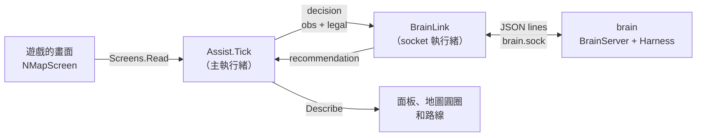

import { Aside, Badge, FileTree } from '@astrojs/starlight/components';

本書其餘的部分都以無頭方式執行：模擬器在沒有視窗的情況下執行遊戲自己的 `sts2.dll`，由大腦回答它。**Mod** 是唯一在真實遊戲裡執行的部分：遊戲從 Steam 啟動，鍵盤前坐著一位玩家。它是 AI 在那裡的宿主，就像自我對弈時的模擬器一樣（[協定：線路 §8](/zh-tw/arch/protocol/wire/#sec-8)）：它讀取畫面上的決策，透過本機 socket 詢問大腦，再把答案顯示在遊戲畫面上。本章寫給想在遊戲裡使用 Mod 或修改它的人。如果觀測、決策介面（surface）和合法動作這些術語還陌生，請先讀[協定](/zh-tw/arch/protocol/)和 [GameBridge](/zh-tw/arch/gamebridge/)。

<Aside title="狀態">

已實作：輔助模式，涵蓋每種決策介面，兩種環境皆可。`src/Sts2Ai.Mod` 能在真實遊戲（v0.111.0）裡載入、連上大腦，在最上層的畫面空閒滿 3 個影格之後詢問每個決策（戰鬥、選牌提示、地圖、獎勵、卡牌獎勵、卡包、事件、商店、休息處、財寶、水晶球），並在一個面板裡用遊戲裡的名字顯示答案，還會在地圖上、以及戰鬥中的卡牌和目標上畫出標記（[輸出](/zh-tw/arch/output/)）。面板上的一個開關選擇 SL 或 NoSL。SL 下，Mod 傳送節點的檢查點和節點裡走過的每一步，大腦因此在節點的複本上規劃每場戰鬥（[SL 紀錄](/zh-tw/arch/mod/sl-record/)）；在真實遊戲裡，90 個 SL 決策放到各自的複本上重播，89 個問出了同一個決策，剩下那一個的原因已經修好（[SL 紀錄 §8](/zh-tw/arch/mod/sl-record/#sec-8)）。還沒有人看著 Mod 在真實遊戲裡跑完一整局。規劃中：自己遊玩（執行轉接器和自動跑局驅動程式），以及它自己的決策日誌（[自動遊玩與安全](/zh-tw/arch/mod/auto/)）。

</Aside>

## 1. Mod 做什麼，不做什麼

Mod 做四件事，全都在遊戲的主執行緒上：

1. **讀取畫面上的決策**：哪個畫面在最上層、它是否空閒，以及它提供的觀測和合法動作；詢問時用的是模擬器所用的同一套 GameBridge 呼叫（[主迴圈 §4](/zh-tw/arch/mod/loop/#sec-4)）。
2. **詢問大腦**：透過 Unix socket，一次一則 `decision` 訊息；如果畫面先往前走了，就傳送 `cancel`（[主迴圈 §3](/zh-tw/arch/mod/loop/#sec-3)、[§8](/zh-tw/arch/mod/loop/#sec-8)）。
3. **顯示答案**：面板、地圖上的路線，以及戰鬥中計畫的標記（[輸出](/zh-tw/arch/output/)）。
4. **保存 SL 紀錄**：節點的檢查點，以及玩家在節點裡做的每個決策，都在遊戲提交它的地方讀取；SL 在每個決策之前把它們傳送出去（[SL 紀錄](/zh-tw/arch/mod/sl-record/)）。

它不做的事：

- **思考**：遊戲行程裡不執行搜尋、學習或任何策略。大腦是另一個行程 `brain`，由玩家啟動（[§4](#sec-4)）；
- **行動**：輔助模式下，每一步都由玩家來打。清單（manifest）裡就這麼寫：「Assist only: it never acts on the game」（只做輔助：從不對遊戲採取行動）。自己遊玩還在規劃中（[自動遊玩與安全 §1](/zh-tw/arch/mod/auto/#sec-1)）；
- **多人模式**：在多人大廳裡，遊戲仍會把它當作不影響遊戲玩法的 Mod 載入，但有不只一位玩家的一局得不到任何幫助：面板顯示「Off in multiplayer」（多人模式下關閉），SL 紀錄也忽略這一局的節點；
- **寫遊戲的檔案**：不寫遊戲玩家檔案底下的任何東西，不存檔，不下主控台指令，不讀檔。它只寫自己的設定檔，放在大腦的 socket 旁邊（[§5](#sec-5)），以及它在遊戲日誌裡的那幾行（[自動遊玩與安全 §3](/zh-tw/arch/mod/auto/#sec-3)）。

## 2. 一個決策，從畫面到面板

以本書範例對局裡的一個決策為例，照遊戲會顯示的樣子來看：第 43 層的地圖（第 3 幕，玩家 HP 為 24/66），有兩個點可以去。




1. 每個影格，`Screens.Read` 向遊戲詢問哪個畫面在最上層（`ActiveScreenContext.GetCurrentScreen()`）。可以移動的地圖畫面就是 `map` 決策介面；一旦動作佇列清空，就用 GameBridge 的 `MapActions` 讀出它的觀測和合法動作，和模擬器的讀法一樣：這裡是 `map:4,10` 和 `map:6,10`，有藥水的話再加上藥水欄的動作。
2. `Assist.Tick` 對觀測取雜湊。當觀測和它的合法動作已經保持 3 個影格不變，而且沒有其他決策開著，它就傳送 `decision`，帶上雜湊、決策介面、觀測和合法動作。
3. 大腦的 Harness 把這個決策路由給宏觀大腦；宏觀大腦用 V 為每個選項的後狀態估值，回答 `map:4,10`，並把本幕剩下的路線作為它的計畫（[宏觀大腦：搜尋 §1](/zh-tw/arch/macro-brain/search/#sec-1)）。
4. 這個答案只對應那個雜湊和那組合法動作。只要它們仍然成立，面板就寫出這個房間（「go to」加上地圖圖例對它的稱呼）和通往頭目的路線上的各個房間，地圖上則在那個點上出現一個脈動的圓圈，並沿路線畫一條線（[輸出 §3](/zh-tw/arch/output/#sec-3)）。
5. 玩家點選一個點。Mod 在遊戲把這次移動排入佇列的地方讀到它，記進 SL 紀錄（[SL 紀錄 §3](/zh-tw/arch/mod/sl-record/#sec-3)）；畫面隨之改變，下一個決策從頭開始。

## 3. 安裝與載入

遊戲如何找到並啟動一個 Mod。本節的內容都在遊戲原始碼裡讀過，並且在本機的遊戲裡對這個 Mod 成立 <Badge text="已核實" variant="success" />。

遊戲遞迴掃描自己的 `mods/` 資料夾尋找清單（manifest），並載入每份清單旁邊名為 `<id>.dll` 的 DLL（`Modding/ModManager.cs`）。本機的遊戲資料夾是 `~/.local/share/Steam/steamapps/common/Slay the Spire 2`，其中：

<FileTree>

- mods/
  - Sts2Ai/
    - Sts2Ai.json 清單
    - Sts2Ai.dll Mod 本體（`<id>.dll`），GameBridge 和 Protocol 都在裡面

</FileTree>

**安裝**：`dotnet build src/Sts2Ai.Mod/Sts2Ai.Mod.csproj -t:Install` 建置 Mod，並把 `Sts2Ai.dll` 和 `Sts2Ai.json` 複製到 `mods/Sts2Ai/`（`Sts2Ai.Mod.csproj:23-26`；遊戲資料夾由 `Sts2GameDir` 屬性指定）。遊戲在下次啟動時發現新的 Mod，並且預設啟用。

**清單**（`Sts2Ai.json`）：

| 欄位 | 值 | 原因 |
|---|---|---|
| `id` | `Sts2Ai` | 決定載入器要找的 DLL 名稱 |
| `name`、`author`、`description` | `STS2 AI`、…、「Shows the AI's recommended action. Assist only: it never acts on the game.」 | 顯示在遊戲的 Mod 列表裡 |
| `version` | `0.1.0` | |
| `has_dll`、`has_pck` | `true`、`false` | 一個 DLL，沒有 Godot 資源包 |
| `affects_gameplay` | `false` | 只在多人模式的握手時有作用，而 Mod 在多人模式下本來就不啟用 |
| `dependencies` | `[]` | |
| `min_game_version` | `0.111.0` | |

**遊戲怎麼處理它**：

- **同意**。玩家在遊戲裡點一下，同意載入 Mod，只需一次。這個回答 `PlayerAgreedToModLoading` 以 `mods_enabled` 存在 `settings.save` 裡。Mod 只在啟動時載入。
- **玩家檔案**。帶 Mod 的對局使用另一個玩家檔案資料夾 `modded/`，第一次使用時從原版（不帶 Mod）的玩家檔案複製而來。
- **入口**。載入器呼叫一個標了 `[ModInitializer(nameof(Init))]` 的靜態方法：`ModEntry.Init`，它再呼叫 `Host.Start`。它在 `ModelDb.Init`（遊戲的卡牌、遺物和怪物資料庫）之前執行，所以 `Start` 只做準備，實際的工作從第一個影格開始。
- **單一 DLL**。載入器在呼叫入口之前先列出 Mod 的所有型別（`Assembly.GetTypes`），而遊戲的組件載入上下文（.NET 裡決定去哪裡找組件相依項的機制）不會到 Mod 的資料夾裡找。只要有一個型別需要放在 `Sts2Ai.dll` 旁邊的 DLL，這次列舉就會失敗，Mod 也就不會被載入；由 `Init` 安裝的解析器又來得太晚。所以 Mod 專案把 GameBridge 和 Protocol 的原始碼編譯進 `Sts2Ai.dll`（`Sts2Ai.Mod.csproj:19`），不引用專案裡的任何其他部分。

**`Host.Start` 做什麼**（`Host.cs:23-42`）：

1. **版本守衛**。如果 `NGame.GetGameVersion()` 不是 `v0.111.0`（GameBridge 所針對的版本），Mod 就保持關閉：不打任何補丁，面板顯示「off: game V, the mod is for v0.111.0」。
2. **先打補丁**。趕在任何其他東西編譯可能把被打補丁的方法內嵌進去的遊戲程式碼之前：選牌提示的上下文（[GameBridge：讀取遊戲 §6](/zh-tw/arch/gamebridge/observe/#sec-6)）、SL 紀錄的鉤子（[SL 紀錄 §3](/zh-tw/arch/mod/sl-record/#sec-3)）和設定分頁（[輸出 §2](/zh-tw/arch/output/#sec-2)）。為什麼要先打：[自動遊玩與安全 §5](/zh-tw/arch/mod/auto/#sec-5)。
3. **大腦連線**，它在自己的執行緒上開始連線（[主迴圈 §8](/zh-tw/arch/mod/loop/#sec-8)）。
4. **每影格回呼**：`Tick`，掛在場景樹的 `ProcessFrame` 上（[主迴圈 §1](/zh-tw/arch/mod/loop/#sec-1)）。

## 4. 搭配大腦執行

Mod 需要一個在它的 socket `~/.local/state/sts2ai/brain.sock`（設定了 `$XDG_STATE_HOME` 時在它底下）上監聽的大腦。大腦就是 SimWorker 的 `brain` 指令（[模擬器：整局 §8](/zh-tw/arch/simulator/runs/#sec-8)），在遊戲之前或之後啟動都可以；Mod 每 2 秒重試一次，直到連上為止。

```bash
dotnet run -c Release --project src/Sts2Ai.SimWorker -- brain --champion eval/silent/champions/nosl.json
```

- `--champion` 指定它要用的冠軍：NoSL 宿主得到檔案裡的戰鬥大腦（PIMC 加戰鬥網路）和宏觀大腦（L0 加 V）；SL 宿主得到 `--sl-policy` 的戰鬥大腦（預設是 SL 規劃器），宏觀大腦相同（[Harness：路由、預算與種子 §1](/zh-tw/arch/harness/routing/#sec-1)）。所以一個大腦就能服務兩種環境，切換面板上的開關也不需要重新啟動。
- 這對 NoSL 冠軍的檔案成立：它的宏觀大腦在從畫面預測出的後狀態上為每個選項估值。SL 冠軍的檔案（`sl.json`）則讓 L0 在節點的複本上試打它的選項（`afterstates: clone`），這只有 SL 允許：用它啟動的 `brain` 會以一個 `error` 拒絕 NoSL 宿主（「l0 plays on the node's clone in SL only」，`Brains/ChampionOptions.cs:41`），而且在 SL 下，戰鬥以外的決策也需要節點的複本（[SL 紀錄 §6](/zh-tw/arch/mod/sl-record/#sec-6)）。
- `--log FILE` 寫出 Harness 的決策日誌；`--wire FILE` 寫出宿主傳來的每則訊息，`clones` 會重播它們（[SL 紀錄 §8](/zh-tw/arch/mod/sl-record/#sec-8)）。
- 透過固定建置的啟動程式（`tmp/builds/REV/sim.sh`）啟動的大腦，它的 `HOME` 指向 `tmp/home`，所以需要 `--socket ~/.local/state/sts2ai/brain.sock` 才會在遊戲尋找的地方監聽（[模擬器：參考 §1](/zh-tw/arch/simulator/reference/#sec-1)）。
- 大腦每局印出一行：對局 id、宿主的身分（`mod`）、這一局怎麼結束、它的層數、決策數，以及重新規劃次數和工作行程裡的遊戲錯誤（如果有）。

接著從 Steam 啟動遊戲，同意載入 Mod（只需一次），然後開始或繼續一局單人遊戲。大腦讀到這一局的 `hello` 之後，面板就會顯示大腦的冠軍。

## 5. 操作與設定

| 操作 | 位置 | 作用 |
|---|---|---|
| F8 | 任何地方 | 隱藏或顯示面板和所有標記 |
| SL / NoSL | 面板的標頭 | 環境（[環境](/zh-tw/arch/environments/)）；切換時，大腦眼中的這一局就結束，下一個決策從那裡開始新的一局 |
| AI 分頁 | 遊戲的設定畫面，排在一般、圖形、聲音和輸入之後 | Mod 的設定 |

設定（`Settings.cs`；AI 分頁的各列在 `SettingsTab.cs`）存在 `~/.local/state/sts2ai/settings.json`，和大腦的 socket 放在一起，不在遊戲的玩家檔案裡。它們在啟動時讀一次，每次變更時寫入；檔案讀不了時就用預設值。

| 列 | 值 | 預設 | 說明 |
|---|---|---|---|
| AI assist（AI 輔助） | off、on | on | off：Mod 什麼都不問、什麼都不畫，大腦眼中的這一局也隨之結束 |
| Environment（環境） | SL、NoSL | SL | 與面板上的開關是同一個選擇 |
| Panel（面板） | off、on | on | 面板卡片本身；標記由各自的列控制 |
| Considered options（考慮過的選項） | off、values、values + bars | values + bars | 面板裡大腦打過分的那些動作 |
| Order numbers on cards（卡牌上的順序編號） | off、on | on | 在計畫本回合要打的卡牌上標出它的步驟編號 |
| Target and end-turn marks（目標與結束回合標記） | off、on | on | 計畫的目標和結束回合按鈕上的圓圈 |
| Map route（地圖路線） | off、next point、whole route | whole route | 下一個點上的圓圈，以及沿路線畫的線 |
| Panel opacity（面板不透明度） | 60% 到 100%，每格 2% | 92% | 卡片的背景 |

最後一個按鈕「Reset AI settings」（重設 AI 設定）把預設值恢復回來。為自己遊玩規劃的按鍵（暫停、單步、半自動）見[自動遊玩與安全 §4](/zh-tw/arch/mod/auto/#sec-4)。

## 6. 面板顯示什麼

面板的標頭顯示大腦的冠軍（在大腦報出它的名字之後）、一個狀態詞和開關。內文顯示答案，或者一則說明為什麼沒有答案的訊息，下面還有較淡的第二行（`Assist.cs:61-162`、`Host.cs:44-63`）：

| 狀態 | 訊息 | 第二行 | 何時 |
|---|---|---|---|
| `starting` | Connecting to the brain（正在連線大腦） | socket 的路徑 | 第一次連線之前 |
| `offline` | No brain running（沒有大腦在執行） | 原因 · trying again every 2 s | 連線失敗或中斷 |
| `ready` | Start or continue a run（開始或繼續一局） | single-player only | 沒有對局 |
| `off` | Off in multiplayer（多人模式下關閉） | | 有不只一位玩家的一局；開關兩邊都不選 |
| `run sent` | Waiting for the brain（等待大腦） | it loads the champion for this run | `hello` 已傳送，`ready` 還沒回來 |
| `off for this run` | Brain error（大腦出錯） | 大腦的訊息 · back on at the next run | 大腦回答了 `error`，直到下一個 `hello` 為止（[主迴圈 §8](/zh-tw/arch/mod/loop/#sec-8)） |
| `ready` | Waiting for a decision（等待決策） | 要先做什麼，例如「open the chest」 | 畫面上沒有要決定的事，或者還有東西在動 |
| `ready` | No SL clone of this room（這個房間沒有 SL 複本） | 原因 · the next room has one | SL、一場戰鬥，而節點的紀錄缺失或已中斷（[SL 紀錄 §6](/zh-tw/arch/mod/sl-record/#sec-6)） |
| `ready` | Thinking…（思考中） | 目前已用的秒數，只要畫面上的決策就是被詢問的那一個 | 決策已詢問、還沒回答，或者較早的一個已取消、它的答案還沒回來（[主迴圈 §3](/zh-tw/arch/mod/loop/#sec-3)） |
| `ready` | 答案 | 大腦和它用的時間 | （[輸出 §2](/zh-tw/arch/output/#sec-2)） |
| `off` | off: game V, the mod is for v0.111.0 | | 版本守衛（[§3](#sec-3)）；沒有開關，也沒有 AI 分頁 |
| `error` | Mod error（Mod 錯誤） | 例外的訊息 | 這個影格拋出了例外；每種不同的錯誤只記一次日誌 |

輔助關閉時，面板和標記都會隱藏。

## 7. 程式碼

`src/Sts2Ai.Mod`，12 個原始碼檔案。它針對遊戲的 DLL 和 GodotSharp（Godot 引擎的 C# API）建置，用的是和模擬器同一份快照（`src/GameReferences.props`），並把 GameBridge 和 Protocol 一起編譯進來（[§3](#sec-3)）。它不引用 Brain 或 Harness。

| 檔案 | 行數 | 內容 |
|---|---|---|
| `ModEntry.cs` | 13 | 載入器呼叫的入口 |
| `Host.cs` | 64 | 版本守衛、補丁、每影格回呼，以及錯誤處理 |
| `BrainLink.cs` | 101 | socket：連線、重新連線、一個讀取執行緒和一個寫入執行緒、收件匣（[主迴圈 §8](/zh-tw/arch/mod/loop/#sec-8)） |
| `Assist.cs` | 226 | 輔助模式，每影格一次：大腦眼中的這一局、空閒、同時只有一個在途的決策、面板顯示什麼（[主迴圈](/zh-tw/arch/mod/loop/)） |
| `Screens.cs` | 168 | 最上層的畫面要求的決策（[主迴圈 §4](/zh-tw/arch/mod/loop/#sec-4)） |
| `NodeRecord.cs` | 299 | SL 紀錄和它的鉤子（[SL 紀錄](/zh-tw/arch/mod/sl-record/)） |
| `UI/Panel.cs` | 356 | 面板卡片，以及它擁有的標記（[輸出 §2](/zh-tw/arch/output/#sec-2)） |
| `UI/Describe.cs` | 189 | 用遊戲裡的名字寫出答案（[主迴圈 §6](/zh-tw/arch/mod/loop/#sec-6)） |
| `UI/MapMark.cs` | 93 | 地圖上的圓圈和路線（[輸出 §3](/zh-tw/arch/output/#sec-3)） |
| `UI/CombatMark.cs` | 137 | 戰鬥中計畫的標記（[輸出 §3](/zh-tw/arch/output/#sec-3)） |
| `UI/Settings.cs` | 66 | 設定和它們的檔案（[§5](#sec-5)） |
| `UI/SettingsTab.cs` | 217 | 遊戲設定畫面裡的 AI 分頁（[輸出 §2](/zh-tw/arch/output/#sec-2)） |

專案檔是 `Sts2Ai.Mod.csproj`（27 行），清單是 `Sts2Ai.json`（12 行）。Mod 沒有自己的單元測試：它和模擬器共用的部分（GameBridge 和 Protocol）在模擬器那邊測試，其餘的在遊戲裡檢查（[自動遊玩與安全 §7](/zh-tw/arch/mod/auto/#sec-7)）。

## 8. 本章

- [主迴圈](/zh-tw/arch/mod/loop/)：遊戲只認一個執行緒、逐步走過每個影格、同時只有一個在途的決策、各畫面的空閒判定、選牌提示、答案，以及大腦連線。
- [SL 紀錄](/zh-tw/arch/mod/sl-record/)：節點的檢查點、在遊戲提交的地方讀取的每一步、中斷的紀錄、傳送什麼，以及它如何在遊戲裡得到檢查。
- [自動遊玩與安全](/zh-tw/arch/mod/auto/)：規劃中的執行器和自動跑局驅動程式、日誌、操作與安全、補丁與 JIT、已有工作、測試和未決問題。
