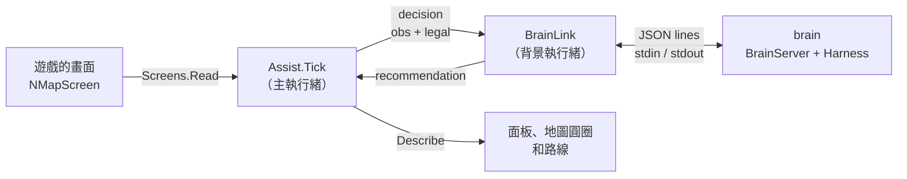

import { Aside, Badge, FileTree } from '@astrojs/starlight/components';

本書其餘的部分都以無頭方式執行：模擬器在沒有視窗的情況下執行遊戲自己的 `sts2.dll`，由大腦回答它。**Mod** 是唯一在真實遊戲裡執行的部分：遊戲從 Steam 啟動，鍵盤前坐著一位玩家。它是 AI 在那裡的宿主，就像自我對弈時的模擬器一樣（[協定：線路 §8](/zh-tw/arch/protocol/wire/#sec-8)）：它讀取畫面上的決策，透過大腦的 stdin 和 stdout 詢問它啟動的大腦，再把答案顯示在遊戲畫面上。本章寫給想在遊戲裡使用 Mod 或修改它的人。如果觀測、決策介面（surface）和合法動作這些術語還陌生，請先讀[協定](/zh-tw/arch/protocol/)和 [GameBridge](/zh-tw/arch/gamebridge/)。

<Aside title="狀態">

已實作：輔助模式，涵蓋每種決策介面，兩種環境皆可。`src/Sts2Ai.Mod` 能在真實遊戲（v0.111.0）裡載入、啟動它自帶的大腦，在最上層的畫面空閒滿 3 個影格之後詢問每個決策（戰鬥、選牌提示、地圖、獎勵、卡牌獎勵、卡包、事件、商店、休息處、財寶、水晶球），並在一個面板裡用遊戲裡的名字和每個選項的獲勝機率顯示答案，還會在地圖上、以及戰鬥中的卡牌和目標上畫出標記（[輸出](/zh-tw/arch/output/)）。玩家要求時，AI 也會從面板的工具列自己打出答案：一個動作、回合或房間的剩餘部分，或者自己一直打到被暫停為止（[自動遊玩與安全](/zh-tw/arch/mod/auto/)）。面板上的一個開關選擇 SL 或 NoSL，Mod 自帶的那一個大腦兩種都打（[§4](#sec-4)）。SL 下，Mod 傳送節點的檢查點和節點裡走過的每一步，大腦因此在節點的複本上規劃每場戰鬥，並為戰鬥以外的每個選項估值（[SL 紀錄](/zh-tw/arch/mod/sl-record/)）。規劃中：在沒有人坐在鍵盤前的情況下打完整局（自動跑局驅動程式），以及它自己的決策日誌（[自動遊玩與安全 §2](/zh-tw/arch/mod/auto/#sec-2)、[§3](/zh-tw/arch/mod/auto/#sec-3)）。

</Aside>

## 1. Mod 做什麼，不做什麼

Mod 做五件事，全都在遊戲的主執行緒上：

1. **讀取畫面上的決策**：哪個畫面在最上層、它是否空閒，以及它提供的觀測和合法動作；詢問時用的是模擬器所用的同一套 GameBridge 呼叫（[主迴圈 §4](/zh-tw/arch/mod/loop/#sec-4)）。
2. **詢問大腦**：透過大腦的 stdin 和 stdout，一次一則 `decision` 訊息；如果畫面先往前走了，就傳送 `cancel`（[主迴圈 §3](/zh-tw/arch/mod/loop/#sec-3)、[§8](/zh-tw/arch/mod/loop/#sec-8)）。
3. **顯示答案**：面板、地圖上的路線，以及戰鬥中計畫的標記（[輸出](/zh-tw/arch/output/)）。
4. **玩家要求時，打出答案**：工具列的各個目標，從一個動作到自動遊玩，每個動作都像玩家的點選那樣執行（[自動遊玩與安全](/zh-tw/arch/mod/auto/)）。
5. **保存 SL 紀錄**：節點的檢查點，以及在節點裡做的每個決策，不論是玩家的還是 AI 的，都在遊戲提交它的地方讀取；SL 在每個決策之前把它們傳送出去（[SL 紀錄](/zh-tw/arch/mod/sl-record/)）。

它不做的事：

- **思考**：遊戲行程裡不執行搜尋、學習或任何策略。大腦是另一個行程 `brain`，由 Mod 從自己的資料夾啟動（[§4](#sec-4)）；
- **不經要求就行動**：AI 只在玩家從工具列或它的按鍵要求時才打，而且只打大腦對畫面上那個決策的答案（[自動遊玩與安全 §4](/zh-tw/arch/mod/auto/#sec-4)）。沒有任何東西會自己開始一局：自動跑局驅動程式還在規劃中（[自動遊玩與安全 §2](/zh-tw/arch/mod/auto/#sec-2)）；
- **多人模式**：在多人大廳裡，遊戲仍會把它當作不影響遊戲玩法的 Mod 載入，但有不只一位玩家的一局得不到任何幫助：面板顯示「多人模式下關閉」，SL 紀錄也忽略這一局的節點；
- **寫遊戲的檔案**：不寫遊戲玩家檔案底下的任何東西，不存檔，不下主控台指令，不讀檔。它只寫自己的設定、大腦的日誌，以及玩家要求時大腦的錄製檔案，都在它的狀態資料夾裡、遊戲的玩家檔案之外（[§4](#sec-4)、[§5](#sec-5)），以及它在遊戲日誌裡的那幾行（[自動遊玩與安全 §3](/zh-tw/arch/mod/auto/#sec-3)）。

## 2. 一個決策，從畫面到面板

以本書範例對局裡的一個決策為例，照遊戲會顯示的樣子來看：第 43 層的地圖（第 3 幕，玩家 HP 為 24/66），有兩個點可以去。

1. 每個影格，`Screens.Read` 向遊戲詢問哪個畫面在最上層（`ActiveScreenContext.GetCurrentScreen()`）。可以移動的地圖畫面就是 `map` 決策介面；一旦動作佇列清空，就用 GameBridge 的 `MapActions` 讀出它的觀測和合法動作，和模擬器的讀法一樣：這裡是 `map:4,10` 和 `map:6,10`，有藥水的話再加上藥水欄的動作。
2. `Assist.Tick` 對觀測取雜湊。當觀測和它的合法動作已經保持 3 個影格不變，而且沒有其他決策開著，它就傳送 `decision`，帶上雜湊、決策介面、觀測和合法動作。
3. 大腦的 Harness 把這個決策路由給宏觀大腦；宏觀大腦用 V 為每個選項的後狀態估值，回答 `map:4,10`，並把本幕剩下的路線作為它的計畫（[宏觀大腦：搜尋 §1](/zh-tw/arch/macro-brain/search/#sec-1)）。
4. 這個答案只對應那個雜湊和那組合法動作。只要它們仍然成立，面板就寫出這個房間（「去」加上地圖圖例對它的稱呼）和通往頭目的路線上的各個房間，地圖上則在那個點上出現一個脈動的圓圈，並沿路線畫一條線（[輸出 §3](/zh-tw/arch/output/#sec-3)）。
5. 玩家點選一個點，或者按 F10，由 AI 像那次點選一樣移動到那裡（[自動遊玩與安全 §1](/zh-tw/arch/mod/auto/#sec-1)）。Mod 在遊戲把這次移動排入佇列的地方讀到它，記進 SL 紀錄（[SL 紀錄 §3](/zh-tw/arch/mod/sl-record/#sec-3)）；畫面隨之改變，下一個決策從頭開始。

## 3. 安裝與載入

Mod 如何建置和安裝，以及遊戲如何找到並啟動它。遊戲怎麼處理一個 Mod，都在遊戲原始碼裡讀過，並且在 Linux 上的遊戲裡對這個 Mod 成立 <Badge text="已核實" variant="success" />。

遊戲遞迴掃描自己的 `mods/` 資料夾尋找清單（manifest）（還有 `mods_STEAMTEST/`，它把其中的內容當作工作坊物品讀取），並載入每份清單旁邊名為 `<id>.dll` 的 DLL（`Modding/ModManager.cs`）。在 Linux 上，遊戲資料夾預設是 `~/.local/share/Steam/steamapps/common/Slay the Spire 2`。裝好的 Mod 在其中：

<FileTree>

- mods/
  - Sts2Ai/
    - Sts2Ai.json 清單
    - Sts2Ai.dll Mod 本體（`<id>.dll`），GameBridge 和 Protocol 都在裡面
    - brain/ Mod 啟動的大腦
      - champion.json 它所用的冠軍檔案
      - nets/ 冠軍的網路，名為 `NAME.net`
      - linux-x64/ 每個平台一個自給自足的大腦，啟動程式是 `Sts2Ai.SimWorker`
      - osx-arm64/
      - win-x64/

</FileTree>

**建置與安裝**。`distro/build.sh [REV]` 從一個提交（預設 HEAD，用 `git archive` 取出）把這個資料夾，也就是工作坊物品，建置到 `out/Sts2Ai/`（不在 git 裡），並在 `out/commit` 裡寫下這個提交。安裝就是把 `out/Sts2Ai/` 複製進遊戲的 `mods/` 資料夾；遊戲在下次啟動時發現新的 Mod，並且預設啟用。這個腳本：

- 只建置一次 Mod，供所有平台使用，因為它跑在遊戲自己的 .NET 上；和模擬器一樣針對遊戲的 DLL 建置（[模擬器：參考 §1](/zh-tw/arch/simulator/reference/#sec-1)）；
- 用設定檔 `Properties/PublishProfiles/brain.pubxml` 為 `linux-x64`、`osx-arm64` 和 `win-x64` 發布大腦（`Sts2Ai.SimWorker`）：自給自足（self-contained），因為玩家沒有 .NET；是一個資料夾而不是單一檔案，因為 Harmony 透過 JIT 自己的程式庫打補丁，而單一檔案的建置會把這個程式庫併進執行檔；不修剪（trim），因為大腦在執行時載入玩家自己的 `sts2.dll`，這需要完整的框架。遊戲的檔案一個都不隨附：遊戲的組件只用於編譯；
- 在一台 Mac 上用 `codesign` 為 `osx-arm64` 的啟動程式做臨時（ad hoc）簽署：Apple 晶片只執行簽署過的程式碼；
- 把 NoSL 冠軍的檔案 `eval/champions/nosl.json` 複製為 `brain/champion.json`（大腦在兩種環境下都用它，[§4](#sec-4)），把它的網路複製進 `brain/nets/` 並去掉 `.json` 副檔名：遊戲會把 Mod 資料夾底下的每個 `.json` 當作可能的清單來讀，網路檔案裡的 `name` 欄位會讓它記一則錯誤。大腦自己的 `deps.json` 和 `runtimeconfig.json` 沒有清單的任何欄位，遊戲會略過它們。

**清單**（`Sts2Ai.json`）：

| 欄位 | 值 | 原因 |
|---|---|---|
| `id` | `Sts2Ai` | 決定載入器要找的 DLL 名稱 |
| `name`、`author`、`description` | `STS2 AI`、…、「An AI for single-player runs: shows its recommended action with each option's chance to win, and plays it when asked. Starts its own brain, a background program, while the game runs.」 | 顯示在遊戲的 Mod 列表裡 |
| `version` | `0.2.0` | |
| `has_dll`、`has_pck` | `true`、`false` | 一個 DLL，沒有 Godot 資源包 |
| `affects_gameplay` | `false` | 只在多人模式的握手時有作用，而 Mod 在多人模式下本來就不啟用 |
| `dependencies` | `[]` | |
| `min_game_version` | `0.111.0` | |

**遊戲怎麼處理它**：

- **同意**。玩家在遊戲裡點一下，同意載入 Mod，只需一次。這個回答 `PlayerAgreedToModLoading` 以 `mods_enabled` 存在 `settings.save` 裡。Mod 只在啟動時載入。
- **玩家檔案**。帶 Mod 的對局使用另一個玩家檔案資料夾 `modded/`，第一次使用時從原版（不帶 Mod）的玩家檔案複製而來。
- **入口**。載入器呼叫一個標了 `[ModInitializer(nameof(Init))]` 的靜態方法：`ModEntry.Init`，它再呼叫 `Host.Start`。它在 `ModelDb.Init`（遊戲的卡牌、遺物和怪物資料庫）之前執行，所以 `Start` 只做準備，實際的工作從第一個影格開始。
- **單一 DLL**。載入器在呼叫入口之前先列出 Mod 的所有型別（`Assembly.GetTypes`），而遊戲的組件載入上下文（.NET 裡決定去哪裡找組件相依項的機制）不會到 Mod 的資料夾裡找。只要有一個型別需要放在 `Sts2Ai.dll` 旁邊的 DLL，這次列舉就會失敗，Mod 也就不會被載入；由 `Init` 安裝的解析器又來得太晚。所以 Mod 專案把 GameBridge 和 Protocol 的原始碼編譯進 `Sts2Ai.dll`（`Sts2Ai.Mod.csproj:19`），不引用專案裡的任何其他部分。`brain/` 底下的 DLL 屬於大腦，一個獨立的程式；遊戲一個都不載入。

**`Host.Start` 做什麼**（`Host.cs:23-46`）：

1. **版本守衛**。如果 `NGame.GetGameVersion()` 不是 `v0.111.0`（GameBridge 所針對的版本），Mod 就保持關閉：不打任何補丁，也不啟動大腦，面板顯示「off: game V, the mod is for v0.111.0」。
2. **先打補丁**。趕在任何其他東西編譯可能把被打補丁的方法內嵌進去的遊戲程式碼之前：選牌提示的上下文（[GameBridge：讀取遊戲 §6](/zh-tw/arch/gamebridge/observe/#sec-6)）、SL 紀錄的鉤子（[SL 紀錄 §3](/zh-tw/arch/mod/sl-record/#sec-3)）和設定分頁（[輸出 §2](/zh-tw/arch/output/#sec-2)）。為什麼要先打：[自動遊玩與安全 §5](/zh-tw/arch/mod/auto/#sec-5)。
3. **大腦**：`BundledBrain.Find` 尋找 Mod 旁邊為這個平台隨附的大腦，大腦連線在自己的執行緒上啟動它（[§4](#sec-4)、[主迴圈 §8](/zh-tw/arch/mod/loop/#sec-8)）。
4. **每影格回呼**：`Tick`，掛在場景樹的 `ProcessFrame` 上（[主迴圈 §1](/zh-tw/arch/mod/loop/#sec-1)）。

## 4. 它自帶的大腦

Mod 自己啟動它的大腦：從它自己的資料夾，作為遊戲的子行程（`BundledBrain.cs`），所以玩家不需要另外安裝或啟動任何東西。

- **執行什麼**。適合遊戲的平台和處理器的 `brain/RID/Sts2Ai.SimWorker`（Windows 上是 `.exe`，`BundledBrain.Find`）；沒有為它們隨附的大腦時，Mod 在沒有大腦的情況下執行，並說明這一點（[§6](#sec-6)）。指令是 SimWorker 的 `brain`（[模擬器：整局 §7](/zh-tw/arch/simulator/runs/#sec-7)）：`brain --champion champion.json --workers N`，N 是邏輯處理器數的一半，取 1 到 8：遊戲保有自己的份額，也不超過規劃器的 8 個世界。在 Windows 以外，啟動程式缺少可執行位元時 Mod 會補上，因為不能指望下載會保留它。
- **它的環境**。工作資料夾是 `brain/`，冠軍的網路（`nets/NAME.net`）就在那裡找到。`STS2_BIN_DIR` 是遊戲載入 `sts2.dll` 的資料夾，所以大腦用的是正在執行的遊戲自己的組件。`DOTNET_ReadyToRun=0`，和模擬器的每個啟動程式一樣（[模擬器：參考 §1](/zh-tw/arch/simulator/reference/#sec-1)）。`SENTRY_GODOT_LIB_PATH` 會被移除：遊戲的 Sentry 擴充在遊戲行程裡設定它，被繼承之後，它會讓每個搜尋工作行程裡 `sts2.dll` 的模組初始化器在 Godot 之外載入這個擴充，工作行程在啟動時就當掉。
- **線路**。經大腦的 stdin 和 stdout 傳遞 JSON 行（[主迴圈 §8](/zh-tw/arch/mod/loop/#sec-8)）。大腦服務啟動它的那一個宿主，直到它的 stdin 關閉。
- **它的日誌**。大腦的 stderr 寫進 Mod 的狀態資料夾 `$XDG_STATE_HOME/sts2ai`（預設 `~/.local/state/sts2ai`）裡的 `brain.log`，在設定旁邊（[§5](#sec-5)）。一次遊戲工作階段裡第一個啟動的大腦新建這個檔案；重新啟動的大腦接著往裡寫。大腦啟動時寫一行，說出它的冠軍，然後每局一行：對局 id、宿主的身分（`mod`）、這一局怎麼結束、它的層數、決策數，以及重新規劃次數和工作行程裡的遊戲錯誤（如果有）。
- **它結束時**。大腦的 stdout 結束或管線出錯時，Mod 把大腦連同它的搜尋工作行程一起殺掉，等 2 秒，再啟動它（[主迴圈 §8](/zh-tw/arch/mod/loop/#sec-8)）；這段期間面板說明大腦為什麼結束（[§6](#sec-6)）。
- **冠軍**。`champion.json` 是 NoSL 冠軍的檔案，一個大腦服務兩種環境：`brain` 按宿主的環境設定 L0 的後狀態，對 NoSL 宿主從畫面預測，對 SL 宿主在節點的複本上試打（`BrainCommand.Champions`）。NoSL 對局得到檔案裡的冠軍，也就是帶冠軍戰鬥網路的 PIMC 和帶它的 V 的 L0；SL 對局得到用同樣兩個網路的 SL 規劃器和在複本上下的 L0，也就是 SL 冠軍（[Harness：路由、預算與種子 §1](/zh-tw/arch/harness/routing/#sec-1)、[評估：冠軍與基線](/zh-tw/arch/evaluation/champions/)）。所以面板的開關不需要第二個大腦。兩種環境用同樣的網路，它們從 SL 的對局裡學來：NoSL 目前不訓練。
- **力度**。Mod 的力度設定（[§5](#sec-5)）在 `hello` 裡向大腦要求這一局用 SL 規劃器的某個等級：`low`、`medium`、`high` 或 `max`（[SL 規劃器：預算 §1](/zh-tw/arch/sl-planner/budget/#sec-1)）。大腦就用該等級的預算來打這一局的 SL 規劃器，並在它回傳的冠軍裡寫出它；沒有要求時，它用自己的。其他戰鬥大腦（PIMC）照原樣打（[Harness §5](/zh-tw/arch/harness/#sec-5)）。
- **錄製**。`--log FILE` 寫出 Harness 的決策日誌，`--wire FILE` 寫出宿主傳來的每則訊息，`clones` 會重播它們（[SL 紀錄 §8](/zh-tw/arch/mod/sl-record/#sec-8)）。只有設定檔裡的 `Record` 打開時（預設關閉，手動設定，[§5](#sec-5)），Mod 才傳這兩個選項：這時它啟動的每個大腦都寫一對以啟動時間（UTC）命名的檔案，`captures/STAMP-wire.jsonl` 和 `captures/STAMP-decisions.jsonl`（`STAMP` 形如 `yyyy-MM-dd-HHmmss`），放在狀態資料夾裡（`BundledBrain.Captures`）。

接著從 Steam 啟動遊戲，同意載入 Mod（只需一次，[§3](#sec-3)），然後開始或繼續一局單人遊戲。大腦讀到這一局的 `hello` 之後，面板就會顯示大腦的冠軍。

## 5. 操作與設定

| 操作 | 位置 | 作用 |
|---|---|---|
| F8 | 任何地方 | 隱藏或顯示面板和所有標記 |
| F5、F10、F11 | 面板標頭下方的工具列 | AI 來打：自己一直打到被暫停、一個動作，或者打到回合或房間結束（[自動遊玩與安全 §2](/zh-tw/arch/mod/auto/#sec-2)） |
| SL / NoSL | 面板的標頭 | 環境（[環境](/zh-tw/arch/environments/)）；切換時，大腦眼中的這一局就結束，下一個決策從那裡開始新的一局 |
| 力度 | 工具列下方的一列切換鈕 | SL 規劃器的力度；變更時，大腦眼中的這一局就結束，和切換開關時一樣，下一個決策用那個力度開始新的一局（SL 下會重新傳送節點的檢查點）；頭部的冠軍名字會顯示這個預算 |
| 速度、停止條件 | 自動遊玩進行時，在工具列下方 | 自動遊玩的等待時間，以及它在哪裡停下 |
| AI 分頁 | 遊戲的設定畫面，排在一般、圖形、聲音和輸入之後 | Mod 的設定 |

設定（`Settings.cs`；AI 分頁的各列在 `SettingsTab.cs`）存在 `~/.local/state/sts2ai/settings.json`（設定了 `$XDG_STATE_HOME` 時在 `$XDG_STATE_HOME/sts2ai` 底下），和大腦的日誌放在一起，不在遊戲的玩家檔案裡。它們在啟動時讀一次，每次變更時寫入；檔案讀不了時就用預設值。

| 列 | 值 | 預設 | 說明 |
|---|---|---|---|
| AI 輔助 | 關、開 | 開 | 關：Mod 什麼都不問、什麼都不畫，大腦眼中的這一局也隨之結束 |
| 環境 | SL、NoSL | SL | 與面板上的開關是同一個選擇 |
| 面板 | 關、開 | 開 | 面板卡片本身；標記由各自的列控制 |
| 候選項 | 關、數值、數值 + 長條 | 數值 + 長條 | 大腦打過分的選項，帶著它們的獲勝機率，顯示在面板裡 |
| 卡牌上的出牌順序 | 關、開 | 開 | 在計畫本回合要打的卡牌上標出它的步驟編號 |
| 目標與結束回合標記 | 關、開 | 開 | 計畫的目標和結束回合按鈕上的圓圈 |
| 地圖路線 | 關、下一個點、整條路線 | 整條路線 | 下一個點上的圓圈，以及沿路線畫的線 |
| 面板不透明度 | 60% 到 100%，每格 2% | 92% | 卡片的背景 |
| 思考深度 | 大腦預設、低、中、高、最高 | 大腦預設 | Mod 向大腦要求的 SL 規劃器力度；與工具列那一列是同一個選擇 |
| 自動打的速度 | 慢、中、快 | 中 | AI 每個動作之前的等待：1.5 秒、0.8 秒、0.2 秒 |
| 菁英、頭目前停下 | 關、開 | 開 | 自動遊玩在移動到菁英或頭目之前停下 |
| 勝率掉 3 點時停下 | 關、開 | 開 | V 的獲勝機率比自動遊玩開始以來的最好值低超過 3 個百分點時，自動遊玩停下 |

最後三列在它們自己的標題「自動打」底下。最後一個按鈕「重設 AI 設定」把預設值恢復回來。檔案裡有一個欄位沒有對應的列：`Record`（預設 `false`），它讓 Mod 啟動的每個大腦錄下自己的工作階段（[§4](#sec-4)）。每個標籤都用遊戲的語言（[輸出 §2](/zh-tw/arch/output/#sec-2)）。各個按鍵，以及每個按鍵打到多遠，見[自動遊玩與安全 §4](/zh-tw/arch/mod/auto/#sec-4)。

## 6. 面板顯示什麼

面板的標頭顯示大腦的冠軍（在大腦報出它的名字之後，連同它的預算）、一行狀態和開關。大腦接下這一局之後，狀態行就是這一局自己的：角色、晉階、層數和 HP，取最近一個決策時的值（「寂靜獵手 · A0 · 第 9 層 · HP 53/70」）；在那之前它是一個詞。內文顯示答案，或者一則說明為什麼沒有答案的訊息，下面還有較淡的第二行（`Assist.cs:163-280`、`Host.cs:48-69`）：

| 狀態 | 訊息 | 第二行 | 何時 |
|---|---|---|---|
| `啟動中` | 正在連接大腦 | 大腦的啟動程式，或「no brain ships with this copy of the mod for this platform」 | 直到大腦第一次啟動，或啟動失敗 |
| `離線` | 大腦沒有在執行 | 原因 · 每 2 秒重試 | 大腦結束了（原因裡有它的結束代碼、它在 stderr 上的最後一行和日誌的路徑）、啟動不了，或者沒有為這個平台隨附大腦 |
| `就緒` | 開始或繼續一局 | 僅限單人 | 沒有對局 |
| `關閉` | 多人模式下關閉 | | 有不只一位玩家的一局；開關兩邊都不選 |
| `已送出本局` | 等待大腦 | 正在為本局載入冠軍 | `hello` 已傳送，`ready` 還沒回來 |
| `本局關閉` | 大腦出錯 | 大腦的訊息 · 下一局恢復 | 大腦回答了 `error`，直到下一個 `hello` 為止（[主迴圈 §8](/zh-tw/arch/mod/loop/#sec-8)） |
| 這一局的狀態行 | 等待下一個決定 | 要先做什麼，例如「打開寶箱」 | 畫面上沒有要決定的事，或者還有東西在動 |
| 這一局的狀態行 | 這個房間沒有 SL 複本 | 原因 · 下個房間會有 | SL，而節點的紀錄缺失或已中斷：這個節點裡不詢問任何 SL 決策（[SL 紀錄 §6](/zh-tw/arch/mod/sl-record/#sec-6)） |
| 這一局的狀態行 | 思考中… | 目前已用的秒數，只要畫面上的決策就是被詢問的那一個 | 決策已詢問、還沒回答，或者較早的一個已取消、它的答案還沒回來（[主迴圈 §3](/zh-tw/arch/mod/loop/#sec-3)） |
| 這一局的狀態行 | 答案 | 預期這場戰鬥或這一局在它之後會怎麼走；底部寫出大腦和它用的時間 | （[輸出 §2](/zh-tw/arch/output/#sec-2)） |
| `關閉` | off: game V, the mod is for v0.111.0 | | 版本守衛（[§3](#sec-3)）；沒有開關，也沒有 AI 分頁 |
| `出錯` | Mod 出錯 | 例外的訊息 | 這個影格拋出了例外；每種不同的錯誤只記一次日誌 |

從大腦的 `ready` 起，工具列、力度那一列，以及顯示獲勝機率和 AI 狀態的橫條，都出現在訊息或答案的上方（[輸出 §2](/zh-tw/arch/output/#sec-2)）。輔助關閉時，面板和標記都會隱藏。表中的每個詞都用遊戲的語言顯示；第二行裡的原因（大腦為什麼結束、大腦的訊息、例外）照原樣以英文顯示。

## 7. 程式碼

`src/Sts2Ai.Mod`，17 個原始碼檔案。它針對遊戲的 DLL 和 GodotSharp（Godot 引擎的 C# API）建置，用的是和模擬器同一份快照（`src/GameReferences.props`），並把 GameBridge 和 Protocol 一起編譯進來（[§3](#sec-3)）。它不引用 Brain 或 Harness。

| 檔案 | 行數 | 內容 |
|---|---|---|
| `ModEntry.cs` | 13 | 載入器呼叫的入口 |
| `Host.cs` | 70 | 版本守衛、補丁、大腦、每影格回呼，以及錯誤處理 |
| `BrainLink.cs` | 110 | 和大腦的連線：在自己的執行緒上啟動它，它結束 2 秒後再啟動；一個讀取執行緒和一個寫入執行緒、收件匣（[主迴圈 §8](/zh-tw/arch/mod/loop/#sec-8)） |
| `BundledBrain.cs` | 104 | Mod 旁邊隨附的大腦：按平台找到它，帶著它的選項和環境啟動，把它的 stderr 寫進 `brain.log`，要求時還有它的錄製檔案（[§4](#sec-4)） |
| `Assist.cs` | 488 | 輔助模式和 AI 的打法，每影格一次：大腦眼中的這一局、空閒、同時只有一個在途的決策、各個目標和它們的等待與停止條件、面板顯示什麼（[主迴圈](/zh-tw/arch/mod/loop/)、[自動遊玩與安全 §2](/zh-tw/arch/mod/auto/#sec-2)） |
| `Executor.cs` | 221 | 像玩家的點選那樣執行一個答案，以及輕推（[自動遊玩與安全 §1](/zh-tw/arch/mod/auto/#sec-1)） |
| `Screens.cs` | 170 | 最上層的畫面要求的決策（[主迴圈 §4](/zh-tw/arch/mod/loop/#sec-4)） |
| `NodeRecord.cs` | 299 | SL 紀錄和它的鉤子（[SL 紀錄](/zh-tw/arch/mod/sl-record/)） |
| `UI/Panel.cs` | 702 | 面板卡片，連同它的工具列和按鍵，以及它擁有的標記（[輸出 §2](/zh-tw/arch/output/#sec-2)） |
| `UI/Icons.cs` | 64 | 工具列的圖示，用程式碼畫出（[輸出 §2](/zh-tw/arch/output/#sec-2)） |
| `UI/Fonts.cs` | 33 | 按遊戲的語言，為 Mod 的文字選用遊戲自己的字型（[輸出 §2](/zh-tw/arch/output/#sec-2)） |
| `UI/L10n.cs` | 175 | 用遊戲的語言寫出 Mod 自己的用語（[輸出 §2](/zh-tw/arch/output/#sec-2)） |
| `UI/Describe.cs` | 226 | 用遊戲裡的名字寫出答案，以及它各個選項的值代表什麼（[主迴圈 §6](/zh-tw/arch/mod/loop/#sec-6)） |
| `UI/MapMark.cs` | 93 | 地圖上的圓圈和路線（[輸出 §3](/zh-tw/arch/output/#sec-3)） |
| `UI/CombatMark.cs` | 139 | 戰鬥中計畫的標記（[輸出 §3](/zh-tw/arch/output/#sec-3)） |
| `UI/Settings.cs` | 96 | 設定和它們的檔案，以及 Mod 的狀態資料夾（`Settings.Dir`）（[§5](#sec-5)） |
| `UI/SettingsTab.cs` | 224 | 遊戲設定畫面裡的 AI 分頁（[輸出 §2](/zh-tw/arch/output/#sec-2)） |

專案檔是 `Sts2Ai.Mod.csproj`（28 行），清單是 `Sts2Ai.json`（12 行）。Mod 沒有自己的單元測試：它和模擬器共用的部分（GameBridge 和 Protocol）在模擬器那邊測試，其餘的在遊戲裡檢查（[自動遊玩與安全 §7](/zh-tw/arch/mod/auto/#sec-7)）。

## 8. 本章

- [主迴圈](/zh-tw/arch/mod/loop/)：遊戲只認一個執行緒、逐步走過每個影格、同時只有一個在途的決策、各畫面的空閒判定、選牌提示、答案，以及大腦連線。
- [SL 紀錄](/zh-tw/arch/mod/sl-record/)：節點的檢查點、在遊戲提交的地方讀取的每一步、中斷的紀錄、傳送什麼，以及檢查它的往返。
- [自動遊玩與安全](/zh-tw/arch/mod/auto/)：執行器、按目標來打、規劃中的自動跑局驅動程式、日誌、操作與安全、補丁與 JIT、已有工作、測試和未決問題。
