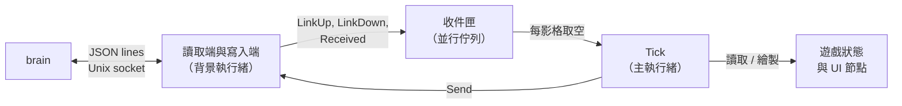

import { Badge } from '@astrojs/starlight/components';
import TickDemo from '../../../../../components/book/TickDemo.svelte';

出現一個決策時，遊戲並不會呼叫 Mod。沒有這樣的事件：決策只不過是遊戲在等玩家、而且沒有任何東西還在動的一個時刻。所以 Mod 每個影格都看一次，只有在某個狀態保持不動之後才去問大腦；玩家要 AI 來打時，同一個影格也會打出答案。本頁沿著這個迴圈走：它在哪裡執行、每個影格做什麼、如何保持同時只有一個決策在途、如何判斷一個畫面已經空閒，以及如何與大腦溝通。AI 如何打出一個答案，見[自動遊玩與安全](/zh-tw/arch/mod/auto/)。[概覽](/zh-tw/arch/mod/)說明 Mod 是什麼；[輸出](/zh-tw/arch/output/)說明答案怎麼畫出來。

## 1. 遊戲只認一個執行緒

Godot 和大多數遊戲引擎一樣，要求遊戲狀態和 UI 節點只能從它的主執行緒存取。所以對遊戲的每一次讀寫，都發生在一個每影格回呼 `Host.Tick` 裡，用 `((SceneTree)Engine.GetMainLoop()).ProcessFrame += Tick` 掛上（`Host.cs:41`）。`ProcessFrame` 是場景樹每影格觸發一次的普通 C# 事件，所以 Mod 不需要 Godot 的原始碼產生器，也不需要自己的節點腳本。

等待 socket 會讓這個影格卡住，所以 socket 的 IO 在從不碰遊戲的背景執行緒上執行：讀取端把收到的東西放進一個並行佇列，也就是**收件匣**（inbox），寫入端則傳送主執行緒排進佇列的東西。`Tick` 在每個影格開始時把收件匣取空。這是 STS2MCP 的做法（[自動遊玩與安全 §6](/zh-tw/arch/mod/auto/#sec-6)）。

`Tick` 在第一個影格建立面板，讀取按鍵（F8，以及工具列的 F5、F10 和 F11），然後把這個影格交給 `Assist.Tick`；如果 Mod 處於關閉狀態（版本守衛），它只顯示原因。影格裡的例外會記入日誌並顯示為「Mod 出錯」，每種不同的錯誤一次，而不是每個影格一次（`Host.cs:44-65`）。

## 2. 每個影格，一步一步

`Assist.Tick`（`Assist.cs:162-278`）每個影格都按這個順序做同樣的步驟。大多數影格會提早停下。

1. **取空收件匣**：連線變化、`ready`、答案或 `error`（[§8](#sec-8)）。
2. **環境和力度**。如果其中一個設定變了，大腦眼中的這一局就結束（`run_end`、`aborted`），下一個決策用新的設定開始新的一局。
3. **對局**。遊戲的對局狀態、本機玩家，以及由種子雜湊得到的對局 id（`RunHeader.IdOf`）。如果 id 和告訴過大腦的那一局不同，那一局就結束：遊戲已經結束時是 `won` 或 `lost`，否則是 `aborted`。關掉輔助也會結束那一局。已經結束的一局會讓 AI 停下。
4. **讀取畫面**，只限單人對局：`Screens.Read` 傳回畫面上的決策，或者什麼都沒有（[§4](#sec-4)）。輔助關閉、沒有大腦時也照樣讀，因為 SL 紀錄需要知道玩家回答的是哪個畫面（[SL 紀錄 §3](/zh-tw/arch/mod/sl-record/#sec-3)）。玩家在這個決策介面上走的一步如果還在演出（事件選項、休息選項、獎勵、購買、占卜），在它的任務結束之前，這個決策會被隱藏。
5. **輔助關閉**：隱藏一切並停下。
6. **誰在場**。沒有連線、沒有對局、多人對局、這一局大腦出過錯，或者還沒收到 `ready`：顯示原因（[概覽 §6](/zh-tw/arch/mod/#sec-6)）並停下。有連線時，一局的第一個影格傳送 `hello`。
7. **沒有要決定的事**：顯示「等待下一個決定」，重設空閒計數，並停下。AI 自己打或打到一個房間結束時，一個沒有決策而在等待的畫面（寶箱、繼續按鈕）會在 1.2 秒後被按下（[自動遊玩與安全 §1](/zh-tw/arch/mod/auto/#sec-1)）。SL 下，沒有節點複本的戰鬥也停在這裡（[SL 紀錄 §6](/zh-tw/arch/mod/sl-record/#sec-6)）。
8. **空閒**。決策的鍵是它的觀測雜湊加上它的合法動作。新的鍵讓計數重新開始；連續不滿 3 個影格，這個影格就停下，面板保持原樣。
9. **顯示、打出或詢問**。有這個鍵的答案就顯示它；如果玩家要 AI 來打，等它的等待時間一過就打出它（[自動遊玩與安全 §2](/zh-tw/arch/mod/auto/#sec-2)）。否則面板顯示「思考中…」，Mod 發出詢問，除非已經有一個決策開著（[§3](#sec-3)）：SL 下先傳節點的檢查點和步驟（[SL 紀錄 §7](/zh-tw/arch/mod/sl-record/#sec-7)），再傳 `decision`。

下圖在一場虛構的 SL 戰鬥上，逐個影格套用這些規則：

<TickDemo client:visible lang="zh-TW" />

## 3. 同時只有一個決策在途

大腦按順序、一次一個地回答同一條連線上的決策（[Harness §5](/zh-tw/arch/harness/#sec-5)）。所以 Mod 最多只開著一個決策：

- **鍵**。一個決策對應一個鍵：觀測的雜湊（`DecisionRequest.HashOf`，對它的 JSON 取 FNV-1a 64，[協定 §4](/zh-tw/arch/protocol/#sec-4)）加上它的合法動作。同一個觀測可能允許不同的動作：休息處在用過一個選項之後就可以離開，儘管看得到的其他東西都沒變（`Assist.cs:246-247`）。
- **詢問**。一個鍵連續保持 3 個影格，而且沒有開著的決策、也沒有它的答案，就以 `decision` 傳送，帶上下一個 id；id 在這條連線上的每一局裡從 0 開始計數。
- **狀態先往前走了**。決策還開著時，一個新的鍵已經連續保持 3 個影格，Mod 就傳送一次帶這個決策 id 的 `cancel`，然後等待。它要等舊決策的答案回來之後，才詢問新的鍵。那個答案會被丟掉。
- **答案**。答案按 id 和開著的決策配對；Mod 不讀它的 `obs_hash`。它為被詢問的那個鍵保存起來，在這個鍵持續的每個影格上顯示。狀態回到這個鍵時會再次顯示它，不用重新詢問。
- **取消後又回來的鍵**。如果狀態從 A 走到 B，又在 A 被取消的答案到達之前回到 A，A 不會再被詢問：那個答案到達時會被丟掉，而 A 已經問過了，所以面板一直顯示「思考中…」，直到鍵改變為止（`Assist.cs:259-265`、`426-431`）。

這樣，即使玩家出手比大腦思考還快，慢的大腦也永遠不會越來越落後：Mod 從不在第一個問題後面再排第二個。大腦收到 `cancel` 時並不會停止搜尋（[協定：線路 §5](/zh-tw/arch/protocol/wire/#sec-5)）；被取消的答案只是耗掉它所需的時間而已。

為什麼是 3 個影格：在同一個動作的兩個步驟之間，佇列可能短暫清空，遊戲看起來會空閒一個影格。這時發出的決策，描述的是一個馬上就要改變的狀態。連續三個影格同一個鍵、每個影格都通過畫面的空閒測試，就是一個狀態必須保持的時間（`Assist.cs:47`）。

## 4. 空閒，逐個畫面

「空閒」指遊戲真的在等玩家：遊戲邏輯在等待，沒有排隊中的動作，沒有還在演出的東西，也沒有別的畫面蓋住正要決策的那個畫面。無頭執行時，GameBridge 的 `CombatActions.WaitingForInput` 就夠了；在真實遊戲裡則不夠（[GameBridge：各決策介面的動作 §1](/zh-tw/arch/gamebridge/actions/#sec-1)）。所以 `Screens.Read`（`Screens.cs:52-115`）從玩家正在看的畫面出發，也就是遊戲自己的 `ActiveScreenContext.Instance.GetCurrentScreen()`：開啟中的模態視窗、開啟著的地圖、覆蓋層堆疊的頂端，否則就是當前房間 <Badge text="已核實" variant="success" />。它的型別決定決策介面：

| 最上層的畫面 | 決策介面 | 何時詢問 |
|---|---|---|
| `NCombatRoom`，手牌處於選擇模式（`NPlayerHand.IsInCardSelection`） | `card_choice` | 立刻：遊戲在一個動作內部等待這個提示 |
| `NCombatRoom`（也包括事件裡的戰鬥） | `combat` | `CombatActions.WaitingForInput`、動作佇列為空，而且手牌處於出牌模式、不在一次出牌當中 |
| `NCombatPileCardSelectScreen`、`NCardGridSelectionScreen`、`NChooseACardSelectionScreen` | `card_choice` | 立刻 |
| `NCardRewardSelectionScreen` | `card_reward` | 立刻 |
| `NChooseABundleSelectionScreen` | `bundle` | 立刻 |
| 帶有一組獎勵的 `NRewardsScreen` | `rewards` | 動作佇列為空 |
| `NCrystalSphereScreen`，小遊戲還沒結束 | `crystal_sphere` | 動作佇列為空 |
| `NMapScreen`，可以移動且不在移動中 | `map` | 動作佇列為空 |
| `NEventRoom`、`NFakeMerchant` 或 `NMerchantInventory`，在事件房間裡 | `event` | 動作佇列為空 |
| `NMerchantRoom` 或 `NMerchantInventory`，在商人房間裡 | `shop` | 動作佇列為空 |
| `NRestSiteRoom` | `rest` | 動作佇列為空 |
| `NTreasureRoom`，已經亮出它的遺物 | `treasure` | 動作佇列為空；寶箱還沒打開時顯示「打開寶箱」 |

提示之所以立刻詢問，是因為遊戲在一個動作或一份獎勵的*內部*等待它們，這時佇列是忙碌的；其他每個畫面都是在佇列清空時等待。

**與模擬器的問法相同**。詢問一個決策介面時，用的是模擬器的 `RunSession` 所用的同一套 GameBridge 呼叫，所以大腦在兩種宿主裡看到的觀測和合法動作相同（[模擬器：整局 §4](/zh-tw/arch/simulator/runs/#sec-4)）。畫面提供什麼，是從畫面節點的私有欄位讀出來的，這些欄位裝的正是它所顯示的東西：獎勵組、卡牌獎勵的卡和它剩下的替代選項（用過的重骰會以一份不含它的新清單回來）、卡包、提示的卡和它的 `CardSelectorPrefs`。手牌的選擇模式和戰鬥牌堆提示則是對一個牌堆做篩選，所以 Mod 把它們的篩選條件套用到那個牌堆上。

**藥水欄**在和模擬器相同的畫面上提供：除了卡牌獎勵、卡包和選牌提示之外到處都有；在戰鬥中，它的動作就在戰鬥自己的動作之中。

**沒有任何合法動作的畫面**（一段動畫、畫面在等的一個繼續按鈕）不是決策：畫面的合法動作為空時，`Ask` 傳回空。

## 5. 選牌提示

選牌提示是要求玩家挑選卡牌的畫面：三選一、棄兩張、升級一張（[協定：觀測與動作 §6](/zh-tw/arch/protocol/observation/#sec-6)）。在遊戲裡，有三件事讓它運作（`Screens.cs:133-159`）：

- **它的上下文**。大腦需要知道為什麼會出現這個提示：是哪張卡牌、哪個遺物或哪個事件提出的，以及選了之後會怎樣。GameBridge 掛在 `CardSelectCmd.From*` 上的前綴，在遊戲提出每個提示時記下它的上下文（[GameBridge：讀取遊戲 §6](/zh-tw/arch/gamebridge/observe/#sec-6)）。畫面在它的入口第一次 await 之後才開啟，那時當前的上下文已經不在了，所以 Mod 取最近記下的那一個，`ChoiceContexts.Last`。每個提示（一個新的畫面節點，或一次新的手牌選擇）取它一次。如果它已經被更早的提示用過，就表示這個提示沒有帶上下文：Mod 記下「a card prompt without its context, left to the player」（一個沒有上下文的選牌提示，留給玩家），什麼也不問。
- **它的上下限**。可以選幾張牌，來自畫面的 `CardSelectorPrefs`，再依上下文修正（`ChoiceContexts.Bounds`）。選一張牌的畫面不論能不能略過，都按 0 到 1 張來詢問，就像 `CardSelectCmd` 詢問選牌器的方式。
- **規範順序**。選項按規範順序排列（`CardChoices.Canonical`），平手時用 `new Random(0)` 決定，所以觀測和它的雜湊在影格之間保持不變，大腦的答案也不取決於畫面上的順序。答案選的是規範順序的索引；SL 紀錄保存的是遊戲自己的索引（[SL 紀錄 §3](/zh-tw/arch/mod/sl-record/#sec-3)），AI 打出它們時用的也是遊戲自己的索引，透過一個從每個規範索引對回去的對應表（`Asking.GameIndex`）。

戰鬥中的提示也帶著這場戰鬥。SL 下沒有節點複本時，提示照樣詢問，戰鬥以外的決策也一樣；只有戰鬥要等（[SL 紀錄 §6](/zh-tw/arch/mod/sl-record/#sec-6)）。沒有帶上下文的提示不會被詢問，而在 SL 下，它的回答會讓節點的紀錄中斷，因為紀錄沒辦法拿它去對照一個從未見過的提示。

## 6. 用遊戲裡的名字寫出答案

大腦用動作文字回答：`play:1:1`、`map:4,10`、`reward:0`。面板按照畫面的叫法、用遊戲的語言為它們命名，依據的是這個答案所對應的觀測（`UI/Describe.cs`）。遊戲沒有文字的 id 就原樣顯示。名字周圍 Mod 自己的用語（「去」、「拿」、「結束回合」）也跟隨遊戲的語言（[輸出 §2](/zh-tw/arch/output/#sec-2)）。

| 決策介面 | 動作顯示為 |
|---|---|
| 戰鬥 | 卡牌的名字（升級過的加上 `+`）和它的目標，「→ 恐鰻」；有好幾個敵人活著時，名字後面加「#2」；藥水是「喝」加藥水名；「結束回合」 |
| 選牌提示 | 「選」加上卡牌，或「都不選」 |
| 地圖 | 「去」加上地圖圖例對這個房間的稱呼 |
| 獎勵 | 「拿 25 金幣」，「拿」加藥水或遺物，「打開卡牌獎勵」加上它的卡，「移除一張牌」；`rewards_done` 是「繼續」，或「略過其餘，繼續」 |
| 卡牌獎勵 | 「拿」加上卡牌，或替代選項自己的名字（略過、重骰） |
| 卡包 | 「第 2 包:」加上它的卡 |
| 事件 | 選項的標題，取自事件的本地化表或遠古之民的本地化表 |
| 商店 | 「買」加上商品「（75 金幣）」、「移除一張牌（75 金幣）」、「離開商店」 |
| 休息處 | 選項的名字，或「離開」 |
| 財寶 | 遺物的名字，或「略過遺物」 |
| 水晶球 | 「在 3,4 大占卜」、「在 3,4 小占卜」 |
| 藥水欄 | 「喝」或「丟掉」加上藥水 |

**計畫**。在戰鬥中，面板寫出到本回合結束為止的計畫：第一個動作，然後是計畫的各個步驟，一直到下一個 `end_turn`。SL 規劃器規劃的是整場戰鬥，但它後面幾個回合要打的牌還沒抽到，畫面叫不出它們的名字，所以只計數：「之後還規劃 2 回合」（`Describe.Turn`）。在地圖上，計畫就是路線：它經過的房間，一直到頭目。其他地方則把計畫的動作照原樣列出。

**考慮過的選項**是大腦打過分的選項中最多五個，選中的排第一，其餘最好的在前：SL 規劃器的第一個動作，帶著各自最佳路線上這場戰鬥的獲勝機率和剩下的生命值；PIMC 的，帶著它們的分數和信賴區間；在戰鬥外，是每個合法選項，帶著 V 對選了它之後贏下這一局的機率，在地圖上還帶著每個選項的路線（[輸出 §2](/zh-tw/arch/output/#sec-2)）。在下一個動作底下，一行較淡的文字說明預期這場戰鬥或這一局在它之後會怎麼走。

**標記**。同一個答案也會畫在遊戲上：地圖上的圓圈和路線，戰鬥中卡牌、目標和結束回合按鈕上的編號和圓圈（[輸出 §3](/zh-tw/arch/output/#sec-3)）。

## 7. Mod 何時等待

除了大腦還在思考之外，面板也會等遊戲：

- **有東西在動**：動作佇列不為空、手牌正在出牌、地圖正在移動。畫面穩定下來之前不詢問任何東西。
- **一步正在演出**。事件選項、休息選項、獎勵、購買和占卜都作為遊戲自己的任務執行，畫面要等任務結束才顯示這一步的結果：在那之前，畫面上仍是它已經回答過的那個決策。Mod 在玩家開始每個這類任務的地方記下它，在它結束之前不在那個決策介面上詢問任何東西，就像模擬器等待自己正在執行的任務一樣（`NodeRecord.Running`，[SL 紀錄 §4](/zh-tw/arch/mod/sl-record/#sec-4)）。
- **Mod 不讀的畫面**：模態視窗、牌組檢視、還沒打開的寶箱。這時顯示「等待下一個決定」；寶箱沒開時會加上「打開寶箱」。

AI 打的時候，等的也是同樣這些東西：它只打出畫面上那個決策的答案。沒有決策而在等待的畫面，只在自動遊玩或一個房間的目標進行時才會被按下；一個決策的按鈕一直沒準備好，AI 會在 10 秒後停下：永遠沒有隨機動作（[自動遊玩與安全 §1](/zh-tw/arch/mod/auto/#sec-1)、[§2](/zh-tw/arch/mod/auto/#sec-2)）。

## 8. 大腦連線

`BrainLink`（`BrainLink.cs`）是線路在 Mod 這一端（[協定：線路](/zh-tw/arch/protocol/wire/)）。

- **Socket**：Unix domain socket `~/.local/state/sts2ai/brain.sock`（設定了該變數時是 `$XDG_STATE_HOME/sts2ai/brain.sock`；`BrainSocket.DefaultPath`），傳輸 JSON lines。Mod 是用戶端，大腦是伺服器端（[概覽 §4](/zh-tw/arch/mod/#sec-4)）。
- **為什麼放在那裡**。Steam 在它的 Linux 執行時容器（pressure-vessel）裡啟動遊戲；這個容器與主機共用家目錄，但有自己的 `$XDG_RUNTIME_DIR`。放在那裡的 socket，遊戲連不到，所以 socket 放在家目錄底下。大腦建立它的資料夾時，設成只有使用者本人能讀取。
- **連線**。一個背景執行緒負責連線、啟動一個寫入執行緒，然後一直讀取到連線結束；接著等 2 秒再連，永不停止。每條連線開始時，收件匣裡出現一個 `LinkUp`，每次結束時出現一個帶原因的 `LinkDown`。
- **傳送**就是把一則訊息排進佇列交給寫入端。沒有連線時訊息會被丟掉：新的連線會從 `hello` 重新開始，所以不需要舊連線的任何東西。

**大腦眼中的對局**（`Assist.cs:112-126`、`204-208`、`407-475`）：

| 何時 | Mod 傳送 | 或者做 |
|---|---|---|
| 單人對局的第一個影格，且已連線 | `hello`：遊戲版本、環境、身分 `mod`、這一局（它的 id、角色和晉階），以及玩家選了的話，SL 規劃器的力度 | 重設決策 id 和 SL 計數器 |
| `ready` 到達 | | 顯示它報出的冠軍 |
| 一個決策被詢問、回答或取消 | `decision`、`cancel`（[§3](#sec-3)）；SL 下先傳 `node_checkpoint` 和 `node_action` | |
| AI 打出了一個答案 | `executed`：決策的 id、動作、`ok` | 把它加進面板的最近動作（[自動遊玩與安全 §2](/zh-tw/arch/mod/auto/#sec-2)） |
| 對局 id 變了，或者已經沒有對局 | `run_end`：遊戲已經結束時是 `won` 或 `lost`，否則是 `aborted` | 讓 AI 停下，並清掉面板的獲勝機率和最近動作 |
| 切換了環境或力度，或關掉了輔助 | `run_end` `aborted` | 下一個決策會傳送新的 `hello` |
| `error` 到達 | `run_end` `failed` | 關閉到下一個 `hello` 為止：「大腦出錯」、「下一局恢復」。下一個 `hello` 會隨新的一局到來，也會在切換環境或力度、關掉再打開輔助或重新連線之後到來，這些都會在同一局遊戲裡重新開始大腦眼中的那一局 |
| 連線中斷 | 什麼都不傳：連線已經沒了 | 忘掉這一局和開著的決策，並讓 AI 停下；下一條連線從 `hello` 重新開始 |

繼續的一局拿到和之前相同的對局 id，因為 id 就是種子的雜湊；重新連線或切換之後大腦拿到的那一局也一樣，只是決策 id 又從 0 開始，節點也會重新傳送。Mod 不預期的大腦訊息會記入日誌並忽略；`ready` 不論何時到來，都會設定冠軍的名字。斷線期間，標頭保留最後一個冠軍的名字。

**一個大腦服務兩種環境**。`hello` 帶著環境，而且在大腦眼中的這一局裡保持不變。`brain` 給 NoSL 對局它的冠軍的戰鬥大腦，給 SL 對局 `--sl-policy` 的戰鬥大腦，宏觀大腦相同（[Harness：路由、預算與種子 §1](/zh-tw/arch/harness/routing/#sec-1)），所以只要宏觀大腦在兩種環境下都能用（[概覽 §4](/zh-tw/arch/mod/#sec-4)），面板的開關就不需要第二個大腦。

**大腦印出什麼**。啟動時印出 `brain: NoSL C; SL C; listening on PATH`，之後每個 `run_end` 一行：`RUN_ID (mod) REASON floor F, N decisions`，有重新規劃和工作行程的遊戲錯誤時也一併印出（`Commands/BrainCommand.cs:48-53`）。
