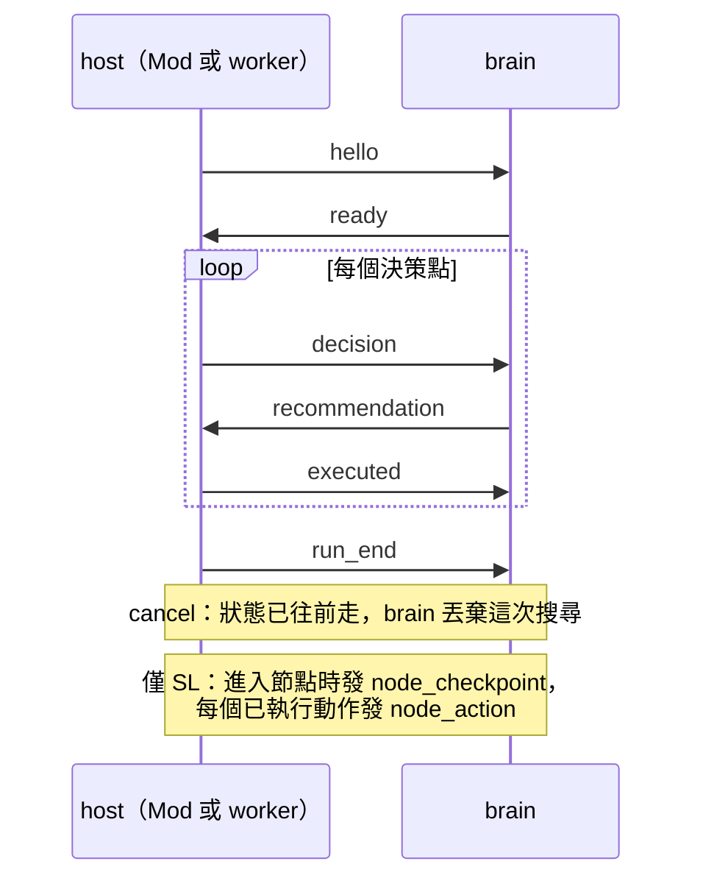

import { Aside } from '@astrojs/starlight/components';

Protocol（協定）是專案各行程之間的共同語言。遊戲宿主（真實遊戲裡的 Mod，或無頭執行整局的 SimWorker）發出觀測和合法動作；決策行程（Harness 和各個大腦）回覆推薦；搜尋則透過這裡定義的世界 API 接觸模擬出來的遊戲。組件 `Sts2Ai.Protocol` 只引用 .NET 框架，所以 Brain 使用它時不需要引用任何遊戲程式碼。

這個組件同時就是觀測的**白名單**：一個欄位只有在遊戲 UI 顯示它（或者能從 UI 顯示的內容推斷出來）、並且有測試檢查這一點時，才會出現在這裡。不在 Protocol 裡的值，到不了大腦那裡。

<Aside title="狀態">

戰鬥部分、帶有每個決策介面畫面的整局觀測（[§3](#sec-3)）和 `ChoiceContext`（[§4](#sec-4)）已實作（`src/Sts2Ai.Protocol`）。戰鬥世界 API 也已實作（[§7](#sec-7)），承載 PIMC 世界搜尋的 worker 訊息也已實作（[§7.1](#sec-7.1)）。宿主與 brain 之間的訊息已實作（`Wire.cs`，[§2](#sec-2)），包括 SL 訊息，模擬器已經能透過它們跑整局。事件流和事實還在規劃中。

</Aside>

## 1. 現有型別

下面這些型別已經存在，覆蓋戰鬥、選牌提示和整局觀測。

- `CombatObservation`：玩家在一場戰鬥裡能看到的一切。它包括遭遇 id 和它的房間型別（Monster、Elite 或 Boss，與地圖上顯示的一致）、幕、晉階等級、回合數、一個 `PlayerView`、手牌（帶 uid）、按卡牌鍵（card key）排序的抽牌堆、棄牌堆和消耗堆、每個槽位的藥水、遺物（每個都帶它的計數、狀態、是否熔化或用盡，以及它儲存的牌，按 id，與它的提示裡列的一致：Pael's Tooth 的牌）、友方單位，以及敵人和它們的意圖 `IntentView{type, damage per hit, hits}`（型別、每段傷害、段數）。抽牌堆要排序，是因為它的真實順序是隱藏的。
- `CardView{id, uid?, up, cost|x_cost, stars, enchant, affliction, tinker?, keywords sorted, vars sorted, upgraded?}`：玩家眼中的一張牌。`ProtocolJson.CardKey` 是這張牌去掉 uid 之後的序列化結果，也就是它對玩家可見的身份：鍵相同的兩張牌，在玩家看來一模一樣。`vars` 不含計算出的數值（完美打擊的傷害）：牌面把它顯示為一個基礎數值加上額外數值乘以狀態裡的某個計數，而這兩部分都已列出。`tinker` 只出現在瘋狂科學（Mad Science）上：Tinker Time 事件給它選的牌型別和附加效果。牌框和牌面文字都顯示了這兩項，而只憑 id 定不下來（不帶這兩項重建的世界給了它錯誤的型別，真實戰鬥裡合法的出牌在那裡變成了不合法）。`upgraded` 是這張牌再升一級之後的樣子，就是遊戲的升級預覽顯示的那樣（牌組檢視裡的核取方塊和升級提示）：那時的數值、費用和關鍵字。只有牌組裡還能升級的牌帶它，出現在整局的牌組裡，以及牌組類提示的選項裡（兩處是同一種檢視）；它是在這張牌的複本上做出來的，不觸發任何鉤子，也不改變這一局的任何東西。
- `PowerView{id, amount, stacks?, card?}`：圖示和提示框裡看到的一個能力。`amount` 是圖示上的數字。`stacks` 是能力本身的層數，提示框裡會寫出來；只有圖示顯示別的數字時才有這一項（Sloth 的圖示數的是本回合打出的牌數，層數才是上限）。`card` 是能力儲存的一張牌，提示框裡會寫出它的名字：Nightmare 下回合要複製的那張牌。
- `CombatAction`：一個戰鬥動作，文字形式為 `play:C[:T]`（打出牌 C，可選目標 T）、`potion:S[:T]`（使用槽位 S 的藥水）或 `end_turn`。動作用 **uid** 指代對象：uid 是取自遊戲本身的穩定 id，而不是清單裡的位置。手牌的 uid 是它的 `NetCombatCardDb` id，生物的 uid 是它的 `CombatId`。因此手牌變化時動作依然有效，而且在模擬器和真實遊戲裡含義相同。
- `CardChoice{options canonical-sorted by card key, ties by hidden-state-free seed; min; max; context}` 以及 `Accepts(picks)`：一個選牌提示，比如「棄 1 張牌」或「3 選 1」。選項按**規範順序**排列：按卡牌鍵排序，鍵相同時用一個不含隱藏狀態的種子打破平局，從不使用遊戲自己的順序。一個回答要選 min 到 max 個選項；`Accepts(picks)` 檢查回答是否有效。`context` 說明遊戲為什麼要問（[§4](#sec-4)）。
- `Observation{run, screen}`：玩家在任一決策點看到的內容（[§3](#sec-3)）；`Surfaces` 常數（`Surfaces.cs`）給各個畫面命名。
- `ProtocolJson`：JSON 設定：欄位名用 snake_case，值為 null 的欄位省略。`ProtocolJson.Hash(obs)` 計算 `obs_hash`（[§2](#sec-2)）。

## 2. 傳輸

所有訊息都是 **JSON lines**：每行一個 UTF-8 編碼的 JSON 物件。

- **Mod ↔ brain**：Unix domain socket。不用 TCP，所以從本機以外無法存取。
- **brain ↔ worker**：子行程的 stdin/stdout 管道。只有效能分析表明 JSON 佔了主要開銷時，才換成二進位編碼。
- 每條訊息的形式是 `{"type": ..., "v": PROTOCOL_VERSION, ...}`。任何不相容的改動都要升版本號，日誌裡會記錄版本號。

下面的訊息裡，**host**（宿主）是執行遊戲的行程：真實遊戲裡的 Mod，或者承載一局的 worker（由 `role` 欄位說明是哪一種）。**brain** 是決策行程。

```
host → brain   hello{v, game_version, env: "NoSL"|"SL", role: "mod"|"worker", run: {run_id, character, ascension}}
brain → host   ready{champion}                // the run is accepted
host → brain   decision{decision_id, obs_hash, surface, obs, legal[], events[]}
brain → host   recommendation{decision_id, obs_hash, action, brain, plan?, candidates?, facts[], degraded?}
brain → host   error{message}                 // instead of ready or a recommendation; the host ends the run
host → brain   executed{decision_id, action, ok, error?}
host → brain   cancel{decision_id}            // state moved on; brain drops the search
host → brain   run_end{won, floor, reason}
// SL only (env-gated, docs: mod §6; a NoSL log containing these is invalid)
host → brain   node_checkpoint{node_index, checkpoint}     // at node entry: ToSave(null) + relic fields
host → brain   node_action{node_index, seq, action}  // every decision in the node, as "surface action"
```

| 訊息 | 方向 | 時機 / 內容 |
|---|---|---|
| `hello` | host → brain | 每局開始時：協定版本、遊戲版本、環境（`NoSL` 或 `SL`）、角色（`mod` 或 `worker`）、對局頭資訊（對局 id、角色、晉階等級） |
| `ready` | brain → host | 對 `hello` 的回答：brain 接下這一局，並說明由哪個冠軍來打 |
| `decision` | host → brain | 一個決策點：決策 id、觀測雜湊、決策介面、觀測、合法動作（選牌提示的合法動作為空，它的回答是 `pick:i,j,…`，[§3](#sec-3)）、自上一個決策以來的事件 |
| `recommendation` | brain → host | 回答：動作、做出選擇的大腦、計畫、候選動作、事實、可選的降級標記（[§6](#sec-6)） |
| `error` | brain → host | 代替 `ready` 或 `recommendation`：brain 接不了這一局，或答不了這個決策（未覆蓋的決策介面、不合法的選擇、與雜湊不符的觀測）；宿主隨即結束這一局 |
| `executed` | host → brain | 某個決策實際執行了哪個動作、是否成功，以及可能的錯誤 |
| `cancel` | host → brain | 狀態已經往前走了；brain 丟棄這次搜尋 |
| `run_end` | host → brain | 一局結束：是否獲勝、層數、原因（`won`、`lost`、觸及決策上限的 `truncated`、`failed` 或 `aborted`） |
| `node_checkpoint` | host → brain | 僅 SL：進入節點時的檢查點，即存檔 `RunManager.ToSave(null)` 加上它丟掉的遺物欄位（[模擬器 §7](/zh-tw/arch/simulator/#sec-7)） |
| `node_action` | host → brain | 僅 SL：節點內做出的每個決策，用 `seq` 從 0 編號，在下一個決策之前傳送，形式是 `surface action` 文字（選牌提示的選擇用遊戲自己的索引） |

這兩種 SL 訊息按環境開關（[Mod §6](/zh-tw/arch/mod/#sec-6)）。NoSL 日誌裡只要出現其中任何一種，這份日誌就無效；NoSL 下 brain 會在下一個決策時用 `error` 回應它們。節點從 0 編號，從宿主看到的第一個節點算起（Mod 可能中途才加入一局）；檢查點加上它之後的決策就是這個節點的複本（[模擬器 §7](/zh-tw/arch/simulator/#sec-7)）。

一局裡正常的訊息往來：



有兩個欄位用來防止過時的回答：

- `obs_hash` 是對 `obs` 的規範 JSON 計算的 FNV-1a 64（一種快速的 64 位雜湊，`ProtocolJson.Hash`）。如果一個推薦的雜湊與當前的不同，也就是說它是針對一個已經不在螢幕上的狀態算出來的，宿主就丟棄它。
- `decision_id` 在一局內嚴格遞增，brain 只回答最新的那一個。

往來的其他規則：

- 一條連線上依次跑多局，每局從 `hello` 到 `run_end`。brain 一側為每局單獨建一個 Harness，在 `hello` 時建好。
- `run_id` 是對局種子的雜湊（FNV-1a 64，十六進位），所以種子從不離開宿主（[Mod §9](/zh-tw/arch/mod/#sec-9)）。Harness 從它派生各個大腦的種子（[Harness §5](/zh-tw/arch/harness/#sec-5)）。
- brain 按順序回答決策，答完一個才讀下一條訊息，所以目前 `cancel` 沒有可丟棄的搜尋。
- 遊戲走到下一個決策或一局結束時，宿主才報告上一個動作 `executed`。在模擬器裡，只有這一局失敗時 `ok` 才為 false。
- brain 還會用收到的觀測核對 `obs_hash`：對不上說明 JSON 在傳輸中走了樣，回答 `error`。

## 3. 觀測

每個決策一個 `Observation`（`Observation.cs`、`Screens.cs`）。它是一個**聯合型別**（union）：整局部分總是存在，介面部分恰好是若干變體之一，也就是正在詢問的那個決策介面對應的變體。**決策介面**（surface）指一類決策畫面（戰鬥、地圖、商店……）。在 JSON 裡，介面部分帶一個 `"surface"` 欄位，值是決策介面的名字，說明它是哪個變體。觀測由 GameBridge 建構（[GameBridge §3](/zh-tw/arch/gamebridge/#sec-3)）。

```
Observation{run: RunView, screen: ScreenView}       // screen JSON carries "surface": <Surfaces constant>
RunView{character, ascension, act (from 0), act_id, floor (run total), hp, max_hp, gold,
        deck (sorted by card key), relics, potions (per slot, null = empty), map}
MapView{points (sorted by row, col: start row 0 .. boss / second boss), visited (this act, last = current),
        boss, second_boss?, ancient?}
MapPointView{col, row, type (map icon; "?" stays Unknown after the visit), next (sorted), quest?}
```

- `act_id` 說明這一局抽到的是該幕的哪個變體。`floor` 按整局累計，與頂欄顯示的一致。
- `map` 是當前這一幕的地圖：每個點及其圖示、它的路徑通向的點、本幕走過的點（最後一個是玩家當前所在的位置），以及地圖上畫出的頭目、第二個頭目和 Ancient。`quest` 標記一個任務獎勵到達的點。

每個介面變體以它的決策介面命名。決策介面的名字同時也是 Harness 把決策路由給某個大腦時用的鍵（[Harness §4](/zh-tw/arch/harness/#sec-4)）。

| 決策介面 | 畫面載荷 | 合法動作形式 |
|---|---|---|
| `combat` | `combat: CombatObservation` | `play:C[:T]`、`potion:S[:T]`、`end_turn` |
| `card_choice` | `choice: CardChoice`（帶它的 `context`，[§4](#sec-4)）；戰鬥進行中時還有 `combat` | `pick:i,j,…`（規範索引；只有 min = 0 時才允許一張都不選） |
| `map` | `travelable`：可前往的座標，按合法動作的順序（地圖本身在 `run.map` 裡） | `map:col,row` |
| `rewards` | 還沒領取的獎勵：`{index, kind, id?, amount?, card?, cards?}`，kind 為 `gold`、`potion`、`relic`、`card`、`special_card` 或 `remove_card`；`cards` 是選卡獎勵裡的牌（介面出現前就已擲好；玩家可以開啟獎勵看一眼再跳過，沒有任何代價） | `reward:i`、`rewards_done` |
| `card_reward` | `cards`，以及 `alternatives`：其他按鈕的 id（略過、重骰、遺物新增的按鈕） | `card:i`、`card_alt:<id>` |
| `bundle` | `bundles`：若干組卡牌 | `bundle:i` |
| `event` | `id`、`page`（本地化鍵）、`options{index, key, locked?, relic?, tips?, kills?}`（事件結束後為空）、`finished` | `event:i`、`proceed` |
| `shop` | `entries{slot, kind, card? or id?, cost, on_sale?}`：仍在出售的商品，kind 為 `card`、`relic` 或 `potion`；`removal_cost`（用過之後不再出現） | `buy:<slot>`、`remove`、`leave` |
| `rest` | `options{id, enabled, heal?}`，`heal` 是 HEAL 選項回復的生命值，以選項文字上顯示的為準（遺物會改變它） | `rest:<id>`、`leave`（只在某個選項成功一次之後，或已沒有選項可選時） |
| `treasure` | `relics`：寶箱裡的遺物 id | `relic:i`、`relic_skip` |
| `crystal_sphere` | `rows`：11x11 網格，`rows[y][x]` 為 `#`（隱藏）、`.`（已揭開且為空），或已揭開格子所顯示內容的一部分（`R` 遺物、`P` 藥水、`C` 卡牌獎勵、`G` 金幣、`X` 詛咒）；`divinations_left` | `big:X,Y`（3x3）、`small:X,Y`（只在會揭開隱藏格子時） |

一局的結束是傳輸訊息 `run_end`（[§2](#sec-2)），不是一個決策介面。

每個宏觀決策介面（除 `combat` 和 `card_choice` 以外的所有決策介面）還會列出藥水欄動作：`potion:S`（可隨時使用的藥水）和 `discard_potion:S`（丟棄藥水）。藥水欄滿時，藥水獎勵和藥水購買會從合法動作裡去掉，直到空出一個槽位；沒有單獨的 `potion_full` 決策介面。事件動作 `proceed` 表示離開、回到地圖：事件已結束時，或者透過 Ancient 事件的 PROCEED 按鈕。

宏觀決策介面以 `MacroDecision{surface, legal, observation}`（在 Brain 裡）交給策略；`card_choice` 以 `ChoiceDecision{choice, observation}` 交給 `IChoicePolicy`。兩者都只在策略讀取時才生成觀測；單獨開局的戰鬥沒有對局，它的提示也就不帶觀測。

- 如果 UI 順序是公開的（獎勵、事件、商店槽位），直接用遊戲所給清單的索引沒有問題。順序可能反映隱藏狀態的卡牌清單（各個牌堆）一律經過規範排序（`CardChoice`）。
- 牌組按卡牌鍵排序，所以以不同順序得到的同一副牌組給出相同的觀測。
- 地圖從不包含未來某個 `?` 的結果；頭目和 Ancient 畫在地圖上，所以包括在內。
- 文字以本地化鍵（loc key，`table.key`；事件選項用它的文字鍵）傳送，從不傳送已經解析好的字串。遊戲填進事件文字的數字暫不包括：有些事件把頁面上不顯示的數值也放在其中，所以要先有一份按事件劃分的白名單。工具提示（提示裡顯示的卡牌或遺物）是可見的，所以選項的 `tips` 列出它們的模型 id（`+` 表示升級過的牌）。
- 觀測是惰性建構的：只在有人讀取時才建構（`MacroDecision.Observation`、`CombatDecision.Observation`，或整局工作階段的 `observed` 回呼）。

## 4. ChoiceContext

`CardChoice` 只說明有哪些選項，不說明遊戲為什麼要問：同樣的選項，用於升級、移除還是棄牌，意義完全不同。在真實遊戲裡，策略可能單獨收到一個選牌提示，沒有別的資訊告訴它這個提示是做什麼用的。`ChoiceContext` 帶上的就是這個原因。它由 GameBridge 填寫（[GameBridge §5](/zh-tw/arch/gamebridge/#sec-5)）。

```csharp
public sealed record ChoiceContext
{
    public required string Purpose { get; init; }       // from the CardSelectCmd entry, or "<pile>_pile"
    public string? Source { get; init; }                // card/relic/power/event id that asked
    public required bool Cancelable { get; init; }      // a cancel or skip button closes the prompt
    public required bool InCombat { get; init; }        // asked during a combat
    public string? PromptKey { get; init; }             // the prompt's loc key, "table.key"
    public ModifierView? Enchantment { get; init; }     // for deck_for_enchantment
}
```

| 欄位 | 含義 |
|---|---|
| `Purpose` | 提示的種類：遊戲所用 `CardSelectCmd` 入口的名字，去掉 "From"，轉成 snake_case：`deck_for_upgrade`、`deck_for_transformation`、`deck_for_enchantment`、`deck_for_removal`、`deck_generic`、`hand`、`hand_for_discard`、`hand_for_upgrade`、`choose_a_card_screen`、`simple_grid`、`simple_grid_for_rewards`。針對戰鬥中某個牌堆的提示是 `draw_pile`、`discard_pile`、`exhaust_pile`…… |
| `Source` | 發起詢問的卡牌、遺物、能力或事件的 id，在遊戲指明時給出：入口的 `source` 參數，否則是它的 `PlayerChoiceContext` 最近涉及的模型（可選） |
| `Cancelable` | `CardSelectorPrefs.Cancelable`，或「3 選 1」畫面的 `canSkip` |
| `InCombat` | 提示開啟時的 `CombatManager.IsInProgress`：是卡牌或能力結算中的提示，而不是休息處、事件或商店裡的。Harness 按它路由提示（[Harness §4](/zh-tw/arch/harness/#sec-4)） |
| `PromptKey` | 提示文字的本地化鍵（可選） |
| `Enchantment` | 用於 `deck_for_enchantment`：被選中的牌獲得的附魔及其數值 |

- 取消或跳過就是空回答，所以只要 `Cancelable` 為真，`min` 就是 0。
- 沒有跳過按鈕的「3 選 1」畫面向選擇器要 0 或 1 張牌，然後自己強制必須選一張，所以它的 `min` 是 1（`ChoiceContexts.Bounds`）。
- 一個入口呼叫另一個入口時（移除卡牌會經過通用的牌組提示），由最外層的入口給出用途。

## 5. 事件

每條 `decision` 訊息都帶有自上一個決策以來的**事件**。這些事件合起來就是公開歷史流：玩家本可以親眼看到的經過。事件集合是最小的，只包含**信念**需要的內容。信念指決策行程根據公開歷史對隱藏狀態做出的估計（[Harness §3](/zh-tw/arch/harness/#sec-3)）。

```
draw{card}  play{card_uid, target?}  move{card, from, to, pos: top|bottom|random|null}
generate{card, to}  shuffle{}  intents{creature, intents[]}  move_done{creature, effects…}
reward_seen{…}  shop_seen{…}  event_page{…}
```

`move` 是一張牌從一個牌堆移到另一個牌堆；`move_done` 報告一個生物完成了它的行動，以及行動的效果。最後一行記錄獎勵畫面、商店或事件頁面顯示了什麼。

- 事件裡用 `CardView` 標識一張牌；牌在手牌中時再加上它的 uid。
- 在遊戲一側，GameBridge 訂閱遊戲的鉤子和事件來生成這條流（[GameBridge §8](/zh-tw/arch/gamebridge/#sec-8)）。
- 只有某個信念特徵需要時，才擴充事件集合。

## 6. 推薦

大腦對一條 `decision` 的回答。`Wire.cs` 裡已經有它，只是還沒有 `Facts` 和 `Degraded`，這兩項在規劃中：

```csharp
public sealed record Recommendation(long DecisionId, string ObsHash, string Action, string Brain,
    IReadOnlyList<string>? Plan = null,          // rest of the turn/screen, or of the act's route on the map
    IReadOnlyList<Candidate>? Candidates = null) : WireMessage;
// Planned:
//   IReadOnlyList<Fact> Facts                   // the only source for explanations
//   bool Degraded                               // worker loss etc.; docs: harness §7
public sealed record Candidate(string Action, double Value, double Ci, int Samples);
public sealed record Fact(string Kind, IReadOnlyDictionary<string, double> Values, bool Exact); // planned; Exact only in SL
```

- `Action` 是該決策的合法動作之一；選牌提示的回答是 `pick:i,j,…`。
- `Brain` 說明是哪個大腦做的選擇，取自冠軍的路由表（[Harness §4](/zh-tw/arch/harness/#sec-4)）。宿主按大腦統計決策數寫進對局記錄，其中佔位策略的決策數必須為零（[評估 §3](/zh-tw/arch/evaluation/#sec-3)）。
- `Candidates` 只來自會搜尋的大腦，`Plan` 來自會規劃的大腦（戰鬥搜尋，以及地圖上的宏觀大腦），與決策日誌裡一樣（[Harness §6](/zh-tw/arch/harness/#sec-6)）。
- `Plan` 是本回合或本介面剩下的步驟，在地圖上是本幕剩下的路線，用於標示和解說。
- `Candidates` 列出評估過的動作，每個帶有 `Value`、`Ci`（信賴區間）和樣本數 `Samples`。
- `Facts` 是解釋的唯一來源。
- 事實的 `Exact` 標記只在 SL 中設定，因為 SL 的事實可以是確切結果（[環境 §8](/zh-tw/arch/environments/#sec-8)）。
- `Degraded` 表示這個回答是在出問題時給出的，例如丟失了一個 worker 行程（[Harness §7](/zh-tw/arch/harness/#sec-7)）。

## 7. 世界 API

搜尋從不直接接觸遊戲，而是從這個 API 拿到**世界**：可以觀測、執行動作、做快照和恢復的模擬戰鬥。型別定義在 Protocol 裡（`World.cs`），所以 Brain 不引用遊戲也能使用；實作在 SimWorker 裡（[模擬器 §6](/zh-tw/arch/simulator/#sec-6)）。NoSL 和 SL 的世界有何不同，見 [環境 §5](/zh-tw/arch/environments/#sec-5)。

```csharp
public enum PlayEnvironment { NoSL, SL }
public enum CombatStatus { InProgress, Won, Lost }

// Hands out the worlds for one decision.
public interface IWorldSource
{
    PlayEnvironment Environment { get; }
    // NoSL: k samples drawn from searchSeed. SL: the one exact copy.
    IReadOnlyList<ICombatWorld> Worlds(int k, ulong searchSeed);
}

public interface ICombatWorld
{
    CombatObservation Observe();
    IReadOnlyList<CombatAction> Legal();   // empty once the combat is over
    CombatStatus Status { get; }
    ulong HiddenKey();                     // what Observe hides that changes what happens next, as a hash
    void Execute(CombatAction action);     // card prompts are answered inside the world
    WorldSnapshot Snapshot();
    void Restore(WorldSnapshot snapshot);  // a snapshot taken from this same world
}

public sealed record WorldSnapshot(IReadOnlyList<string> Steps);
public sealed record Candidate(string Action, double Value, double Ci, int Samples);
```

- NoSL 世界是隱藏狀態的一個樣本，與觀測一致；SL 世界是真實戰鬥的一份精確副本。
- 目前只有戰鬥世界：它唯一的使用者是戰鬥大腦。整局級的世界等到宏觀搜尋時再加。
- `WorldSnapshot` 是這個世界從開始以來走過的步驟清單（動作、選牌回答、確定化步驟），以文字形式儲存。對搜尋來說它是不透明的；只有生成它的那個世界會讀它，並透過重播恢復。因為它是純文字，任何 worker 都能恢復它。
- 世界裡彈出的選牌提示在世界內部回答。v0 交給 `p0`，也就是這一局自己回答提示所用的固定規則，所以世界裡的選擇和這一局一樣；把每個選項變成搜尋分支還在規劃中（[戰鬥大腦 §2](/zh-tw/arch/combat-brain/#sec-2) 第 7 條）。
- `Candidate` 是一個評過分的動作：它在各個世界上的平均估值、95% 信賴區間的半寬，以及世界的個數。

SL 封存：節點複本在節點出口處停下（`AtHorizon`），之後的任何一步都會拋出例外；SL 世界在它那場戰鬥結束後，任何動作都會拋出例外，所以搜尋永遠不會離開這個房間（[模擬器 §7](/zh-tw/arch/simulator/#sec-7)）。

### 7.1 worker 訊息

worker 行程池（[模擬器 §8](/zh-tw/arch/simulator/#sec-8)）不會一步一步地透過線路操作世界：一次行程間往返（幾十 µs）和一個模擬步（約 0.1 ms）的開銷相當，而搜尋每個決策要走幾千步。所以一個請求要的是一整塊工作：一個世界的搜尋，或者 SL 規劃器的一個回合（`Worker.cs`）：

```csharp
// The worker's first line, once it has booted.
public sealed record WorkerHello(string Game);

// A request, typed by "type" on the wire; its reply carries the same id.
public abstract record WorkerRequest(long Id);

// "pimc_world": build the combat from Observation with BuildSeed, take world World of Worlds drawn
// from SearchSeed, and search this turn after each of First, in that order, each with NodesPerFirst nodes.
// History is the combat's record of enemy moves so far, for the leaves.
public sealed record PimcWorldRequest(long Id, CombatObservation Observation, IReadOnlyList<CombatAction> First,
    string BuildSeed, ulong SearchSeed, int World, int Worlds, int NodesPerFirst,
    IReadOnlyList<EnemyTurns>? History = null) : WorkerRequest(Id);

// "sl_world": load Node, the SL clone, and search this turn after each of First, each with NodesPerFirst nodes.
public sealed record SlWorldRequest(long Id, NodeClone Node, IReadOnlyList<CombatAction> First,
    int NodesPerFirst, IReadOnlyList<EnemyTurns>? History = null) : WorkerRequest(Id);

// "sl_turn": load Node, play Path from the decision, and search the rest of that turn with Nodes nodes
// (the SL planner, Combat brain §3): keep the best Keep states at the next turn's start and the best end of
// the combat, none whose bound cannot beat Floor. History is the record of enemy moves up to that state.
public sealed record SlTurnRequest(long Id, NodeClone Node, IReadOnlyList<CombatAction> Path, int Nodes, int Keep,
    double? Floor, IReadOnlyList<EnemyTurns>? History = null) : WorkerRequest(Id);

// Lines[i] is the best line after First[i]; Turn answers an sl_turn. Error is set instead when the request failed.
public sealed record WorkerReply(long Id, IReadOnlyList<PlannedLine>? Lines, string? Error, IReadOnlyList<string> GameErrors,
    TurnSearch? Turn = null);

// Cut: the nodes ran out, or more states were found than kept.
public sealed record TurnSearch(IReadOnlyList<TurnEnd> Ends, int Nodes, bool Cut);

// Where a turn ends (or the combat): its actions and the observation hash before each, the leaf's value, the
// bound (a win at its HP and potions), the key of its observation and full hidden state, its record of moves.
public sealed record TurnEnd(IReadOnlyList<CombatAction> Actions, IReadOnlyList<ulong> Hashes, CombatStatus Status,
    double Value, double Bound, ulong Key, IReadOnlyList<EnemyTurns> History);

// Nodes: the actions simulated below the line's first action. Hashes: the hash of the observation each action
// is played at, which a followed plan checks before each step.
public sealed record PlannedLine(double Value, IReadOnlyList<CombatAction> Actions, int Nodes = 0,
    IReadOnlyList<ulong>? Hashes = null);
```

- 請求帶著 worker 需要的一切，所以任何 worker 都能處理它，崩潰的 worker 的請求可以重發。
- NoSL 請求裡是觀測，絕不是真實狀態：worker 看到的不會比玩家多。SL 請求裡是節點複本，這是 SL 允許知道的。`TurnEnd` 的鍵是隱藏狀態的雜湊，它只留在 SL 的搜尋裡；葉節點仍然只讀觀測。
- `GameErrors` 是處理請求期間遊戲的 `Log.Error` 輸出，供宿主計數。

## 8. 不變數與測試

- **往返**：每個型別序列化再反序列化後，得到相同的 JSON。戰鬥：selftest；整局：一批 `run --check` 中的每個觀測。
- **白名單**：每個欄位都有測試，證明該欄位在 UI 上可見。新增任何欄位時，評審者要在公平性表（fair-play table）裡加一行。
- 沒有任何欄位攜帶種子、亂數計數器、怪物動作 id（move id）、牌堆的隱藏順序或存檔路徑。
- 只要遊戲的順序可能反映隱藏狀態，就使用規範順序。

## 9. 未決問題

1. 事件流的粒度：先從最小集合開始，按需擴充。
2. worker 的管道是否需要二進位編碼（實測決定）。
3. 還有哪些內容要進入觀測：事件文字裡的數字（按事件的白名單）、卡牌獎勵的稀有度提示、轉化（transform）在確認前顯示的預覽。
