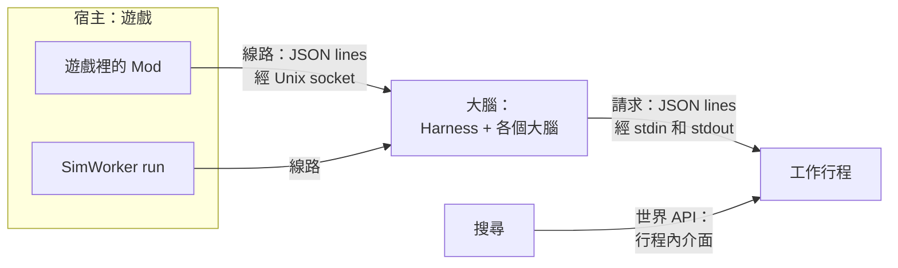

import { Aside } from '@astrojs/starlight/components';

專案的各個程式從不共用物件：遊戲、大腦和搜尋的工作行程在不同的行程裡執行，而大腦根本不能看到遊戲（[前言 §1](/zh-tw/#sec-1)）。它們共用的是一種語言，也就是組件 `Sts2Ai.Protocol`（`src/Sts2Ai.Protocol`）裡的型別。一個部分告訴另一個部分的每件事，都是這些型別之一，通常是一行 JSON。本章講的就是這種語言：每條訊息和每個欄位的含義，以及其中可以有什麼、不可以有什麼。

<Aside title="狀態">

已有：每個決策畫面的觀測，包括戰鬥和選牌提示；文字形式的動作；宿主與大腦之間的線路及其 SL 節點訊息，模擬器透過它打完整局，遊戲裡的 Mod 透過它給出建議；戰鬥世界 API；四種工作行程請求。規劃中：公開歷史的事件流、用於解釋的事實，以及推薦的 `degraded` 旗標（[§6](#sec-6)）。

</Aside>

## 1. 三種對話

這些型別服務三種對話：

| 對話 | 雙方 | 承載什麼 | 頁面 |
|---|---|---|---|
| 線路 | 一個**宿主**，也就是執行遊戲的行程（真實遊戲裡的 Mod，或承載一局的模擬器），和**大腦**，也就是決策行程 | hello、每個決策及其觀測和合法動作、推薦、一局的結束；SL 下還有節點的檢查點和決策 | [線路](/zh-tw/arch/protocol/wire/) |
| 工作行程請求 | 大腦的搜尋和模擬器的工作行程 | 每個請求一個單位的搜尋工作：一個戰鬥決策的一個世界、SL 規劃器的一個回合、複本上的一組試探 | [世界與工作行程訊息](/zh-tw/arch/protocol/worlds/) |
| 世界 API | 一次搜尋和它在其中打的世界 | 觀測、列出合法動作、執行、快照、還原 | [世界與工作行程訊息](/zh-tw/arch/protocol/worlds/) |

三種對話都承載的觀測和動作，有自己的一頁：[觀測與動作](/zh-tw/arch/protocol/observation/)。

## 2. 不認識遊戲的組件

`Sts2Ai.Protocol` 除了 .NET 框架之外什麼都不引用：沒有遊戲組件，也沒有其他專案。這正是它存在的全部意義。大腦（`Sts2Ai.Brain`）引用 Protocol，不引用任何遊戲的東西，而 Harness 引用 Brain，所以大腦能讀到的，永遠只有 Protocol 型別所承載的內容。讀取遊戲的 GameBridge 把遊戲翻譯成 Protocol 型別（[GameBridge](/zh-tw/arch/gamebridge/)）。

| 專案 | 引用 |
|---|---|
| `Sts2Ai.Protocol` | 無 |
| `Sts2Ai.Brain` | Protocol（以及網路用的 ONNX Runtime） |
| `Sts2Ai.Harness` | Brain，因此也有 Protocol |
| `Sts2Ai.GameBridge` | Protocol 和遊戲的組件 |
| `Sts2Ai.SimWorker` | 以上全部 |
| `Sts2Ai.Mod` | 把 GameBridge 和 Protocol 的原始檔編譯進自己裡面，並在遊戲內部執行 |

這條邊界檢查兩次：`BoundaryTests`（xUnit，不需要遊戲）和 `selftest` 的前兩項檢查，都會走訪 Brain、Protocol 和 Harness 編譯後的引用，只要其中任何一個連到遊戲組件就失敗；GameBridge 是對照組，它確實連到了（[模擬器：參考 §5](/zh-tw/arch/simulator/reference/#sec-5)）。

## 3. 裡面可以有什麼

一個 Protocol 型別就是大腦被允許知道的東西，所以放什麼進去是一個公平性的決定，而不是為了方便。規則如下：

- **只有玩家看得到的東西**。一個欄位之所以存在，是因為遊戲畫面顯示了它，或者它可以從畫面顯示過的內容推出。每個型別的文件註解都寫明遊戲在哪裡顯示它（`CombatObservation.cs:3-12`）。
- **從不包含隱藏狀態**：沒有種子、亂數流計數器、怪物排定的招式（只有它們的意圖）、玩家看不到的牌堆順序，也沒有存檔路徑。抽牌堆是一份排過序的清單；怪物顯示它的意圖，從不顯示它的招式（[觀測與動作 §3](/zh-tw/arch/protocol/observation/#sec-3)）。
- **沒有可能洩漏隱藏狀態的順序**。如果遊戲自己給一份清單的順序可能取決於隱藏的東西，這份清單就改用規範順序送出（[觀測與動作 §4](/zh-tw/arch/protocol/observation/#sec-4)）。
- **SL 的例外是明確寫出的**。SL 下大腦可以確切知道當前節點，所以有兩種訊息承載了 NoSL 永遠不可以知道的東西：節點檢查點，它的存檔包含這一局的種子和亂數流；以及工作行程請求裡的節點複本。兩者都由環境把關：NoSL 的一局會拒絕它們（[線路 §6](/zh-tw/arch/protocol/wire/#sec-6)），而搜尋只透過世界讀取它們，從不直接讀。

沒有逐欄位檢查它在遊戲裡可見的測試：這些規則靠審查、靠文件註解，以及靠下面的觀測往返來維持。一個新欄位到達玩家面前時，就在輸出一章的公平性表裡得到它的一列（[輸出 §6](/zh-tw/arch/output/#sec-6)）。

## 4. JSON 慣例

每條 Protocol 訊息都是由 `ProtocolJson`（`ProtocolJson.cs`）寫出的 JSON：

- 屬性名稱用 `snake_case`（`max_hp`、`decision_id`）；值為 null 的欄位省略；
- **列舉寫成數字**，因為沒有設定字串轉換器：`TurnEnd` 的 `status` 是 `0`、`1` 或 `2`；
- **字典的鍵保持原樣**：一張牌的 `vars` 保留遊戲的名稱（`"Damage"`、`"Block"`）；
- **`ulong` 寫成 JSON 數字**：雜湊、隱藏鍵和搜尋種子。JavaScript 讀取它們時會損失精度；.NET 和 Python 能精確讀取；
- 清單保留其中的 null：空的藥水槽在 `potions` 裡是 `null`；
- **戰鬥動作寫成文字**，`play:7:1`，透過它們自己的轉換器，所以日誌裡的一行讀起來就是那個動作本身。

兩個函式給出身份：

- `ProtocolJson.Hash(value)` 是 FNV-1a 64，一種快速的非加密雜湊，作用在值的 JSON 的 UTF-8 位元組上。它為一個觀測命名（`obs_hash`，16 位十六進位數字）、為一局命名（`run_id`，取自種子的 JSON 字串），也為一場戰鬥的隱藏狀態命名（世界的隱藏鍵）。因為它雜湊的是 JSON，所以它取決於序列化：型別相差一個欄位的兩個建置，會把同一個觀測雜湊成不同的值，大腦就是用這一點來抓出從另一個 commit 建置的宿主（[線路 §5](/zh-tw/arch/protocol/wire/#sec-5)）。
- `ProtocolJson.CardKey(card)` 是這張牌去掉 uid 的 JSON：玩家看得到的這張牌的一切。鍵相同的兩張牌，對玩家來說是同一張牌；每份順序不得取決於隱藏狀態的清單，都按它排序。

## 5. 測試

| 檢查什麼 | 在哪裡 |
|---|---|
| 邊界：Brain、Protocol 和 Harness 連不到任何遊戲組件 | `BoundaryTests`；`selftest` |
| 每個戰鬥觀測和每個戰鬥動作都能通過 JSON 往返，以文字和以 JSON 形式皆然 | `selftest`，每場戰鬥（[模擬器：參考 §5](/zh-tw/arch/simulator/reference/#sec-5)） |
| 一局的每個觀測都能通過 JSON 往返，而且同一局給出相同的觀測雜湊 | `run --check`（[模擬器：整局 §6](/zh-tw/arch/simulator/runs/#sec-6)） |
| 一局在行程內和透過線路打出來一樣：軌跡、觀測、對局記錄、決策日誌 | `run --check` |
| 大腦在 NoSL 下拒絕節點訊息；節點複本保留連戰的規則 | `DispatcherTests` |
| 線路版本：讀取時拒絕另一個 `v` 的訊息 | `WireStream.Receive` |
| 宿主送出的 SL 決策在它們的複本上重播時，得到相同的觀測 | 對 `brain --wire` 日誌執行 `clones`（[Mod：SL 紀錄 §8](/zh-tw/arch/mod/sl-record/#sec-8)） |

## 6. 規劃中

- **事件流**。每條 `decision` 將帶有自上一條以來的公開事件（抽到和移動的牌、顯示過的意圖、看過的畫面），讓對隱藏狀態的信念可以從中建立（[觀測與動作 §8](/zh-tw/arch/protocol/observation/#sec-8)）。
- 推薦裡的**事實**：解釋的唯一來源，只有在 SL 下才是確切的（[線路 §7](/zh-tw/arch/protocol/wire/#sec-7)）。
- **`degraded`**：在出問題時給出的推薦，例如失去了一個工作行程。目前失去工作行程會讓這個決策失敗（[模擬器：工作行程池 §6](/zh-tw/arch/simulator/pool/#sec-6)）。

## 7. 本章

| 頁面 | 講什麼 |
|---|---|
| [線路](/zh-tw/arch/protocol/wire/) | 宿主與大腦之間的對話：它的 socket、每條訊息和每個欄位、一步一步走完的一局、規則、SL 節點訊息、推薦、兩種宿主有何不同 |
| [觀測與動作](/zh-tw/arch/protocol/observation/) | 每個決策的觀測：一局、一場戰鬥、卡牌身份與規範順序、每個畫面及其動作、選牌提示及其情境、省略了什麼 |
| [世界與工作行程訊息](/zh-tw/arch/protocol/worlds/) | 搜尋在其中打的世界 API、節點複本和敵人出招記錄，以及四種工作行程請求和它們的回答 |

未決問題：

1. 事件流該多細：從信念需要的開始，按需擴充。
2. 工作行程的管道是否需要二進位編碼；只有效能分析顯示 JSON 佔主要開銷時才需要。
3. 還有什麼要進入觀測：事件文字裡的數字（需要按事件的白名單，因為有些事件保有頁面上不顯示的數值）、卡牌獎勵的稀有度提示、轉化在確認之前顯示的預覽。
