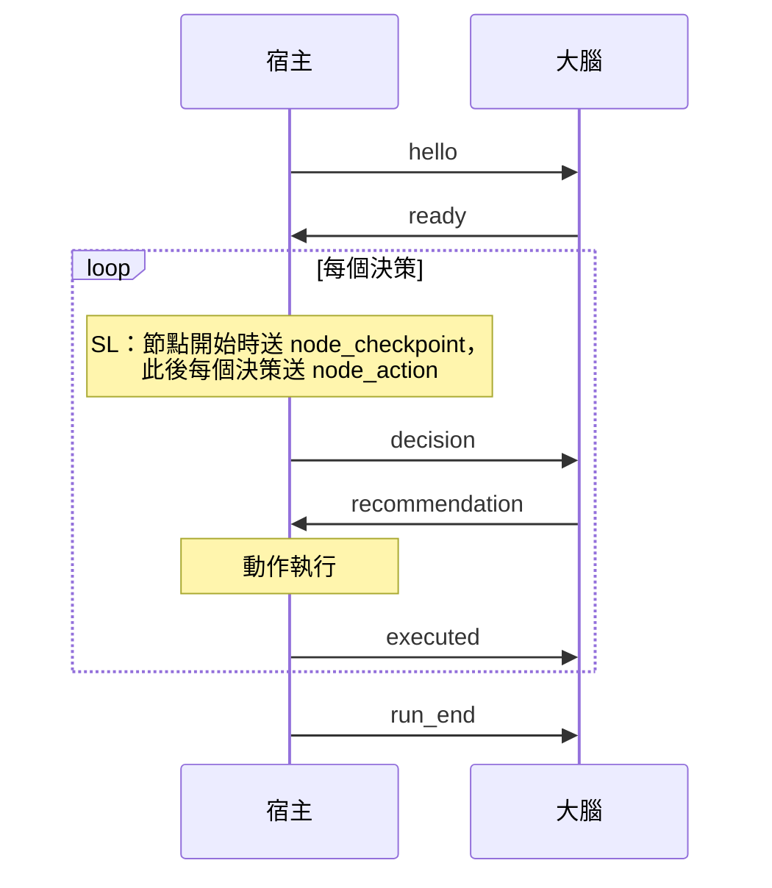

import WireExchange from '../../../../../components/book/WireExchange.svelte';

大腦從不在遊戲裡面執行。遊戲那一側，也就是**宿主**，每個決策問它一個問題，得到一個回答。宿主是真實遊戲裡的 Mod，或承載一局的模擬器（`run --brain`）；**大腦**是 Harness 加上冠軍的各個大腦，由 `brain` 指令提供服務（[模擬器：整局 §8](/zh-tw/arch/simulator/runs/#sec-8)）。兩端用同一批型別（`Sts2Ai.Protocol/Wire.cs`），所以不管是哪個宿主在問，一局都打得一樣。

## 1. 連線

- **Unix domain socket**，從不用 TCP，所以本機以外的任何東西都碰不到大腦。預設是 `$XDG_STATE_HOME/sts2ai/brain.sock`，那個變數沒有設定時是 `~/.local/state/sts2ai/brain.sock`（`BrainSocket.DefaultPath`）：Steam 在一個容器裡執行遊戲，這個容器和主機系統共用家目錄，但不共用 `$XDG_RUNTIME_DIR`。
- **大腦負責監聽**（`BrainServer.Listen`，`Sts2Ai.Harness/BrainServer.cs`）。它建立 socket 所在的目錄，只有使用者本人可讀；取代已經不在的大腦留下的 socket 檔案；如果還有大腦在那裡監聽，就拒絕啟動。以 NUL 位元組開頭的路徑指名一個抽象 socket，它沒有檔案：`run --check` 為它的行程內大腦用的就是這種。
- **一次一個宿主**。大腦服務一條連線，直到宿主關閉它，再接下一條。位元組不是有效訊息的連線會被丟棄並留下一條警告，大腦則繼續監聽。
- **一局接一局**。一條連線依序承載多局，每局從 `hello` 到 `run_end`。

## 2. 格式

每條訊息是一行 UTF-8 JSON（`WireStream`）。第一個屬性是 `type`，訊息的種類；第二個是 `v`，協定版本，目前是 1；接著是訊息的各個欄位，按宣告的順序，用 `snake_case`，值為 null 的欄位省略（[概覽 §4](/zh-tw/arch/protocol/#sec-4)）：

```json
{"type":"executed","v":1,"decision_id":0,"action":"event:0","ok":true}
```

任何不相容的改動都會提升版本號。讀取方拒絕 `v` 不是自己版本的訊息。在同一個版本內，一方不認識的欄位會在讀取時被丟掉；這時觀測雜湊就會不同，所以從與大腦不同的 commit 建置的宿主，會在它的第一個決策就失敗，並附上說明原因的訊息（[§5](#sec-5)）。

## 3. 訊息

| 型別 | 方向 | 欄位 | 含義 |
|---|---|---|---|
| `hello` | 宿主 → 大腦 | `game_version`、`env`（`"NoSL"` 或 `"SL"`）、`role`（`"mod"` 或 `"worker"`）、`run`：`{run_id, character, ascension}` | 一局開始；環境在整局中固定不變 |
| `ready` | 大腦 → 宿主 | `champion` | 大腦接下這一局，並指名打這一局的冠軍 |
| `decision` | 宿主 → 大腦 | `decision_id`、`obs_hash`、`surface`、`obs`、`legal` | 一個決策點：畫面的種類、觀測（[觀測與動作](/zh-tw/arch/protocol/observation/)）、合法動作；選牌提示的 `legal` 為空，它的回答是 `pick:i,j,…` |
| `recommendation` | 大腦 → 宿主 | `decision_id`、`obs_hash`、`action`、`brain`、`plan`?、`candidates`? | 回答（[§7](#sec-7)） |
| `executed` | 宿主 → 大腦 | `decision_id`、`action`、`ok`、`error`? | 一個決策的動作已經執行 |
| `cancel` | 宿主 → 大腦 | `decision_id` | 回答到來之前，遊戲已經往前走了 |
| `run_end` | 宿主 → 大腦 | `won`、`floor`、`reason` | 一局結束；`reason` 是 `won`、`lost`、`truncated`（決策上限）、`failed` 或 `aborted` |
| `error` | 大腦 → 宿主 | `message` | 代替 `ready` 或 `recommendation`：大腦接不了這一局，或答不了這個決策；宿主結束這一局 |
| `node_checkpoint` | 宿主 → 大腦 | `node_index`、`checkpoint`、`gauntlet`? | 僅 SL：一個節點開始（[§6](#sec-6)） |
| `node_action` | 宿主 → 大腦 | `node_index`、`seq`、`action` | 僅 SL：在節點內做出的一個決策（[§6](#sec-6)） |

`run_id` 是種子 JSON 字串的 `ProtocolJson.Hash`，寫成 16 位十六進位數字（`RunHeader.IdOf`）：大腦可以用這個 id 區分各局、為自己的亂數流設定種子，卻無法從中得知種子（[Harness：路由、預算與種子 §5](/zh-tw/arch/harness/routing/#sec-5)）。`decision_id` 在每局裡從 0 開始計數。`obs_hash` 是觀測的雜湊，寫成 16 位十六進位數字。

## 4. 一局，一步一步



本書範例對局的開頭，就是在 SL 下承載它的模擬器會送出的樣子：

<WireExchange client:visible lang="zh-TW" />

## 5. 往來的規則

**回答與遊戲保持同步**。

- 大腦按順序回答決策，每個都在讀下一條訊息之前回答。`decision_id` 不大於上一個的決策會得到 `error`（`BrainServer.cs:101-105`）。
- 大腦檢查 `obs_hash` 是不是它收到的 `obs` 的雜湊。不符表示觀測在傳輸途中走了樣，最常見的原因是兩端從不同的 commit 建置，這會得到一條說明這一點的 `error`。
- 推薦會重複決策的 id 和雜湊。只要其中一個不同，模擬器這個宿主就讓這一局失敗；Mod 按決策 id 保存回答，只有在遊戲仍然顯示同一個觀測和同一份合法清單時才顯示它（[§8](#sec-8)）。
- 動作必須是這個決策的合法動作之一（對選牌提示來說，是提示接受的選擇）；Harness 拒絕其他任何東西，所以不合法的回答會以 `error` 的形式到達宿主。

**`error` 的含義**。大腦拒絕這一局時（一個它的冠軍打不了的環境，例如 NoSL 的一局裡的 SL 規劃器），送出 `error` 代替 `ready`；答不了時，送出它代替推薦：一局之外的決策、沒有涵蓋的決策介面（surface）、不合法的選擇、對不上的雜湊、在被拒絕的節點訊息之後的決策。宿主隨後結束這一局：模擬器的這一局失敗；Mod 送出帶 `failed` 的 `run_end`，並在這一局裡關閉助手。

**`executed` 和 `cancel`**。模擬器這個宿主在遊戲到達下一個決策或一局結束之後，才為一個決策送出 `executed`；只有這一局失敗時 `ok` 才為 false。大腦讀取這兩種訊息，然後忽略它們：它在往下讀之前就回答了每個決策，所以永遠沒有需要丟棄的搜尋。Mod 只給建議、從不行動，所以它不送 `executed`；回答到達之前遊戲已經往前走時，它送出 `cancel`，並等到那個回答到了才再問。

**對局**。一局中途的 `hello` 會開始新的一局：大腦丟掉舊一局的 Harness。在 `run_end` 時，`brain` 指令寫出這一局的決策日誌，並為它印出一行。各宿主的結束原因：模擬器以 `won`、`lost`、`truncated` 或 `failed` 結束一局；Mod 則是 `won`、`lost`、`failed`，或者在玩家中途切換環境或關掉助手時是 `aborted`。

## 6. SL：節點訊息

SL 下大腦可以確切知道當前節點；一個節點是一個地圖點，從抵達開始，到離開它的那次移動為止（[環境：資訊與節點 §3](/zh-tw/arch/environments/information/#sec-3)）。宿主用兩種訊息送出大腦重建它所需要的東西，也就是節點的複本（[模擬器：世界與 SL 複本 §3](/zh-tw/arch/simulator/worlds/#sec-3)）：

- **`node_checkpoint`**，在節點開始時送出：`node_index`（從 0 起算，從宿主看到的第一個節點算起；Mod 可能中途才加入一局）；`checkpoint`，一個本身就是一份 JSON 的字串，包含抵達時遊戲的存檔和每個遺物的簡單欄位；以及 `gauntlet`，在按菁英連戰規則進行的一局裡為 true，讓複本保留這條規則。Mod 從不設定它。
- **`node_action`**，節點內做出的每個決策一條：`seq`，在節點內從 0 起算；以及決策的軌跡形式：決策介面、一個空格，然後是動作（`map 0,1`、`combat play:7:1`）。選牌提示的一步是 `card_choice`，選擇用遊戲自己的索引表示，而不是 `pick:` 的規範索引（[觀測與動作 §4](/zh-tw/arch/protocol/observation/#sec-4)），因為複本透過遊戲的選牌器重播它。

**時機**。兩者都是延後送出的，就在下一個決策之前：如果此後開始了新節點，先送檢查點，再送節點裡每個還沒送出的決策（`Brains/RunBrains.cs:88-99`）。因此一個節點的移動，也就是它的最後一個決策，永遠不會被送出：下一個決策在下一個節點裡，而那個節點以它自己的檢查點開始。

**規則**（`Sts2Ai.Harness/Dispatcher.cs:182-197`）：NoSL 的一局裡的節點訊息會被拒絕；節點索引必須遞增；`seq` 必須等於節點到目前為止的動作數；在任何檢查點之前出現的 SL 戰鬥決策是錯誤。大腦不回答節點訊息：被它拒絕的節點訊息，會讓這一局的下一個決策帶著原因失敗。

**SL 放行了什麼**。檢查點承載遊戲的存檔，而存檔包含這一局的種子和亂數流，所以在 SL 下，種子終究還是到了大腦這裡。SL 可以知道它：節點的結果就是遊戲自己的結果（[環境：資訊與節點 §2](/zh-tw/arch/environments/information/#sec-2)）。大腦只透過在工作行程裡載入檢查點來讀它，也就是作為一個在節點出口封存的複本。

## 7. 推薦

```csharp
public sealed record Recommendation(long DecisionId, string ObsHash, string Action, string Brain,
    IReadOnlyList<string>? Plan = null, IReadOnlyList<Candidate>? Candidates = null) : WireMessage;

public sealed record Candidate(string Action, double Value, double Ci, int Samples,
    IReadOnlyList<double>? Values = null, IReadOnlyList<int>? Nodes = null);
```

| 欄位 | 含義 |
|---|---|
| `action` | 這個決策的合法動作之一；對選牌提示是 `pick:i,j,…` |
| `brain` | 選出它的大腦，用冠軍路由表裡的名稱（[Harness：路由、預算與種子 §1](/zh-tw/arch/harness/routing/#sec-1)）；宿主按大腦統計決策數寫進對局記錄，其中佔位決策必須一個都沒有（[評估：指標、種子與報告 §2](/zh-tw/arch/evaluation/metrics/#sec-2)） |
| `plan` | 大腦在這個動作之後的計畫：會搜尋的戰鬥大腦給出本回合剩下的部分，地圖上的宏觀大腦給出本幕剩下的路線 |
| `candidates` | 只來自會搜尋的大腦：它評過分的第一個動作，最好的在前 |

一個 `Candidate`（`World.cs:59`）是一個評過分的動作：`value`，它在各個世界上的平均值；`ci`，它 95% 信賴區間的半寬；`samples`，世界的個數；以及搜尋保留了它們時的 `values`，它在每個世界裡的值，和 `nodes`，它在每個世界裡用掉的搜尋節點數。計畫和候選動作也正是決策日誌所保存的（[Harness：決策日誌 §5](/zh-tw/arch/harness/decision-log/#sec-5)），以及輸出顯示給玩家的（[輸出 §2](/zh-tw/arch/output/#sec-2)）。

**規劃中**：

- `facts`：解釋的唯一來源。每條事實將是一個種類和它的數字，只有在 SL 下才標為確切，因為 SL 的事實可以是確切的結果（[環境：世界 §7](/zh-tw/arch/environments/worlds/#sec-7)）。
- `degraded`：在出問題時給出的回答，例如失去了一個工作行程（[Harness：路由、預算與種子 §6](/zh-tw/arch/harness/routing/#sec-6)）。

## 8. 兩種宿主

| | 模擬器（`run --brain`、`run --check`） | 遊戲裡的 Mod |
|---|---|---|
| `role` | `worker` | `mod` |
| 何時提問 | 在一局到達的每個決策 | 畫面靜止 3 個影格之後（同一個觀測雜湊和同一份合法清單），一次一個決策 |
| 對回答做什麼 | 打出它 | 顯示它；由玩家行動 |
| `executed` | 每個動作之後 | 從不 |
| `cancel` | 從不 | 畫面先變了的時候 |
| 節點訊息 | SL 下，在每個決策之前 | SL 下，在每個決策之前 |
| 大腦送來的 `error` | 這一局失敗 | `run_end` `failed`；這一局剩下的部分助手都關閉 |
| `run_end` 的原因 | `won`、`lost`、`truncated`、`failed` | `won`、`lost`、`failed`、`aborted` |

Mod 那一側在 [Mod：主迴圈 §8](/zh-tw/arch/mod/loop/#sec-8) 和 [Mod：SL 紀錄 §7](/zh-tw/arch/mod/sl-record/#sec-7) 裡說明：它只在單人遊戲的對局裡執行，並且只在它建置時所針對的遊戲版本上執行。
