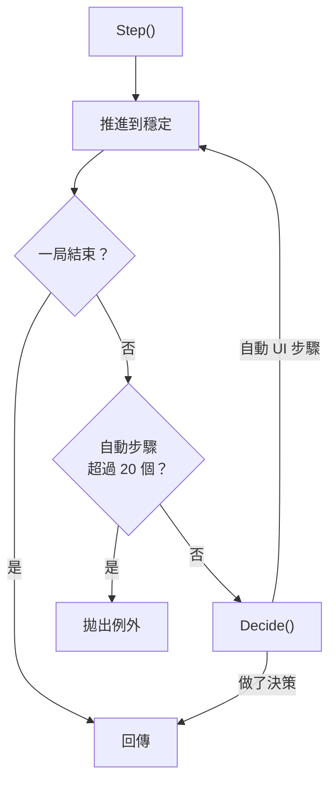

import { Aside, Badge, Steps } from '@astrojs/starlight/components';

模擬器就是 `Sts2Ai.SimWorker`：一個普通的 .NET 行程，載入遊戲自己的 `sts2.dll`，以**無頭**（headless）方式執行遊戲規則，沒有 Godot 引擎、視窗、渲染和聲音。規則就是遊戲本身的程式碼，不是重寫的（[總覽 §1](/zh-tw/#sec-1)，約束 4）。決策行程從不載入遊戲，而是與模擬器行程通訊（[總覽 §3](/zh-tw/#sec-3)）。

<Aside title="狀態">

已有：無頭宿主、單場戰鬥工作階段、Determinize、CombatBuilder、整局工作階段、戰鬥世界（[§6](#sec-6)）、SL 節點複本（[§7](#sec-7)），以及給 PIMC 的 NoSL 和 SL 世界、給 SL 規劃器的各個回合用的 worker 行程池（[§8](#sec-8)）。規劃中：整局世界。

</Aside>

一個 worker 行程有三種角色：

- **(a)** R1–R3 中「真實」一局的宿主（R1–R3 是[模擬到實機階梯](/zh-tw/arch/evaluation/#sec-1)中由模擬器而不是真實遊戲來玩這一局的幾級）；
- **(b)** 搜尋世界：NoSL 樣本和 SL 複本（[環境 §5](/zh-tw/arch/environments/#sec-5)）；
- **(c)** 基準測試和 selftest。

每個行程同一時刻只持有**一個活著的一局或一場戰鬥**。遊戲把一局和戰鬥放在行程級單例（`RunManager`、`CombatManager`）裡，所以第二局無法與第一局並存。因此分支靠重播來做（[§2](#sec-2)），並行搜尋需要多個行程（[§8](#sec-8)）。

像 `Runs/RunManager.cs:295-312` 這樣的檔案引用指向反編譯出的遊戲組件。Godot 節點檔案（`NGame.cs`、`NRestSiteRoom.cs`）按檔名唯一，所以只寫檔名。

## 1. 無頭宿主

遊戲是一個 Godot 應用。規則寫在受控 C# 裡（「模型層」），介面寫在 Godot 節點裡。無頭執行時只跑模型層。這要靠三樣東西：原生引擎的存根（stub）、一組 Harmony 補丁（在執行時改寫遊戲方法），以及遊戲自帶的 `TestMode`：這是遊戲為自動化測試準備的開關，開啟後大部分模型程式碼會跳過表現層。

`HeadlessGame.Boot` 每個行程執行一次：

<Steps>

1. `GodotNativeStub.Install`。GodotSharp 透過一張原生函式指標表存取引擎。沒有引擎時，存根把每個槽都填成同一個回傳清零記憶體的小函式，於是碰到 Godot 的受控程式碼可以無副作用地跑過去。
2. `HeadlessPatches.Apply`：安裝下面列出的各組補丁。
3. `TestMode.TurnOnInternal`。
4. `ModManager.State=Skipped`：無頭時從不載入 Mod。
5. `AssemblyInfo.Init`、`ModelDb.Init`、`ModelIdSerializationCache.Init`、`ModelDb.InitIds`：載入遊戲的模型資料庫。
6. `LocalContext.NetId=1`。
7. 測試用的設定和偏好，`FastMode=Instant`。

</Steps>

遊戲的 `Log.Error` 輸出和未觀察到的任務例外都會被收集起來，selftest 斷言它們為零。

補丁分組（`HeadlessPatches.cs`）：

| 分組 | 作用 |
|---|---|
| 引擎外殼 | 用受控外殼代替引擎：OS、Time、單例、資源、本地化、玩家名 |
| 資源預載入 | 關閉 |
| 表現層 | 模型程式碼中沒有 TestMode 守衛就進入表現層的地方：Kaiser Crab 的手臂、SoulNexus、`EventPresentation` 轉譯器（[§5.2](#sec-5.2)） |
| 持久化 | 關閉：`SaveRun`、進度、重播。任何磁碟 IO 都會拋出例外。 |
| 規則保真 | 恢復被 TestMode 改掉的正式版規則：RollingBoulder 逐個敵人命中；`ShippedBranch` 轉譯器在 MerchantPotionEntry、Cauldron、CallingBell 中把 TestMode 分支換回正式版分支 |
| 速度 | `FastCreatures`、`FastPlayerCreatures`、`FastPlayers`；`FastHookListeners`，透過反向補丁與遊戲原本的監聽器逐一比對 |
| 選擇 | `ChooseABundle`、`CrystalSphereScreen`、`CardRemovalUsed`；另有 GameBridge 的 `ChoiceContexts`，最先打補丁（[GameBridge §5](/zh-tw/arch/gamebridge/#sec-5)） |

轉譯器（transpiler）是一種 Harmony 補丁，它直接改寫方法的 IL，而不是在方法外面包一層。

**JIT。** csproj 裡設了 `TieredCompilation=false`。開啟分層編譯時，執行時會在背景重新 JIT 熱點方法，曾有一次重新 JIT 在幾千場戰鬥之後悄悄丟掉了一個 Harmony 補丁。啟動時還要設 `DOTNET_ReadyToRun=0`（快約 20%）。

**Pump。** `Pump` 是一個單執行緒的 `SynchronizationContext`。遊戲的非同步程式碼（動作、鉤子、命令）把後續回呼投遞給它，驅動方 pump 時，這些回呼全部在驅動執行緒上執行。沒有任何東西在別的執行緒上跑，事件順序因此固定：確定性正是從這裡來的。`RunUntil(cond)` 一直 pump 到條件成立；`Drain()` 執行佇列裡的全部回呼。**推進到穩定**（settle）指一直 pump，直到遊戲再次等待玩家操作。

**執行方式。** 把 `HOME` 設成一個臨時目錄，並設 `DOTNET_ROOT=~/.dotnet`。可執行檔案是 `src/Sts2Ai.SimWorker/bin/Release/net9.0/Sts2Ai.SimWorker`。

**命令列。** `--help` 列出所有命令，`COMMAND --help` 列出一個命令的選項（System.CommandLine）。每個命令是一個類別，帶著自己的選項；幾個命令共用的選項組（配裝、遭遇池、預算、葉節點、冠軍）在 `Args.cs` 裡。stdout 只輸出命令的結果，供腳本讀取（`serve` 的 stdout 就是線路）。日誌（Microsoft.Extensions.Logging）寫到 stderr，每條一行，預設 Information 及以上；`--verbose` 再加上 Debug：遊戲自己的日誌。失敗的戰鬥或對局會以 Error 記下呼叫堆疊；若是 worker 裡的某個世界失敗，還附上 worker 的完整例外。罕見的失敗未必會再出現。結束代碼：0 完成；1 完成但有失敗（戰鬥或對局失敗、晉級門檻沒通過）；2 命令列或它指定的檔案有錯，報一行；70 程式 bug，附呼叫堆疊。

| 命令 | 作用 |
|---|---|
| `list` | 列出本遊戲版本裡的角色、幕和遭遇 |
| `combat --encounter ID` | 跑一場戰鬥，印出每一步 |
| `combat --from OBS.json` | 同上，但從一場按該觀測建構的戰鬥開始（[§3](#sec-3)） |
| `run` | 跑整局（[§5](#sec-5)）；`--policy pimc` 讓戰鬥大腦在 worker 裡打其中的戰鬥（[§8](#sec-8)），`--macro l0` 讓宏觀大腦做其餘決策 |
| `report` | 用對局記錄生成評估報告（[評估 §6](/zh-tw/arch/evaluation/#sec-6)） |
| `gate` | 用挑戰者的對局記錄對比冠軍的報告，以及它的晉級（[評估 §5](/zh-tw/arch/evaluation/#sec-5)） |
| `leaderboard` | 從報告生成排行榜（[評估 §2](/zh-tw/arch/evaluation/#sec-2)） |
| `seeds` | 輸出一個種子集的種子（[評估 §4](/zh-tw/arch/evaluation/#sec-4)） |
| `weights` | 把 V 的初始權重輸出成權重檔案（加 `--leaf` 則輸出 PIMC 的預設葉節點權重），供調參起步（[學習 §2](/zh-tw/arch/learning/#sec-2)） |
| `bench` | 在一個遭遇池上跑大量戰鬥：吞吐量和失敗數（[§4](#sec-4)） |
| `selftest` | 檢查確定性、恢復、確定化等（[§9](#sec-9)） |
| `forkbench` | 一次恢復和一個搜尋分支的開銷（[§4](#sec-4)） |
| `panel` | 固定的戰鬥測試集：佔位策略或戰鬥大腦，每個玩家用同樣的種子（[戰鬥大腦 §7](/zh-tw/arch/combat-brain/#sec-7)） |
| `fusion` | 融合測試集：取決策日誌裡的 NoSL 戰鬥決策，比較 PIMC 值和合併後的值（[戰鬥大腦 §8](/zh-tw/arch/combat-brain/#sec-8)） |
| `fidelity` | 從觀測建構的戰鬥打起來和真實戰鬥有多接近，取樣的部分除外（[§6](#sec-6)） |
| `serve` | 作為 worker 執行：從 stdin 讀 JSON 行請求，在 stdout 回覆（[§8](#sec-8)）；`--leaf FILE` 設定它搜尋用的葉節點權重，`--combat-net FILE` 設定學到的葉節點 |

所有會跑戰鬥的命令都接受配裝選項（角色、牌組、遺物、藥水、生命值）。

## 2. 戰鬥工作階段

戰鬥工作階段在真實引擎裡跑一場戰鬥。它由 `CombatSetup(Character, Encounter, ActIndex, Seed, Ascension, Loadout?, From?)` 描述，啟動過程如下：

1. `Player.CreateForNewRun(ch, UnlockState.all)`，然後套用配裝；
2. 用 `MockSinglePointActMap` 呼叫 `RunState.CreateForTest`；
3. `RunManager.SetUpTest`；
4. `EnterRoomDebug(Monster, encounter)`。

這**不是**真實的移動路徑：它跳過了 `?` 擲骰及其機率，也跳過了 `GenerateRooms` <Badge text="已核實" variant="success" />。對孤立的戰鬥沒問題，對整局則是錯的，整局有自己的開局方式（[§5](#sec-5)）。

**快照與恢復。** 快照是一份配方，而不是遊戲物件的複製：`(Setup, Trace)`。軌跡（trace）的每一項是 `Action`、`Choice(game indexes)`、`Determinize(seed)` 三者之一。恢復時，按 setup 重新開一場戰鬥，再重播軌跡。相同的 setup 和軌跡總是得到相同的狀態，因為所有隨機性都來自帶種子的亂數流。`Rng.Chaotic`（用時鐘做種子）只影響外觀 <Badge text="已核實" variant="success" />：造型、螢幕震動、對白、Trial 的參賽者編號、YummyCookie 圖示、加牌動畫的時間。

**確定化。** `Determinize(seed)` 把玩家不可能知道的一切換成由 `seed` 抽出的樣本，可見狀態保持不變。只從確定化狀態出發分支的搜尋用不到真實的未來，不同的種子給出不同但合理的未來。種子只來自呼叫方，絕不來自本局。它呼叫 `Resample(new Rng(seed))`，做以下幾件事：

- 為每條 `RunRngType` 流、每條 `PlayerRngType` 流和每個怪物的 `Rng` 重新播種；
- 重排抽牌堆：先按卡牌鍵排序（這個順序只取決於玩家看得到的東西），再做一次 Fisher–Yates 洗牌；
- 給手牌以外的牌重新編號（`CombatBuilder.NumberCards`）。遊戲按抽牌順序給牌編號，舊 id 會洩漏真實的抽牌順序；
- 對每個敵人，在顯示相同意圖的動作中均勻地重新抽取 `NextMove`，並把狀態日誌的最後一項（`StateLog[^1]`）改成與之一致。

**執行。** `Execute` 透過 `CombatActions.Start`（UI 入口）發起動作，然後推進到穩定：一直 pump 到 `WaitingForInput` 或戰鬥結束。

**uid。** 動作用 uid 指代卡牌和生物：手牌用它的 `NetCombatCardDb` id，生物用它的 `CombatId`。例如 `play:7:2` 表示把 7 號牌打向 2 號生物。因為編號是確定的，重播也是確定的。

## 3. CombatBuilder

`CombatBuilder` 建構一場顯示給定觀測的戰鬥。`CombatBuilder.Setup(obs, seed)` 的步驟：

1. 用觀測裡的牌組、遺物和生命開始這場遭遇。開戰時的效果可能殺死生命很低的玩家（Royal Poison 在第一回合開始時造成 4 點傷害，而每次建構都從第一回合開始），死去的玩家的遺物、能力和卡牌不再起作用；這樣的戰鬥會以滿生命重新開始，再由 `Apply` 照常設成觀測的生命。按開戰時生命設標誌的遺物（Red Skull 的力量）這時可能不對，只有這種罕見的開局才有這個風險；
2. `Apply` 覆蓋可見狀態：回合數；敵人（增、刪、排序）；生命值和格擋；能量；金幣；藥水；充能球欄位和充能球，連同它們顯示的數值；遺物計數器（顯示的或隱藏的）和已用盡的遺物；遺物儲存的牌（Pael's Tooth 的牌，它的計數就是牌數），用標準副本，因為提示裡看不出升級，而且這些牌要到戰鬥之後才回來；能力，圖示顯示別的數字時連同層數，以及能力儲存的牌；4 個牌堆及每張牌的修改；意圖；
3. `Resample(StableHash(seed))` 抽取隱藏狀態；
4. `BuildDifferences` 按 JSON 路徑比較輸入觀測與重建後戰鬥的觀測。為空表示完全一致。

細節：

- **旋鈕求解。** 顯示出來的數字由內部數字推出，每種能力或遺物的推法都不同。建構器逐個嘗試這些數字（數值、動態變數、欄位，以及能力內部資料裡的整數和小數欄位，例如 `HARDENED_SHELL_POWER` 本回合已受的傷害），直到顯示一致。觀測中已用盡的遺物（用過的 `LIZARD_TAIL`、飛行次數用完的 `WINGED_BOOTS`）也這樣處理：在它的計數之後，逐個嘗試它的整數和布林欄位，直到重建的遺物同樣用盡、計數仍與觀測一致。`SILVER_CRUCIBLE` 要計數用完、並且進過財寶房之後才算用盡。
- **意圖。** 建構器在顯示所觀測意圖的動作中選擇。被眩暈的敵人會得到一個合成的眩暈動作，做法與 `Creature.StunInternal` 相同（`FollowUpStateId = StateLog.Last().Id`）。先搜尋能力裡隱藏的列舉開關（例如 `SurroundedPower._facing`），再搜尋怪物自己的整數欄位（例如瀑布巨人的壓力槍傷害，每開一次火就漲一次），使匹配的敵人數最多。
- **uid** 與觀測對齊；其他牌編在它們之後。
- 玩家之外的**盟友**像敵人一樣建構：遺物帶來的寵物在戰鬥開始時就加入，按怪物 id 對上；缺的那個按召喚的方式成為玩家的寵物加入。任何角色都能用別的角色卡池裡的牌召喚 Osty（`KALEIDOSCOPE` 會給這種牌），在建構盟友之前，這讓 g1 的 165 局裡失敗了一局。
- **費用。** 牌自己的費用這樣設：疊上全域修正（能力、遺物）之後得到顯示的費用；它可以低於 0。攻擊藥水讓一張 `PINPOINT` 本回合免費，本回合每打出一張技能牌它還會再少 1 費；被纏繞（`TANGLED_POWER` 加 1）之後它仍顯示 0。把牌自己的費用截在 0 讓 g1 的 452 局裡失敗了一局。
- **出招日誌。** 怪物按它出過的招選下一招（同一招不連出三次、固定循環），而新開的戰鬥日誌是空的。`Setup(obs, seed, history)` 拿到每個敵人在每一回合開始時顯示的記錄（[Harness §6](/zh-tw/arch/harness/#sec-6)），給每個怪物它的日誌：先是之前每一回合的招，再是當前這一招。之前某一回合匹配顯示相同意圖的招，否則匹配意圖型別和段數相同的招，再否則只匹配型別相同的招，因為數值會隨怪物的力量增長。有某一回合匹配不到任何招的怪物，保留新開的日誌。眩暈和遊戲裡一樣不進日誌：顯示為眩暈的回合跳過；當前被眩暈的怪物，眩暈之後接著打它在本回合開始時顯示的那一招。沒有記錄時，每個怪物都是新開的日誌。
- **近似（缺口）**：本回合的歷史，以及能力和怪物內部的計數器；費用修正的持續時間；玩家減益的衰減；沒有記錄時眩暈動作的後續；牌組 = 見過的所有牌，包括生成的牌。`fidelity` 在模擬器裡衡量它們的代價（[§6](#sec-6)）；從未在真實遊戲的觀測上驗證過。

selftest 矩陣（2026-10-27），所有檢查都通過：

| 組合 | 戰鬥數 |
|---|---|
| SILENT | 60/60 |
| IRONCLAD | 58/58 |
| SILENT，菁英 + 頭目，第 0 / 1 / 2 幕 | 57 / 57 / 58 |

## 4. 效能

測於 2026-10-26，Release 建置，`DOTNET_ReadyToRun=0`。

**戰鬥**（`bench`，第 0 幕弱遭遇 + 普通遭遇，`play` 策略）：

| 角色 | 戰鬥數 | 戰鬥/秒 | 動作/秒 | 每場用時 |
|---|---|---|---|---|
| SILENT | 5000 | 319 | 10.3k | 3.1 ms |
| IRONCLAD | 2000 | 379 | | |

短批次（n=200）約 6.7 ms 一場：主要耗在啟動和 JIT 預熱上。

**分支**（`forkbench`）。一個搜尋分支 = 一次恢復 + 一次確定化 + 用佔位策略推演（rollout）到戰鬥結束。

| 指標 | 數值 |
|---|---|
| 恢復 | 0.28 ms + 每個重播動作 0.073 ms |
| 分支 | 中位數 2.78 ms，p90 3.97 ms |
| 平均根深度 / 平均推演長度 | 15.8 / 16.6 個動作 |
| 吞吐量 | 每核 329 分支/秒 |

**搜尋 worker 的時間花在哪裡。** 在一次整局門檻的某個 worker 上取樣 40 秒（2026-10-27：從觀測建構的 NoSL 世界，戰鬥網路 c2，16 個執行緒上 4 個對局各 8 個 worker），worker 87% 的時間在搜尋，其餘在等請求。恢復世界佔 48%：從 setup 開始戰鬥 38%（進房間 9%，套用觀測 8%，重取樣 4%，比較建構結果與觀測 10%），重播這條線 7%，確定化 4%。執行搜尋的動作佔 16%，建觀測 16%（不算那次比較是 11%），戰鬥網路 5%。恢復不再比較建構結果——同一請求的第一次建構已經檢查過（提交 `5032064`）：冠軍的對局完全相同，在那樣的負載下快 7%。

**多行程**（每個行程 `bench` n=3000；掛鐘時間包含約 1.2 s 啟動）：

| 行程數 | 戰鬥/秒 |
|---|---|
| 1 | 275 |
| 4 | 1060 |
| 8 | 1860 |
| 12 | 1879 |
| 16 | 2019 |

機器有 8 個實體核心；SMT 約多 8%。預設行程池為 8 個行程。每個 worker 約佔 160 MB 記憶體。

**整局**（`run`：SILENT A0，9999 生命值，隨機宏觀策略 + `play` 戰鬥策略；耗時主要在隨機打法下拖得很長的戰鬥上）：每行程約 1,800 個決策/秒，每局約 0.4 s；8 個行程各跑 50 局，掛鐘時間 22 s。

**可用的提速手段**，按順序：

1. 減少重播深度：深度優先搜尋中複用前綴；節點檢查點（[§5.4](#sec-5.4)）。
2. 按鉤子過濾監聽器（需要 `perf`，尚未安裝）。
3. 物件圖深複製：消除重播開銷；AlphaZero 式搜尋需要它。

## 5. 整局工作階段

`RunSession`（`RunSession.cs`）跑完整的一局：使用真實的世界初始化（[§5.1](#sec-5.1)），每個決策都經由 GameBridge 入口，與 Mod 將來呼叫的是同一批函式。遊戲自己執行每個房間；驅動方扮演 UI 的角色：當前顯示哪個介面、介面上的按鈕做什麼。

介面本該記住的東西按房間存放在 `RoomProgress` 裡：已離開房間、已發放獎勵、休息成功、寶箱已開啟、遺物已選。`CurrentRoom` 變化時它會重置，事件裡的戰鬥結束、回到該事件時也算變化。

**Step。** `Step()` 先推進到穩定，再呼叫 `Decide()`。`Decide()` 做一個決策，或者做一個自動的 UI 步驟（發放戰鬥獎勵、開啟寶箱、離開財寶房）。連續超過 20 個自動步驟就拋出例外。

**推進到穩定。** 戰鬥中，pump 到 `WaitingForInput`（EndTurn 之後：要到後面的回合）。戰鬥外，pump 到 pump 佇列為空且動作執行器空閒。然後收集驅動方發起的遊戲任務（`_running`：購買、休息選項、獎勵、占卜……）。出錯的任務會拋出例外。

**Decide 的順序：**

1. 最新開啟的獎勵畫面；
2. 驅動方的任務還在執行，卻沒有可以應答的介面：拋出例外；
3. 地圖（在 `MapRoom` 裡，或已離開房間）；
4. 按房間：戰鬥、事件（先處理水晶球小遊戲）、商店、休息處、財寶房。其他房間拋出例外。

**策略：**

- 戰鬥：`ICombatPolicy`；
- 選牌提示：經由 `PolicySelector`，以 `ChoiceDecision(choice, observation)` 交給 `IChoicePolicy`（另有卡牌獎勵和卡包的處理器）；
- 其他所有介面：`IMacroPolicy`（`MacroDecision(surface, legal, observation)`）：宏觀大腦（[宏觀大腦 §2](/zh-tw/arch/macro-brain/#sec-2)）或佔位實作 `RandomMacro`。

選牌提示的選擇數量範圍來自它的上下文（`ChoiceContexts.Bounds`）：可取消的提示 min 為 0。

**輸出：**

- 軌跡：每個決策記為「surface action」，包括在其他動作內部回答的選牌提示；
- 每一幕地圖的雜湊；
- `Summary()`：幕、層數、房間、生命值、金幣、牌組、遺物、藥水；
- 可選的 `observed` 回呼：在每個決策的動作生效之前，收到該決策的 `Observation`。

`IsOver = RunState.IsGameOver`。一局在勝利房間裡結束即為獲勝。

**命令列**：`run [--n] [--start] [--seed | --seeds FILE] [--asc] [--champion FILE] [--env NoSL|SL] [--policy play|random|pimc|plan] [--macro random|l0] [--value FILE] [--leaf FILE] [--combat-net FILE] [--leaf-prices leaf|v] [--worlds] [--nodes] [--elite-x] [--boss-x] [--halving] [--follow] [--effort] [--beam] [--easy-beam] [--replan] [--loss-plans] [--macro-explore T] [--combat-explore T] [--workers] [--max-decisions] [--check] [--trace] [--obs] [--log FILE] [--records FILE] [--brain SOCKET]`，外加配裝選項。每個決策都經過 Harness 的 `Dispatcher`（[Harness §4](/zh-tw/arch/harness/#sec-4)），工作階段把它當作自己的戰鬥、提示和宏觀策略。用 `pimc` 時，每個戰鬥決策都在 worker 行程池裡搜尋，除非 `--workers` 另行指定，每個世界一個 worker；這一局本身一直活在本行程裡；`--leaf` 設定搜尋用的葉節點權重，`--combat-net` 設定學到的葉節點（[戰鬥大腦 §4](/zh-tw/arch/combat-brain/#sec-4)）；`--elite-x` 和 `--boss-x` 讓菁英戰和頭目戰裡每個世界的節點數乘上倍數，`--halving` 讓這些節點按 Sequential Halving 分給各個第一個動作，而不是平分，`--follow` 把每個世界都規劃得一樣的本回合剩餘動作直接打出，不再搜尋（[戰鬥大腦 §5](/zh-tw/arch/combat-brain/#sec-5)）。用 `plan` 時（只在 SL 下），SL 規劃器在 worker 行程池裡規劃每場戰鬥（[戰鬥大腦 §3](/zh-tw/arch/combat-brain/#sec-3)）：`--effort` 設定它的預算（預設 `medium`），`--beam`、`--easy-beam`、`--replan`、`--loss-plans` 和 `--nodes` 覆蓋其中的部分；`--elite-x` 和 `--boss-x` 放大它的束寬和輕鬆束寬（[戰鬥大腦 §5](/zh-tw/arch/combat-brain/#sec-5)）；`--leaf-prices v` 讓它的葉節點用 V 給結局定價（[戰鬥大腦 §4](/zh-tw/arch/combat-brain/#sec-4)）。`--env` 選擇環境（預設 NoSL）：SL 下搜尋的是節點複本，而不是 NoSL 世界（[§7](#sec-7)）。`--macro` 選擇戰鬥之外所有決策的大腦：`random`（佔位策略）或 `l0`（宏觀大腦），它的 V 是 `--value` 讀入的東西：網路檔案（V v2 或純 V，[學習 §1](/zh-tw/arch/learning/#sec-1)），或已不再擬合的 V v0 權重（預設是 V v0 的初始權重）；戰鬥中的選牌提示交給 `p0`（[戰鬥大腦 §2](/zh-tw/arch/combat-brain/#sec-2) 第 7 條）。`--macro-explore T` 和 `--combat-explore T` 只用於自我對弈：l0 和 pimc 按各自的估值抽取答案，而不是總取最好的那個（[學習 §5](/zh-tw/arch/learning/#sec-5)）。`--champion FILE` 打冠軍檔案指明的冠軍（[評估 §5](/zh-tw/arch/evaluation/#sec-5)）；給出的選項覆蓋檔案裡的。`--seeds` 從 `--start` 起跑一個種子檔案裡的種子，`--records` 為每局寫一條對局記錄，供 `report` 使用（[評估 §4](/zh-tw/arch/evaluation/#sec-4)、[§6](/zh-tw/arch/evaluation/#sec-6)）。`--check` 還會觀測每個決策：每個觀測的 JSON 往返必須完全一致，重播時比較觀測雜湊，每局的結果行末尾附上它們的摘要（`obs`）。`--obs` 印出每個觀測。`--log` 寫出決策日誌（[Harness §6](/zh-tw/arch/harness/#sec-6)）。`--check` 把每個種子再打一遍，這一遍走傳輸協定（[協定 §2](/zh-tw/arch/protocol/#sec-2)），連到同一行程裡一個執行緒上執行的 `BrainServer`，冠軍相同，然後比較兩遍：軌跡、觀測、對局記錄和決策日誌。SL 下第二遍還帶著節點訊息。

`--brain SOCKET` 則讓這些對局連到在 SOCKET 上等待的 brain 去打，與將來的 Mod 一樣：每局傳送 `hello`，帶上由種子雜湊得到的對局 id，每個決策都連同它的觀測一起發出。冠軍由 brain 決定，所以 `--policy`、`--macro`、預算選項和 `--log` 都屬於 brain。`brain [--socket PATH] [--champion FILE] [--policy …] [--macro …] [--worlds] [--nodes] [--workers] [--log FILE]` 就是這個 brain：單獨執行的 Harness，一次服務一個連上來的宿主，預設 socket 是 `~/.local/state/sts2ai/brain.sock`（[Mod §5](/zh-tw/arch/mod/#sec-5)）。它自己不需要遊戲；pimc 的搜尋 worker 各自啟動遊戲。它每局印出一行，附上它的 worker 的遊戲錯誤，宿主的對局記錄不計入這些錯誤。

### 5.1 開局

一局的開始方式與遊戲開始一局新的單人遊戲相同。遊戲裡負責這件事的程式碼是 `NGame.StartRun`，它在一個 Godot 節點裡 <Badge text="已核實" variant="success" />，所以 `RunSession` 複製了它的邏輯。從 `RunSetup(Character, Seed, Ascension, Loadout?)` 出發：

1. `Player.CreateForNewRun(ch, UnlockState.all, NetId)`，然後套用配裝；
2. 用 `ActModel.GetRandomList(Rng(hash(seed),"act_selection"), UnlockState.all, false)` 擲出各幕，與 `StartRunLobby.BeginRunLocally` 的做法相同；
3. `RunState.CreateForNewRun`；
4. `SetUpNewSingleplayer(run, shouldSave:false)`；
5. `FinalizeStartingRelics`、`Launch`、`EnterAct(0, false)`；
6. 推進到穩定。第一個決策是 Neow。

出處：`Nodes/NGame.cs:1138-1145,1176-1187`；`Runs/RunManager.cs:295-312,711-738`。

- 不用 `SetUpTest`，因為它跳過 `GenerateRooms`（`RunManager.cs:743-771`）：沒有 Ancient 事件，也沒有雙頭目。
- `UnlockState.all` 表示全部已發現，且 `NumberOfRuns` 很大，所以沒有新手調整，一局從 Neow 開始。
- 尚未做：照搬使用者真實的存檔檔案（需與 R4 對照驗證）；把晉階等級限制在角色的上限內（`StartRunLobby.cs:485-491`）。呼叫方傳入的都是合法值。

### 5.2 決策介面

決策介面（surface）指決策畫面的種類。下表按已實作的情況列出每一種；動作語法見 [協定 §3](/zh-tw/arch/protocol/#sec-3)。「合法動作」是 GameBridge 列出的內容，「執行」是實際完成這個動作的遊戲呼叫。

| 介面 | 合法動作（GameBridge） | 執行 | 備註 |
|---|---|---|---|
| map | `MapActions.Travelable`：沿用 `NMapScreen.RecalculateTravelability` 的規則，按 (row, col) 排序 | `RequestEnqueue(VoteForMapCoordAction(…))` | |
| combat | `CombatActions.Legal` | `CombatActions.Start` | 獲勝後：`room.OfferRoomEndRewards()`；若 `!Encounter.ShouldGiveRewards` 則 `ProceedFromTerminalRewardsScreen`。自動完成，與 `NCombatUi.OnCombatWon` 相同。 |
| rewards | 未領取的獎勵（藥水只在有空槽時出現）；`rewards_done`，除非 `DisallowSkipping` | `SelectLocalReward` | 獎勵組透過 `RewardsSet.testSelector` 送達（`ThrowInTestIfRewardsNotTaken=false`）。非終結的獎勵組在 `IsRewardsSetCompleted` 後關閉。選擇完成時：非終結組 → `SkipLocalRewardsSet`；頭目或勝利（不在雙頭目之間） → `ActChangeSynchronizer.SetLocalPlayerReady`；否則 `ProceedFromTerminalRewardsScreen`（與 `NRewardsScreen` 的做法相同）。 |
| card_reward | 各張卡牌加替代選項；每個畫面可重骰一次（用過後按鈕仍在清單裡） | `PolicySelector.GetSelectedCardReward` 處理器 | |
| card_choice | 經由 `PolicySelector` 交給 `IChoicePolicy`；數量範圍由 `ChoiceContexts.Bounds` 給出 | 回答就是所選的牌；空回答表示取消或跳過 | 上下文在 `CardSelectCmd.From*` 入口內部讀取。沒有跳過按鈕的選一張牌 min 為 1（遊戲在選擇器之後強制執行）。 |
| bundle | `bundle:i` | 在 `CardSelectCmd.FromChooseABundleScreen` 上加前綴補丁：預留選擇 id、詢問、`SyncLocalChoice` | TestMode 會強制選 `bundles[0]`。唯一的呼叫方是 ScrollBoxes。 |
| event | 去掉鎖定項後的選項 | `EventSynchronizer.ChooseLocalOption(i)` | `IsProceed` 選項是 UI 按鈕：Ancient 事件的「PROCEED」對應 `proceed`；Trial 的 DOUBLE_DOWN（放棄彈出視窗）永遠不合法。事件結束後唯一的動作是 `proceed`，即開啟地圖（無頭時 `NEventRoom.Proceed` 會拋出空參考例外）。 |
| crystal_sphere | `big:X,Y`（3x3 區域）或 `small:X,Y`（單格），僅當能揭開隱藏格子時提供 | `SetTool` + `CellClicked` | CRYSTAL_SPHERE 小遊戲。`NCrystalSphereScreen.ShowScreen` 上的前綴補丁把它交給驅動方（`HeadlessPatches.CrystalSphereShown`）。最後一次占卜後，獎勵以一個獎勵組送達。提供小工具是為了能避免把詛咒完整揭開。 |
| shop | 有貨且買得起的 `buy:i`（藥水需要空槽，且角色可以獲得藥水：Sozu 禁止獲得，購買會失敗且什麼都不變）；`remove`；`leave` | `OnTryPurchaseWrapper(inv)` | `CardRemovalUsed` 把刪牌標記為已用，這本是刪牌節點的工作；它也覆蓋 Lord's Parasol 的免費刪牌。TestMode 下 `MerchantRoom.Exit` 提前返回，所以不寫歷史（只影響外觀）。 |
| rest | 可用的選項；成功一次後或沒有可用選項時提供 `leave` | `RestSiteSynchronizer.ChooseLocalOption` → `Task<bool>` | `NRestSiteRoom.cs:333,571-596` |
| treasure | `relic:i`、`relic_skip` | 寶箱自動開啟（`DoNormalRewards` + `DoExtraRewardsIfNeeded`）。選或跳過一次，然後 `ProceedFromTerminalRewardsScreen`。 | 單人模式下跳過後 `CurrentRelics` 仍非空，所以需要 `RelicPicked` 標記。 |
| 藥水欄 | `potion:S`（隨時可用的藥水）、`discard_potion:S`；附加在每個宏觀決策介面上 | `EnqueueManualUse` / `DiscardPotionGameAction` | 藥水欄滿時，藥水獎勵和藥水購買都會隱藏，直到空出一個槽。 |
| 失敗 / 勝利 | 無 | 無 | `RunState.IsGameOver`。勝利房間表示獲勝；之後遊戲會殺死玩家。 |

**整局需要的補丁**（[§1](#sec-1)）：

- 資源預載入；
- 模型程式碼中繞過 TestMode 守衛的表現層程式碼：Kaiser Crab 的手臂（`BeforeDeath`）和 SoulNexus（`AfterDeath`）；
- `EventPresentation` 轉譯器。在每個 `EventModel` 子類別裡（包括其中的 lambda 和非同步狀態機），呼叫 Godot 物件或回傳 Godot 物件的呼叫會被丟掉並回傳預設結果，`Task.Delay` 變成已完成的任務。涉及 Amalgamator、DenseVegetation、DollRoom、JungleMazeAdventure、PunchOff 和 Trial；
- `CrystalSphereScreen`；
- `ChooseABundle`；
- `CardRemovalUsed`。

用 9999 生命值配裝時觀察到的**正常遊戲行為**（不是 bug）：

- 擊殺機制：THE_INSATIABLE 的 Sandpit `Kill`，以及 THE_LOST_AND_FORGOTTEN 偷取力量和敏捷（約 156 回合）；
- PunchOff 的「event not finished」警告：它的戰鬥帶有 `shouldResumeAfterCombat:false`，真實遊戲裡也會同樣警告。

### 5.3 確定性

測於 2026-10-26，200 個種子（SILENT A0，9999 生命值，隨機宏觀策略 + `play` 戰鬥策略）：

- `--check` 在同一行程內重播每一局：200/200 完全相同（軌跡、摘要、地圖雜湊）。
- 同樣的 200 個種子換一種行程劃分（8 個行程各 25 局對比 4 個行程各 50 局），逐行完全相同：結果、摘要、決策數、地圖雜湊。所以 `MapPoint.Children` 順序不一致的風險沒有出現；`MapActions` 仍然會排序。
- IRONCLAD、DEFECT、REGENT、NECROBINDER（各 25 局，`--check`）：重播全部相同，0 失敗，0 遊戲錯誤。
- 加上觀測後（相同設定）：每個觀測的 JSON 往返都完全一致；200/200 重播相同，包括每個決策的觀測雜湊；8 × 25 與 4 × 50 的每局結果行相同，包括觀測摘要；其他 4 個角色（各 25 局）相同；0 失敗，0 遊戲錯誤，0 次空閒等待。每個決策介面都到達過；最少見的是 bundle，200 局裡出現在 9 局。

TestMode 會改動一些規則。對整局有影響的分支（來自本地筆記 `tmp/notes/testmode-audit.md`）：

| TestMode 分支 | 處理方式 |
|---|---|
| RewardsSet 自動領取 | `testSelector` |
| ChooseABundle | 前綴補丁（[§5.2](#sec-5.2)） |
| ActModel 第 1 幕調整和新手調整 | 使用 `UnlockState.all` 時不會發生 |
| `MerchantRoom.Exit` | 只影響外觀 |

**真實時間等待。** 模型程式碼不能使用 `Task.Delay`：真實時間的等待會破壞靜止判定，推進到穩定時就無法判斷遊戲何時空閒。Amalgamator 已打補丁。其他幾處在無頭時不會走到：`ActionExecutor.WaitForUnpause`（暫停時每 50 ms 輪詢一次）、`CombatState.GodotTimerTask`（按 net id 查詢生物時的超時）、休息處的工具提示（UI）。守護手段是 pump 的空閒等待計數，即它不得不阻塞、等待其他執行緒投遞工作的次數：在 200 局的批次裡 `pump idle waits` = 0。

**內嵌執行。** 在 `NonInteractiveMode` 下，遊戲內嵌執行動作，而不是每影格讓出一次，所以「發出即不管」（fire-and-forget）的工作順序可能與真實遊戲不同。這一點記在 R2/R3 差異清單裡。

### 5.4 整局快照

從開局重播整局，要付出 0.073 ms 乘以幾千個動作的代價。所以改為：

- 每次進入節點時，儲存 `RunManager.ToSave(null)`，即遊戲自己的序列化器；
- 整局快照 = `(checkpoint, node trace)`；
- 恢復時載入檢查點（走 [§7](#sec-7) 的路徑），再重播節點軌跡。

這就是 SL 複本的機制（[§7](#sec-7)），所以只有一條程式碼路徑，開銷也在那裡測量。

## 6. NoSL 世界

NoSL 世界是一個確定化樣本：一個與玩家見過的一切都一致的完整遊戲狀態（[環境 §1](/zh-tw/arch/environments/#sec-1)）。戰鬥世界已實作；整局世界還在規劃中。

- **輸入**：公開記錄（協定型別）和一個搜尋種子。**輸出**：與之一致的取樣狀態。
- **戰鬥世界**：`SimWorlds` 在一個行程內實作世界 API（[協定 §7](/zh-tw/arch/protocol/#sec-7)）。根是 `CombatBuilder.Setup(combat obs, build seed)`，從觀測建構，從不取自真實戰鬥。第 k 個世界 = 根 + `Determinize(seed_k)`，`seed_k` 由搜尋種子和 k 混合得到。怪物的出招日誌來自它們意圖的記錄（[§3](#sec-3)）；本回合的歷史和隱藏計數器的後驗仍是缺口。
- **所有世界共用一場活戰鬥**。每個世界儲存自己的軌跡，它的快照就是這份軌跡。當另一個世界正處於活狀態時使用某個世界，它會從根開始重播來重建自己；只在一個世界裡進行的搜尋，只有回溯時才重播。世界裡的選牌提示交給 `p0`，與這一局相同（[戰鬥大腦 §2](/zh-tw/arch/combat-brain/#sec-2) 第 7 條），所以搜尋預期的正是這一局會做的選擇。世界的軌跡取自活戰鬥，所以也包含戰鬥開始時問到的提示（每回合開始時都會問的遺物）；重播按順序發放記錄下的選擇，缺了這些，後面某個提示的選擇就會被它們拿走。
- **與真實戰鬥共用一個行程**。行程內搜尋（不帶 `--workers` 的 `panel`，[戰鬥大腦 §7](/zh-tw/arch/combat-brain/#sec-7)）在每個決策之前把真實戰鬥儲存為快照，讓世界使用這個行程，之後再透過重播把真實戰鬥放回去。用 worker 行程池（[§8](#sec-8)）時，世界在 worker 裡，真實的戰鬥或一局一直活著，沒有這種交接。
- `SimWorlds.SL` 是同一個類別，以真實戰鬥的快照為根、只有一個世界：這場戰鬥的精確副本，沒有封存。它要求真實戰鬥在同一行程裡，所以只有測試集用它；整局裡的 SL 世界是節點複本（[§7](#sec-7)）。兩種 SL 世界都按完整的隱藏狀態（`HiddenState.Full`）區分狀態：除了 NoSL 世界的鍵裡有的，還有每個怪物到目前為止出過的招，以及戰鬥歷史裡本回合的內容（作為多重集，[戰鬥大腦 §3](/zh-tw/arch/combat-brain/#sec-3)）。
- **整局世界**（越過節點的宏觀搜尋）：從 `RunView`（牌組、遺物、藥水、生命值、金幣、幕、層數、地圖、已造訪的點）建構一個 `SerializableRun`，隱藏部分用取樣填充：每條亂數流；`RoomSet` 的內容和計數器（依據規則：各幕的池子減去已見過的）；抽取袋（grab bag）；機率（能從獎勵歷史推斷的就推斷，否則用先驗）。像存檔一樣載入它（[§7](#sec-7)）。是否精確由觀測往返測試來檢驗。
- **保真度。** `fidelity` 衡量一個世界打起來和真實戰鬥有多接近，`Determinize` 取樣的部分除外。在 panel 戰鬥中每隔 k 個決策，真實戰鬥用一個佔位策略繼續打到回合結束，包括敵人的回合。從這個決策的觀測和記錄建構出來的戰鬥，拿到真實戰鬥的取樣狀態（抽牌順序、RNG 流、每個怪物的 RNG 和下一招：`CombatSession.Mirror`），打同樣的動作。第一個不同的觀測（不計 uid）按 JSON 路徑計數。寂靜獵手初始牌組，策略 `play`，每隔一個決策（2026-10-27）：

  | 戰鬥 | 決策數 | 直到敵人回合結束都相同：無記錄 → 有記錄 |
  |---|---|---|
  | 第 0 幕弱怪 + 普通，30 | 459 | 82.4% → 96.3%；加上眩暈的後續是 97.4% |
  | 第 1 幕弱怪 + 普通，30 | 478 | 88.7% → 98.1%；加上眩暈的後續是 99.0% |
  | 第 0 幕頭目，9 | 201 | 96.5% → 96.5% |
  | 第 0 幕菁英，15 | 289 | 99.0% → 99.0% |

  沒有建構錯的戰鬥，建構出的戰鬥裡也沒有不合法的動作。回合內不同的最多 1%。其餘在回合結束後才不同：第 0 幕是 `TWO_TAILED_RAT` 的意圖，它召喚與否取決於怪物內部的計數（還要幾回合才能召喚、已經召喚了幾次）；第 1 幕是 `PARAFRIGHT` 的意圖；頭目戰是瀑布巨人的傷害。被眩暈的 `CORPSE_SLUG`（另一隻鼻涕蟲死了）以前會接錯招，眩暈的後續改為取自記錄之後就對了。
- R1 與 R4 走同一條 Build 路徑，決策時不走「對真實狀態做確定化」的捷徑，所以各級階梯上的行為完全相同。對真實狀態做 `Determinize` 只保留給測試和基準測試。

## 7. SL 節點複本

SL 複本是當前節點的一個精確副本，在節點出口處封存（[環境 §6](/zh-tw/arch/environments/#sec-6)）。`run --env SL` 在 worker 行程池裡搜尋它（[§8](#sec-8)）。

- **節點與檢查點**：節點是一個地圖點，從到達開始，到離開為止。到達時遊戲會儲存這一局（`RunManager.ToSave(null)`；無頭宿主留下這份存檔而不寫入磁碟）。節點的檢查點是這份存檔，加上每個遺物的簡單欄位（數字、標誌和列舉，其中包括它的狀態）；遺物沒有標記為儲存的欄位，存檔會丟掉（GameBridge 裡的 `Checkpoint`，Mod 也用它）。`RunSession` 保留它，以及此後的每個決策，形式是「介面 動作」文字；卡牌提示的選擇用遊戲自己的索引，卡牌提示從節點入口開始編號。
- **複本**：`NodeClone(save, trace)`，一個只有模擬器讀取的協定型別。`RunSession.Clone()` 可以在節點內任意時刻生成複本，`RunSession.Load(clone)` 載入它：像遊戲的「繼續」那樣載入存檔，放回遺物欄位，再重播決策。

載入走遊戲「繼續」（Continue）的路徑（`NMainMenu` 的 Continue 和 `NGame.LoadRun`，去掉節點樹部分）<Badge text="已核實" variant="success" />：

<Steps>

1. `SaveManager.FromJson<SerializableRun>(save)`，然後 `RunState.FromSerializable(save)`。
2. `await RunManager.Instance.SetUpSavedSingleplayer(state, save)`。它要求 `State==null`，所以要先對上一個工作階段呼叫 `CleanUp()`。它會讓 `NumReloads` 加一，而這個欄位只有統計會讀。它還會開啟存檔；複本再把它關掉，和模擬器開始的任何一局一樣，否則一局結束時會寫入進度。
3. `Launch()`；`await GenerateMap()`（存檔裡的地圖）。
4. `await LoadIntoLatestMapCoord(AbstractRoom.FromSerializable(save.PreFinishedRoom, state))`。它像到達時那樣進入這個點：相同的 `?` 擲骰結果、遭遇、怪物生命值、開局洗牌和怪物動作。
5. 重播軌跡：戰鬥和宏觀決策從佇列裡取，卡牌選擇交給選牌器。記錄的介面與被問到的介面不同，或者某一步一直沒被問到，都算分歧，會拋出例外。

</Steps>

- **id**：多人測試載入器（`Nodes.Debug.Multiplayer/NMultiplayerTest.cs:552-556`）還會把存檔裡沒有的動作、鉤子、選擇和獎勵 id 快進到位。複本不這樣做：沒有任何觀測顯示這些 id，不快進時複本的觀測也與原局一致。
- **封存**：離開節點的移動是節點的最後一個決策。複本記錄它，但停在那裡不移動，並設定 `AtHorizon`；之後任何 `Step` 都會拋出例外。一局如果在節點內結束，複本也隨之結束。
- **存檔丟掉的遺物狀態**：存檔裡沒有的東西，按載入時的設定回來。在遺物的狀態和計數上表現出來的有 `KUSARIGAMA`、`WHETSTONE`，以及 `LAVA_ROCK`：它在第 1 幕頭目的獎勵之後把自己停用，卻只儲存「已觸發」。此後的每個複本都把這個遺物顯示為正常，SL 規劃器的每一步都遇到它沒預料到的觀測，此後的每個戰鬥決策都要重新規劃（40 局 SL 對局裡有 2 局分別重新規劃了 148 次和 120 次，[戰鬥大腦 §7.2](/zh-tw/arch/combat-brain/#sec-7.2)）。所以檢查點帶上每個遺物的簡單欄位，載入存檔之後再把它們放回去（2026-10-28）。存放引用的欄位（一張牌、一個清單）不帶；真有要緊的，`run --check` 會發現。
- **檢驗**：`run --check` 檢查一局的每個節點，不允許任何差異。五個角色，每個角色 86 局 9999 生命（宏觀隨機）和 90 局正常生命（宏觀 L0），戰鬥用 `play`：共 9,747 個節點，全部精確重播，遊戲也沒有記錄錯誤（2026-10-28）。檢查點帶上遺物欄位之前，7,335 個節點裡有 35 個在遺物狀態上不同。
- **開銷**：一次載入加重播，正常生命下平均每個節點 8–11 ms（最多 241 ms）。9999 生命下頭目戰很長，平均 25–38 ms（最多 8.8 s，一個很長的頭目節點）。
- **整局裡**：SL 下，宿主到達節點時傳送檢查點，節點裡每個決策做出之後也傳送（`node_checkpoint`、`node_action`，[協定 §2](/zh-tw/arch/protocol/#sec-2)）。Harness 儲存最新的檢查點和此後的決策；到了戰鬥決策時，它們就是複本（[Harness §3](/zh-tw/arch/harness/#sec-3)）。模擬器的整局宿主傳送它們，Mod 也從遊戲裡傳送（[Mod §6](/zh-tw/arch/mod/#sec-6)）；`clones` 把宿主的 SL 決策放到各自的複本上重播，比較觀測（[Mod §12](/zh-tw/arch/mod/#sec-12)）。
- **SL 世界**：`NodeWorld` 把複本當作戰鬥世界（[§6](#sec-6)）：載入並重播之後，它就是決策時的真實戰鬥。一個動作是複本的又一步；恢復時連同保留的步驟重新載入複本，因為一個行程只能持有一局。世界裡的選牌提示交給 `p0`，與 NoSL 世界相同。戰鬥之外的決策會拋出例外：搜尋只在戰鬥之內。一次恢復的代價約為載入 0.5 ms，加上從進入節點起每重播一步約 0.1 ms（2026-10-28；上面的 8–11 ms 包含了每一步都建一次觀測，那是 `run --check` 用來比較的，搜尋不需要），所以長戰鬥的後段一次恢復要 10–20 ms。
- **視野邊界反事實的輔助工具**（規劃中）：擾動 RoomSet 的尾部、UnknownMapPoint、TreasureRoomRelics、抽取袋的尾部和後續地圖種子（[環境 §7](/zh-tw/arch/environments/#sec-7)）；逐一測試節點內從不讀取它們。

## 8. worker 行程池與 IPC

worker 就是同一個可執行檔案以 `serve` 啟動。`WorkerPool`（在 `Sts2Ai.Harness` 裡，它只透過協定型別看到遊戲）啟動 N 個 worker，在池的整個生命週期裡一直用它們。

- **線路**。每條訊息是 stdin/stdout 上的一行 JSON（[協定 §7](/zh-tw/arch/protocol/#sec-7)）。worker 啟動完（約 1.2 s）先寫一行 `WorkerHello{game}`，之後按順序對每一行請求回一行 `WorkerReply`，直到 stdin 關閉。遊戲啟動之前，`serve` 把 `Console.Out` 轉到 stderr，所以遊戲印出的任何東西都進不了這條流。池為每個 worker 保留最後 20 行 stderr，用於錯誤資訊。
- **目前有三種請求**。`PimcWorldRequest` 是 PIMC 對一個戰鬥決策中一個 NoSL 世界的搜尋。worker 用建構種子從觀測建構戰鬥（`SimWorlds.NoSL`，[§6](#sec-6)），取由搜尋種子抽出的第 k 個世界，對本回合做深度優先搜尋（[戰鬥大腦 §2](/zh-tw/arch/combat-brain/#sec-2)），回覆每個首個動作之後的最佳路線。`PooledPimc` 每個世界發一個請求，再用與行程內 PIMC 相同的方式合併回覆（[戰鬥大腦 §2](/zh-tw/arch/combat-brain/#sec-2)）；用 Sequential Halving 時每一輪發一組這樣的請求，只帶還留著的第一個動作（[戰鬥大腦 §5](/zh-tw/arch/combat-brain/#sec-5)）。
- `SlWorldRequest` 是 PIMC 在一個首個動作之後對 SL 世界的搜尋：worker 載入節點複本（`NodeWorld`，[§7](#sec-7)），搜尋本回合。SL 只有一個世界，所以 `PooledPimc` 改為按首個動作拆分：每個首個動作一個請求，每個請求拿到該動作在一次搜尋裡應得的那份預算。每個請求有自己的置換表，而單行程搜尋在各首個動作之間共用一張，所以答案可能與行程內搜尋不同。
- `SlTurnRequest` 是 SL 規劃器從束裡的一個狀態出發對一個回合的搜尋（[戰鬥大腦 §3](/zh-tw/arch/combat-brain/#sec-3)）：worker 載入節點複本，從決策處走完這個狀態的路徑，搜尋這個回合，回覆這個回合最好的幾個結束狀態（`TurnSearch`）。`PooledPlanner` 在束的每個回合裡對每個保留狀態發一個請求，帶上目前最好的完整路線作為剪枝的下限。一個回合的搜尋整個在一個請求裡，所以計畫和單行程裡的一樣，`selftest --workers N` 會檢查這一點。
- **自包含的請求**。請求帶著 worker 需要的一切，請求之間不留任何狀態。所以任何空閒的 worker 都能接任何請求。NoSL 下離開宿主行程的只有觀測：真實狀態永遠不會到達 worker。SL 下離開的是節點複本，這是 SL 允許知道的。請求還帶著這場戰鬥至今的敵人出招記錄：NoSL 的 worker 用它建構怪物的出招日誌（[§3](#sec-3)），各種請求都把它交給葉節點（[戰鬥大腦 §4](/zh-tw/arch/combat-brain/#sec-4)）。
- **確定性**。回覆按請求順序合併，絕不按完成順序。種子相同時，結果與行程內搜尋完全相同，連數值也一樣：`selftest --workers N` 檢查四個決策；6 場戰鬥的 panel 軌跡，用 8 個 worker 和行程內相比，diff 為空。
- **崩潰**。關閉 stdout 或管道斷開的 worker 會被重啟，請求再發一次；第二次失敗就回報錯誤。在池的超時（5 分鐘）內沒有啟動完或沒有回答的 worker 也一樣，先被殺掉：一個請求最多幾秒，這樣的 worker 是卡住了。次數報告為 `worker restarts`。帶錯誤的回覆（worker 內的例外）讓這個決策失敗；行程池保留回覆裡的遊戲錯誤，交給呼叫方報告。回覆裡寫明最內層例外拋出的位置，worker 發完後就結束：拋出了例外的請求可能讓遊戲停在已搭好的狀態（戰鬥仍在），之後的每個請求都會失敗；下一個請求會重啟它。worker 裡遊戲的 `Log.Error` 輸出隨回覆回傳，與宿主的一起計數。
- **速度**。6 場第 1 幕戰鬥、預設預算（8 個世界 × 300 個節點）下，8 個 worker 每個動作 68.7 ms，行程內是 307.5 ms（9.4 s 對 42.1 s）。用 `pimc` 戰鬥策略打整局，同時跑兩局、每局 8 個 worker 時，每局約 19.9 s（[戰鬥大腦 §7.2](/zh-tw/arch/combat-brain/#sec-7.2)）。SL 只搜尋一個世界而不是八個：在前三個種子上，8 個 worker 下每局 6–9 s，戰鬥決策的中位數是 47 ms；這裡一次恢復的代價是載入加重播這個節點。

為整局世界和一個請求裝不下的搜尋規劃的請求：按種類（建構、複製、整局宿主）開啟一個世界，得到世界 id；然後對它做快照、恢復、執行、查合法動作、觀測和分支；最後關閉。這樣的世界在它的 worker 裡保有活狀態，所以它的分支應優先發給這個 worker（親和性），因為換個 worker 恢復要付出重播的代價；快照仍可移植，所以任何 worker 都能接手。那時崩潰就從快照重新開啟該 worker 的世界。

## 9. 測試

**已有，在 `selftest` 中：**

- 確定性；
- 恢復，且隱藏狀態逐位元組相同；
- 確定化保持觀測不變，能重播，並能繼續打下去；
- 建構出的戰鬥顯示該觀測，能恢復，並能繼續打下去；只存在模型自身狀態裡的數值也能顯示出來（磨損過的玻璃充能球、用完的白銀坩堝、儲存著兩張牌的 Pael's Tooth、本回合受過傷害的堅硬外殼）；
- 以 3 點生命、帶著 Royal Poison 建構的玩家能活過開局，遺物和能力照常起作用；
- 快速鉤子監聽器與遊戲原本的結果相同；
- Brain、Protocol 和 Harness 不觸及任何遊戲組件（以 GameBridge 作為反面對照）；
- 帶 `--workers N` 時：池化的 PIMC 與行程內 PIMC 選出相同的動作，數值相同，沒有 worker 重啟，worker 裡也沒有遊戲錯誤；
- 協定往返；
- Rolling Boulder 的補丁路徑被走到過；
- 搜尋世界在選牌提示之後能精確恢復，帶著每回合開始都會提問的遺物（Toasty Mittens）也一樣；
- 整局裡一場戰鬥的 SL 世界顯示這場戰鬥，和原對局打得一樣，並能恢復；
- SL 封存：記下了離開動作的節點複本，載入後停在視野邊界，拒絕再走一步；SL 世界打到它那場戰鬥結束後，拒絕任何動作；
- SL 計畫成立：規劃器在節點複本上為對局裡一場戰鬥剩下的部分做計畫（滿血的普通戰鬥，必須贏）；對局重新打到那個決策，然後一步一步照著計畫打，每個觀測都和計畫預期的一樣，戰鬥結束時的生命值和藥水正是計畫的估值所說的；用 `--workers N` 時，行程池裡的規劃器做出相同的計畫，連節點數都相同；
- 沒有遊戲錯誤。

**已有，在 `run` 中：**

- `--check` 在同一行程內重播每一局，重播走傳輸協定，連到行程內的 brain，然後比較軌跡、摘要、地圖雜湊、觀測雜湊、對局記錄和決策日誌（除了其中的耗時）；每個觀測還必須能完整地經過 JSON 往返；
- 報告列出從未到達的決策介面、驅動方失敗（沒有後備：未知介面直接拋出例外）、遊戲的 `Log.Error` 輸出，以及 pump 空閒等待（真實時間等待）。出現任何一項，結束代碼就是 1；
- 跨行程：同樣的種子換一種行程劃分再跑，對比每局的輸出行。
- `--check` 還會把第一遍對局的每個節點從它的檢查點載入出來，重播這個節點的決策（[§7](#sec-7)）。複本必須逐個給出與原對局相同的觀測，移動之後停在視野邊界上，並拒絕越過邊界再走一步。任何差異或遊戲錯誤都算失敗。SL 下兩遍都把檢查點和決策發給 brain，由它搜尋複本；走傳輸協定的一遍必須和行程內的一遍打得一樣。

2026-10-26 的結果見 [§5.3](#sec-5.3)。

**已有，在 `src/Sts2Ai.Tests` 中**（xUnit，`dotnet test src/Sts2Ai.Tests`），覆蓋不需要遊戲就能執行的部分：敵人出招記錄、葉節點價值、預算、報告與晉級門檻、Harness 的路由（選了不合法的動作或遇到沒有路由的介面就拋出例外，戰鬥大腦拿到目前為止的出招記錄，宏觀決策清空這份記錄）、探索（softmax 的抽取、l0 和 pimc 的探索、日誌裡的標記），以及命令列（預設值、錯誤輸入、冠軍檔案的選項墊在給出的選項之下、冠軍的選項能重新打出同一個冠軍）。

**規劃中**：視野邊界反事實欄位；Mod 能記錄整局後，做 R3 與 R4 的同種子差異對比。

## 10. 未決問題

1. 深複製還是重播：等搜尋做出來、效能剖析表明恢復是主要開銷時再定。
2. 從 `RunView` 建構整局世界：`RoomSet` 和各種機率中，有多少能推斷出來，有多少只能用先驗。
