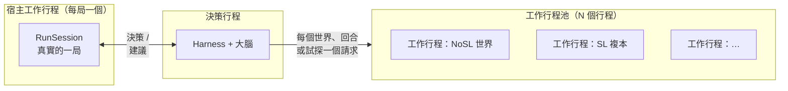

import { Aside } from '@astrojs/starlight/components';

搜尋和自我對弈需要一個程式能夠執行的殺戮尖塔 2：開始一場戰鬥，試一種打法，退回去，再試另一種；一夜之間打一萬局。**模擬器**就是這樣的遊戲。它不是規則的重寫，而是遊戲自己的 `sts2.dll`，載入到一個普通的 .NET 行程裡，以**無頭**方式執行：沒有 Godot 引擎、沒有視窗、沒有渲染，也沒有聲音，CPU 能跑多快就跑多快。這個專案是 `Sts2Ai.SimWorker`，它的一份執行中的副本就是一個*工作行程*（worker）。

本章說明如何讓遊戲這樣執行、它這樣執行之後能做什麼（單場戰鬥、整局、搜尋所探索的世界），以及它的許多份副本如何協同工作。

<Aside title="狀態">

已有：無頭宿主（[無頭宿主](/zh-tw/arch/simulator/headless/)）；帶快照、確定化和 CombatBuilder 的單場戰鬥工作階段（[戰鬥](/zh-tw/arch/simulator/combat/)）；走過每個決策畫面的整局，以及透過線路對接大腦來託管的對局（[整局](/zh-tw/arch/simulator/runs/)）；NoSL 戰鬥世界和 SL 節點複本（[世界與 SL 複本](/zh-tw/arch/simulator/worlds/)）；工作行程池及其三種請求（[工作行程池](/zh-tw/arch/simulator/pool/)）。規劃中：整局世界，它能讓 NoSL 搜尋看到當前地圖點之後的東西（[世界與 SL 複本 §8](/zh-tw/arch/simulator/worlds/#sec-8)）。

</Aside>

## 1. 為什麼用真實遊戲

殺戮尖塔 2 的每條規則都在遊戲的 C# 程式碼裡：數百張卡牌、遺物、能力、怪物和事件，每一個都有自己掛進回合、抽牌和傷害的鉤子。重寫這些規則，等於做出第二個遊戲，它必須在每個細節上都與第一個一致，而且遊戲每次更新都會讓它走樣。在一個略有偏差的遊戲裡規劃的搜尋，在真實遊戲裡就會做出略有偏差的動作。

所以專案的第四條約束是：模擬器*就是*真實的 `sts2.dll`（[前言 §2](/zh-tw/#sec-2)）。遊戲版本固定在 v0.111.0。專案加上的是包在它外面的一套框架：一個代替引擎的存根、一組關掉表現層而保持規則完整的補丁，以及一個扮演各個畫面的驅動程式。

遊戲的兩個事實決定了其餘的一切：

- **它的規則和畫面是分開的**。遊戲是一個 Godot 應用程式。規則在普通的 C# 物件裡（卡牌、生物、房間、這一局），專案把它們叫作*模型層*；畫面是 Godot 節點（名為 `N…` 的類別，例如 `NCombatRoom`），負責繪製模型，並把點擊轉成呼叫。無頭執行時只跑模型層，驅動程式在畫面原本會呼叫模型的地方呼叫模型（[無頭宿主 §1](/zh-tw/arch/simulator/headless/#sec-1)）。
- **每個行程只有一局**。遊戲把當前這一局和當前這場戰鬥放在行程級的單例裡（`RunManager.Instance`、`CombatManager.Instance`）。同一個行程裡，第二局無法與第一局並存。所以分支靠**重播**來做（退回去的方法是從頭開始、重複走過的步驟，[戰鬥 §2](/zh-tw/arch/simulator/combat/#sec-2)），並行搜尋則需要多個**行程**（[工作行程池](/zh-tw/arch/simulator/pool/)）。

## 2. 工作行程做什麼

一個工作行程有三種角色：

1. **託管這一局**。在自我對弈和評估中，由模擬器而不是真實遊戲來打這一局，也就是[模擬到實機階梯](/zh-tw/arch/evaluation/#sec-2)的 R1–R3 級。宿主工作行程持有唯一真實的那一局，並就每個決策詢問大腦，和 Mod 在真實遊戲裡的做法完全一樣。
2. **搜尋世界**。戰鬥大腦和宏觀大腦在世界裡嘗試各種打法：NoSL 下是從觀測建出的樣本，SL 下是當前節點的複本（[環境：世界 §1](/zh-tw/arch/environments/worlds/#sec-1)）。每個搜尋請求都送到池裡的一個工作行程，由它建構或載入世界、在其中搜尋，然後回覆。
3. **基準測試與檢查**。`bench` 和 `selftest` 也在這裡執行（[參考](/zh-tw/arch/simulator/reference/)）。

決策行程（Harness 和各個大腦在其中執行）從不載入遊戲，它透過訊息和工作行程溝通（[前言 §3](/zh-tw/#sec-3)）。在真實遊戲裡，Mod 是宿主，工作行程只負責搜尋；在自我對弈中，宿主也是一個工作行程。Harness 分辨不出這兩者：「換世界，不換大腦」。

## 3. 全貌

在打整局的指令 `run` 裡，宿主和決策行程是同一個行程：這一局在其中一直活著，大腦則在它啟動的工作行程池裡搜尋。用 `run --brain SOCKET` 時，大腦改為一個獨立的行程，也就是 Mod 所連接的那一個（[整局 §7](/zh-tw/arch/simulator/runs/#sec-7)）。

## 4. 程式碼

`src/Sts2Ai.SimWorker` 引用遊戲、GameBridge、Protocol、Brain 和 Harness。它的程式碼按職責分在各個資料夾裡，命名空間跟著資料夾走（`Simulation/` 就是 `Sts2Ai.SimWorker.Simulation`），專案檔把這些命名空間匯入每個檔案。

| 資料夾 | 內容 |
|---|---|
| （根目錄） | `Program.cs`：找到遊戲的二進位檔，以本行程的副本形式啟動工作行程 |
| `Runtime/` | 讓遊戲脫離引擎執行：`HeadlessGame`（啟動）、`GodotNativeStub`、`Pump`、各個補丁（`Runtime/Patches/`）、`FastHookListeners`、日誌 |
| `Simulation/` | 戰鬥和整局的遊戲一側：`CombatSession`、`CombatBuilder`、`RunSession`、`SimWorlds`、`NodeWorld`、`NodeProbe`（在複本上回答 L0 的試探）、`PolicySelector`、`Loadout`、`GameSeeds` |
| `Brains/` | 一局的大腦需要的東西：冠軍的選項（`ChampionOptions`、`LeafChoice`），以及大腦連線和節點匯出（`RunBrains`） |
| `Commands/` | 命令列：每個指令一個類別，共用的選項組在 `Args.cs` 裡 |
| `Checks/` | `selftest`，它的檢查分在四個檔案裡：指令本身，以及戰鬥、規則和整局的檢查 |

`Simulation/` 和 `Runtime/` 不使用 `Commands/` 裡的任何東西。不需要遊戲的 xUnit 測試在 `src/Sts2Ai.Tests` 裡（[參考 §7](/zh-tw/arch/simulator/reference/#sec-7)）。

## 5. 本章

| 頁面 | 說明的內容 |
|---|---|
| [無頭宿主](/zh-tw/arch/simulator/headless/) | 遊戲如何在沒有引擎的情況下啟動：原生存根、補丁、TestMode、JIT，以及讓它具有確定性的單執行緒 `Pump` |
| [戰鬥](/zh-tw/arch/simulator/combat/) | 戰鬥工作階段、作為配方的快照、確定化、從觀測建構戰鬥（CombatBuilder）、保真度與速度 |
| [整局](/zh-tw/arch/simulator/runs/) | `RunSession`：開始一局、「步進—穩定—決策」迴圈、每個決策畫面、確定性、對接大腦託管對局 |
| [世界與 SL 複本](/zh-tw/arch/simulator/worlds/) | NoSL 戰鬥世界、節點檢查點、SL 複本的載入與封存、SL 世界、整局世界 |
| [工作行程池](/zh-tw/arch/simulator/pool/) | 池、它的三種請求、跨行程的確定性、當機與速度 |
| [參考](/zh-tw/arch/simulator/reference/) | 建置與執行、每個指令和選項、結束代碼、每個測試 |

像 `Runs/RunManager.cs:295-312` 這樣的檔案引用，指向反編譯出的遊戲組件 `MegaCrit.Sts2.Core`（資料夾 `Runs/` 就是它的命名空間 `MegaCrit.Sts2.Core.Runs`）；像 `Simulation/RunSession.cs` 這樣的專案路徑，除非寫明是別的專案，都在 `src/Sts2Ai.SimWorker/` 之下。Godot 節點檔案（`NGame.cs`、`NRestSiteRoom.cs`）按檔名唯一，所以只寫檔名。
