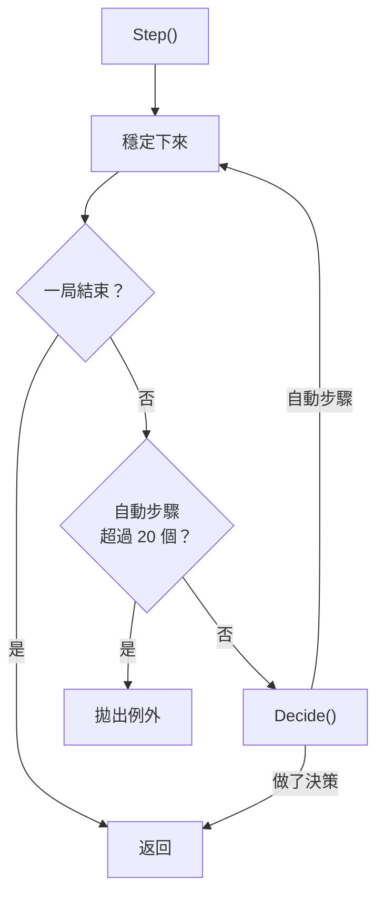

import { Badge } from '@astrojs/starlight/components';
import SurfaceCounts from '../../../../../components/book/SurfaceCounts.svelte';

殺戮尖塔 2 的一局是三幕的地圖點，加上幾百到大約一千個決策：本書貫穿始終的範例對局是一場勝局，用了 848 個決策，其中四分之三在戰鬥裡。`RunSession`（`Simulation/RunSession.cs`）在真實引擎裡打這樣一局，每個決策都經過 GameBridge，也就是 Mod 在遊戲裡呼叫的同一批函式（[GameBridge](/zh-tw/arch/gamebridge/)）。本頁從開始到結束跟著一局走一遍。

## 1. 一局是一個迴圈

無頭時，遊戲仍然自己執行每個房間：擲出遭遇、打怪物的回合、發放獎勵。它不做的是顯示畫面，而在真實遊戲裡，有些事是由畫面的程式碼決定的：戰鬥之後開哪個畫面、Proceed 按鈕做什麼、地圖什麼時候打開。`RunSession` 扮演 UI 的這一部分。它知道此刻會顯示哪個畫面，詢問這個畫面上的決策，再做它的按鈕會做的事（[無頭宿主 §1](/zh-tw/arch/simulator/headless/#sec-1)）。

所以一局是一個迴圈：讓遊戲一直執行到它等待玩家為止，問一個問題，套用答案，再來一次。問題有三種，各由自己的介面（interface）回答：

| 問題 | 介面 | 由誰提問 |
|---|---|---|
| 一個戰鬥動作：打出一張牌、使用一瓶藥水、結束回合 | `ICombatPolicy` | 驅動程式，在玩家的回合 |
| 一個選牌提示：棄一張牌、三選一、選要消耗的牌 | `IChoicePolicy` | 遊戲，從某個動作內部，透過選牌器 `PolicySelector` |
| 其他一切：地圖、獎勵、卡牌獎勵、事件、商店、休息處、寶箱、卡包、水晶球 | `IMacroPolicy` | 驅動程式 |

一局在它的**軌跡**裡記下每個決策，每個一行文字：決策介面（surface，即決策畫面的種類，[§4](#sec-4)）和動作，例如 `map 0,1`、`combat play:7:2` 或 `card_choice 3`。軌跡讓一局可以重播：設定相同、答案相同，遊戲就打出同樣的一局（[§6](#sec-6)）。

和戰鬥工作階段一樣，一個行程裡同一時間只有一局是活的：遊戲的管理器（`RunManager.Instance`、`CombatManager.Instance`）是單例（[戰鬥 §1](/zh-tw/arch/simulator/combat/#sec-1)）。

## 2. 開始一局

一局的開始方式，和遊戲開始一局新的單人遊戲相同。遊戲裡負責這件事的程式碼是 `NGame.StartRun`，它在一個 Godot 節點裡 <Badge text="已核實" variant="success" />，所以 `RunSession.Start` 照抄了它（`Simulation/RunSession.cs:149-178`）。它的輸入是 `RunSetup(Character, Seed, Ascension, Loadout?)`。

1. `Player.CreateForNewRun(character, UnlockState.all, netId)`，然後是配置，如果有給的話（[參考 §3](/zh-tw/arch/simulator/reference/#sec-3)）。
2. 用種子擲出各幕：`ActModel.GetRandomList(new Rng(hash(seed), "act_selection"), UnlockState.all, isMultiplayer: false)`，和 `StartRunLobby.BeginRunLocally` 的做法相同（`Multiplayer.Game.Lobby/StartRunLobby.cs:469-472`）。
3. `RunState.CreateForNewRun([player], acts, [], GameMode.Standard, ascension, seed)`。
4. `RunManager.SetUpNewSingleplayer(run, shouldSave: false)`（`Runs/RunManager.cs:295-312`），它最後做房間生成 `GenerateRooms`。
5. `FinalizeStartingRelics`，但只在配置沒有指定遺物時才做：配置的遺物就是它們的最終狀態，拾取效果已經做過，藥水槽也包括在內。然後是 `Launch` 和 `EnterAct(0, doTransition: false)`（`Runs/RunManager.cs:711-738`）。
6. 穩定下來（[§3](#sec-3)）。第一個決策是第一幕的遠古之民涅奧。

遊戲裡的出處是 `NGame.StartNewSingleplayerRun`（`Nodes/NGame.cs:1137-1144`）和 `NGame.StartRun`（`Nodes/NGame.cs:1179-1190`）。

有三件事刻意不照測試設定的做法來做：

- 一局不用遊戲的 `SetUpTest`（`Runs/RunManager.cs:446-462`），因為它會跳過 `GenerateRooms`（`Runs/RunManager.cs:743-767`）：少了它就沒有遠古之民，也沒有雙頭目。
- `UnlockState.all` 表示每個紀元和遭遇都已解鎖，而且打過的局數極大（`Unlocks/UnlockState.cs:34`），所以第 1 幕和第一局給新玩家的調整永遠不會生效，一局從涅奧開始（[無頭宿主 §5](/zh-tw/arch/simulator/headless/#sec-5)）。
- 沒做的：照搬真實玩家的設定檔（他們解鎖了什麼），以及把晉階限制在角色的上限內，這是遊戲大廳會做的（`StartRunLobby.cs:485-491`）。呼叫方傳入的都是合法值。

**種子**。一局的種子是遊戲種子：遊戲字母表裡的 12 個字元，字母表是數字和去掉 I 與 O 的大寫字母，例如 `0SSL7NS01MU6`。`run --seeds FILE` 從種子檔案讀入種子（[評估：指標、種子與報告 §5](/zh-tw/arch/evaluation/metrics/#sec-5)）；沒有種子檔案時，`run --seed B` 用基數 B 和索引生成第 *i* 局的種子：`GameSeeds.MakeSeed(B, i)`（`Simulation/GameSeeds.cs:7-12`）。

## 3. 走一步、穩定、決定

`Step()` 做一個決策（`Simulation/RunSession.cs:226-241`）。它先穩定下來，如果這一局還沒結束，就呼叫 `Decide()`；它要麼提出一個問題並開始執行它的答案，要麼做一個畫面不必詢問就會做的自動步驟。自動步驟之後，它再穩定一次。連續超過 20 個自動步驟而沒有任何決策，是驅動程式的 bug，會拋出例外。



**穩定**（settle，`Simulation/RunSession.cs:245-263`）用 pump 推進遊戲，直到玩家可以行動（[無頭宿主 §7](/zh-tw/arch/simulator/headless/#sec-7)）：

- 戰鬥中，直到 `CombatActions.WaitingForInput` 成立（玩家的回合、出牌階段、動作執行器空閒）；玩家結束回合之後，要到後面的回合才算，所以敵人的回合會先打完；
- 其他地方，直到 pump 的佇列為空且動作執行器空閒。

**戰鬥回合上限**。遊戲不限制一場戰鬥打多少回合，有的戰鬥可以永遠打不完：玩家再也傷不到敵人，敵人也打不穿玩家的格擋，這場戰鬥就會一直打下去。所以第 81 回合開始時仍在進行的戰鬥算輸。穩定時，一到第 81 回合玩家的回合，它就像遊戲自己的擊殺指令那樣殺死玩家：`CreatureCmd.Kill`，強制執行，什麼都救不回來（瓶中精靈之類），再做遊戲的勝負檢查，戰鬥就此結束（`Simulation/FightCap.cs:14-35`）。對局隨之結束，結果是 `lost`，記錄裡是死在這場戰鬥中、生命值為 0，和其他死亡一樣。搜尋世界背後的戰鬥工作階段也這樣穩定，所以搜尋看到的是同樣的輸（[戰鬥 §1](/zh-tw/arch/simulator/combat/#sec-1)）。

接著它記下對局記錄需要的東西：剛結束的戰鬥記下它的結局（生命值、最大生命值、藥水），包括死在玩家自己的動作之中的情形，新一幕的地圖記下它的雜湊。對局在第一個決策之前就死去的戰鬥，會得到一筆生命值為 0 的記錄。最後，它收集驅動程式發起且已完成的遊戲任務（一次購買、一個休息選項、一份獎勵、一次占卜）；出錯的任務會拋出例外。

**決定**（`Simulation/RunSession.cs:298-325`）依這個順序查看：

1. 開著的獎勵畫面：一組獎勵如果不是這個房間的最後一組，而且全部領完了，就自己關閉；否則最新開啟的那一組就是決策。
2. 驅動程式的任務還在執行，卻沒有可回答的東西，這是 bug，會拋出例外：已開始的任務唯一能等待的畫面就是獎勵。
3. 地圖，在 `MapRoom` 裡，或者一旦離開了當前房間。
4. 房間：戰鬥、事件（有水晶球小遊戲開著時先處理它）、商店、休息處、財寶。其他種類的房間會拋出例外。

**畫面會記住的東西**按房間存放在 `RoomProgress` 裡（`Simulation/RunSession.cs:599-608`）：是否已離開房間、是否已進入戰鬥、已提供的獎勵、某個休息選項是否成功、寶箱是否已開、遺物是否已選。當前房間改變時它會重新開始；事件裡的戰鬥結束、事件繼續時，也算改變。

**自動步驟**，即畫面不需決策就會做的事：

- 贏下的戰鬥發放它的獎勵（`OfferRoomEndRewards`），如果它的遭遇不給獎勵就直接繼續（`ProceedFromTerminalRewardsScreen`），和 `NCombatUi.OnCombatWon` 的做法一樣（`Nodes.Combat/NCombatUi.cs:363-373`）；
- 財寶房的寶箱打開（`DoNormalRewards`，然後 `DoExtraRewardsIfNeeded`），遺物被選走或跳過之後，離開房間。

## 4. 每一種決策畫面

**決策介面**（surface）是決策畫面的種類；協定定義了十一種（`Sts2Ai.Protocol/Surfaces.cs:9-19`）。這裡按驅動程式的處理方式逐一列出。「合法動作」是 GameBridge 生成的清單，「執行」是把答案付諸實行的遊戲呼叫；每個動作的文字定義在 [協定：觀測與動作 §5](/zh-tw/arch/protocol/observation/#sec-5)。

| 決策介面 | 合法動作 | 執行 | 驅動程式的部分 |
|---|---|---|---|
| `combat` | `CombatActions.Legal`：可打出的牌及其目標、可使用的藥水、結束回合 | `CombatActions.Start` | 在玩家的回合提問；戰鬥的結束是一個自動步驟 |
| `card_choice` | 提示的選項，按標準順序，數量範圍來自它的上下文（`ChoiceContexts.Bounds`）；可取消的提示最小值為 0 | 所選的牌，作為遊戲自己清單裡的索引 | 從遊戲的 `CardSelectCmd` 入口內部提問，戰鬥內外都有 |
| `map` | `MapActions.Travelable`：起點、最後一列之後的頭目、第一個頭目之後的第二個頭目，其他情況用遊戲的 `MapTravel.GetTravelablePointsFrom`；先按列、再按行排序 | `VoteForMapCoordAction`，和 `NMapScreen` 的做法一樣 | 在 `MapRoom` 裡，或一旦離開了房間 |
| `rewards` | 每份未領取的獎勵（藥水只在有空槽時才算）；`rewards_done`，除非這組獎勵不允許跳過且並非每份都已領取 | `SelectLocalReward` | 獎勵組透過 `RewardsSet.testSelector` 送達；`rewards_done` 時：不是房間最後一組的獎勵組被跳過，在頭目之後或勝利房間裡（不在兩個頭目之間）換幕，否則結束這個房間的獎勵（`ProceedFromTerminalRewardsScreen`），和 `NRewardsScreen` 的做法一樣 |
| `card_reward` | 每張牌一個 `card:i`，加上每個還沒用掉的替代選項（每個畫面可重骰一次；用過之後按鈕仍列著） | 選牌器的卡牌獎勵處理器 | 畫面還開著時，每選一次之後再問一次 |
| `bundle` | `bundle:i`；不能跳過 | 選牌器的卡包處理器 | 無頭時遊戲會拿第一個卡包；一個補丁把這個選擇交給驅動程式（[無頭宿主 §4](/zh-tw/arch/simulator/headless/#sec-4)）；卷軸箱（ScrollBoxes）是它唯一的來源 |
| `event` | 未鎖定的選項，作為 `event:i`；屬於 UI 按鈕的選項（「PROCEED」）作為 `proceed`；事件結束後只有 `proceed` | `EventSynchronizer.ChooseLocalOption(i)` | `proceed` 打開地圖（遊戲的 `NEventRoom.Proceed` 在無頭時會拋出例外）；Trial 的 DOUBLE_DOWN 是一個放棄的彈出視窗，永遠不合法 |
| `crystal_sphere` | 3×3 區塊裡有任一格隱藏時提供 `big:X,Y`，格子 X,Y 隱藏時提供 `small:X,Y` | `SetTool`，然後 `CellClicked` | 同名事件的小遊戲，由一個補丁交給驅動程式；最後一次占卜之後，它的獎勵以一組獎勵送達 |
| `shop` | 有貨且買得起的條目 `buy:i`（藥水還需要空槽，且角色可以拿藥水：添水禁止這一點）；刪牌服務有貨且買得起時提供 `remove`；`leave` | `OnTryPurchaseWrapper(inventory)` | 一個補丁把刪牌標記為已用，這在遊戲裡是刪牌畫面的節點做的；這也涵蓋領主陽傘的免費刪牌 |
| `rest` | 可用的選項，按 id（`rest:HEAL`）；某個選項成功之後，或沒有任何可用選項時，提供 `leave` | `RestSiteSynchronizer.ChooseLocalOption` | |
| `treasure` | `relic:i`、`relic_skip` | `PickRelicLocally`、`SkipRelicLocally` | 寶箱自己打開；單人模式下跳過之後遺物仍列著，所以要有 `RoomProgress.RelicPicked` |

**藥水欄**。隨時可用的藥水（`potion:S`）和丟棄藥水（`discard_potion:S`）在地圖、獎勵、事件、商店、休息處、財寶和水晶球畫面上提供，排在畫面自己的動作之後（`Simulation/RunSession.cs:471-478`）。卡牌獎勵、卡包和選牌提示都沒有。藥水欄的動作立即執行，然後再問一次這個畫面。藥水欄滿時，藥水獎勵和購買藥水都不合法，直到空出一個槽。戰鬥中，藥水是戰鬥動作；戰鬥裡沒有丟棄。

**沒有後備**。驅動程式不認得的畫面會拋出例外，這一局就失敗：未知的房間、未知類型的獎勵、商店條目或水晶球物品、連結的獎勵組、沒有畫面卻還在等待的任務。不在合法清單裡的答案也一樣。失敗從不被一個預設選擇蓋過去，所以打完的一局，每個決策都是由它的策略回答的。

一局遇到每種畫面的頻率，取自冠軍晉級報告裡的 300 局 SL 對局：

<SurfaceCounts client:visible lang="zh-TW" />

在 9999 生命值的對局裡見到的**正常遊戲行為**，不是 bug：擊殺機制，例如無饜沙蟲（THE_INSATIABLE）的沙坑 `Kill`，以及迷失之物與遺忘之物（THE_LOST_AND_FORGOTTEN）一直偷取力量和敏捷，直到這場戰鬥輸掉（在 9999 生命值下約要 156 回合；戰鬥回合上限讓它在第 81 回合結束）；還有 PunchOff 的「event not finished」警告，它的戰鬥帶有 `shouldResumeAfterCombat: false`（`Models.Events/PunchOff.cs:138`）；真實遊戲也會同樣警告。

## 5. 誰來回答，以及一局報告什麼

**戰鬥決策和宏觀決策**帶著它們的合法動作，以及按需建構的觀測（`CombatDecision`、`MacroDecision`）：不看觀測的策略永遠不必為它付出代價。答案必須合法，否則這一局拋出例外。

**選牌提示**經過 `PolicySelector`，它在一局進行時就是遊戲的選牌器（`Simulation/PolicySelector.cs:21-80`）：

- 它按標準順序顯示選項（`CardChoices.Canonical`），所以不管遊戲的清單是什麼順序，同樣的牌構成同樣的提示；這個順序裡的平手，用一條以提示編號為種子的亂數流來打破，這條亂數流不知道任何隱藏的東西，重播時也相同；
- 它把答案記成遊戲自己清單裡的索引，也就是重播時交回的形式；
- 卡牌獎勵和卡包是整局層級的決策，由驅動程式的處理器回答；沒有這些處理器，卡牌獎勵會被跳過，卡包則拿第一個；
- 每次進入節點，提示都從 0 重新編號，因為節點的複本也是自己編號的（[世界與 SL 複本 §3](/zh-tw/arch/simulator/worlds/#sec-3)）。

在 `run` 裡，三個介面是同一個物件：Harness 的 `Dispatcher`，它把每個決策交給回答它的大腦（[Harness：路由、預算與種子 §1](/zh-tw/arch/harness/routing/#sec-1)）：戰鬥交給戰鬥大腦，戰鬥中的選牌提示交給 `p0`，其他一切（包括戰鬥外的選牌提示）交給宏觀大腦（[宏觀大腦](/zh-tw/arch/macro-brain/)）。

**結果**。一局結束時是 `won`（結束於勝利房間）、`lost`（結束於其他任何地方）、`truncated`（超過 `--max-decisions` 仍未結束，預設 20,000）或 `failed`（拋出了例外）。勝局的記錄寫著生命值 0：一到勝利房間，遊戲就殺死玩家。範例對局的記錄是：won、第 2 幕（從 0 算起）、第 48 層、生命值 0/66。

**`run` 印出什麼**。第一行說明這批對局、環境、冠軍和遊戲版本。然後每局一行，形式如下（範例對局，省略了牌組、遺物和藥水）：

```text
#15 0SSL7NS01MU6 won act 2 floor 48 room … hp 0/66 gold 195 deck [...] relics [...] potions [...] decisions 848 331715 ms maps <3 hashes>
```

SL 規劃器重新規劃過時，`maps` 之前有 `replans N`；取了觀測時，它之後有 `obs <digest>`（[§6](#sec-6)）。失敗的一局會多一行 `failure:`，之後最多三行 `game error:` 列出遊戲錯誤。最後是總計：

| 行 | 計的是什麼 |
|---|---|
| `done in S s: D decisions/s` | 實際耗時和每秒決策數 |
| `pump idle waits: N (T ms)` | pump 不得不阻塞、等待另一個執行緒送來工作的次數；必須為 0（[§6](#sec-6)） |
| `outcomes:` | 每種結果的局數 |
| `surfaces:` | 每種決策介面的決策數 |
| `surfaces never reached:` | 沒有任何一局遇到的決策介面；只在有的時候才印 |
| `failure xN:` | 每條失敗訊息，以及它結束了幾局 |
| `determinism:` | 用 `--check` 時：透過線路重播後完全相同的局數，以及能從檢查點精確重播的節點數，附上每個節點的時間 |
| `game Log.Error lines:` | 遊戲錯誤，接著用了行程池時是 `worker restarts`，用 SL 規劃器時是 `replans` |

**結束代碼**：有一局失敗、有一次重播不同、有一個節點沒有精確重播，或記錄到遊戲錯誤時為 1；否則為 0。從未到達的決策介面和空閒等待只會印出來（`Commands/RunCommand.cs:146`）。

**記錄與日誌**。`--records FILE` 每行寫一條對局記錄，是 `report` 和 `gate` 的輸入（[評估：指標、種子與報告 §8](/zh-tw/arch/evaluation/metrics/#sec-8)）：

| 欄位 | 內容 |
|---|---|
| `config` | `game`（版本）、`commit`（模擬器的提交，`src/` 有改動時帶 `-dirty`）、`champion`（它的名字）、`env` |
| `seed`、`character`、`ascension`、`run_id` | 這一局；`run_id` 是大腦用來識別它的雜湊（[§7](#sec-7)） |
| `outcome`、`act`、`floor`、`hp`、`max_hp`、`gold` | 它在哪裡結束 |
| `combats` | 每場戰鬥：幕、層、遭遇、房間種類，第一個決策時的生命值、最大生命值和藥水，以及它的 `end`：是否死亡，以及剩下的生命值、最大生命值和藥水 |
| `surfaces`、`brains` | 每種決策介面的決策數，以及每個回答它們的大腦的決策數 |
| `card_rewards`、`card_rewards_skipped` | 關閉的卡牌獎勵畫面數，以及其中一張牌都沒拿就關閉的數目 |
| `game_errors`、`failure`、`elapsed_ms` | 這一局的健康狀況和它的實際耗時 |

`--log FILE` 寫出 Harness 的決策日誌，每個決策一行（[Harness：決策日誌 §1](/zh-tw/arch/harness/decision-log/#sec-1)）。兩個檔案都逐行寫出（flush）；一局的日誌行在這一局結束時寫出，所以中途停下的批次最多丟失正在打的那一局。

## 6. 確定性

下游的一切都需要一局是它的設定和答案的函數。SL 複本從檢查點重播一個節點的決策，必須到達相同的狀態（[世界與 SL 複本](/zh-tw/arch/simulator/worlds/)）；晉級門檻在相同的種子上把挑戰者和冠軍配對（[評估：晉級門檻 §2](/zh-tw/arch/evaluation/gates/#sec-2)）；`--check` 把一局和它自己的重播比較。給定種子，遊戲是確定性的，但前提是沒有別的東西滲進來：沒有時鐘、沒有執行緒時序、沒有無序的集合。pump 在一個執行緒上按投遞順序執行每個後續（continuation）（[無頭宿主 §7](/zh-tw/arch/simulator/headless/#sec-7)），規則永遠碰不到以時鐘為種子的亂數流（[戰鬥 §2](/zh-tw/arch/simulator/combat/#sec-2)），GameBridge 則把遊戲不按順序保存的東西排好序，例如一個地圖點的子節點。

**`run --check`** 在它打的每一局上檢查這一點（`Commands/RunCommand.cs:94-130`）：

- 它觀測每個決策：每個觀測都必須能完全不變地經過 JSON 往返，並保留它的雜湊；
- 它把每個種子透過線路再打一遍（[協定：線路 §1](/zh-tw/arch/protocol/wire/#sec-1)），連到同一行程中一個執行緒裡、冠軍相同的大腦（或連到給定的 `--brain`），然後比較兩遍：軌跡、觀測雜湊、摘要、地圖雜湊、對局記錄和決策日誌，耗時除外；SL 下第二遍還帶著節點訊息；
- 它從檢查點載入第一遍的每個節點，重播節點的決策，要求複本逐一顯示這一局的觀測，在移動之後停在視野邊界，並拒絕再走一步（[世界與 SL 複本 §5](/zh-tw/arch/simulator/worlds/#sec-5)）。

**實測**於 2026-10-26，200 個種子（寂靜獵手、晉階 0、9999 生命值、隨機宏觀策略和 `play` 戰鬥策略）：

- `--check`：200 局裡 200 局重播完全相同（軌跡、摘要、地圖雜湊）；每個觀測都完全不變地經過往返，每個決策的觀測雜湊都相符；
- 跨行程劃分：同樣的 200 個種子，分成 8 個行程各 25 局，和分成 4 個行程各 50 局，給出相同的行（結果、摘要、決策數、地圖雜湊、觀測總雜湊），所以地圖點子節點的順序從沒出現過不同，雖然 `MapActions` 還是會排序；
- 其他四個角色（鐵甲戰士、故障機器人、儲君、縛亡者），各 25 局，用 `--check`：重播相同；
- 0 失敗、0 遊戲錯誤、0 次空閒等待；每種決策介面都到達過，最少見的是 `bundle`，200 局裡出現在 9 局。

複本自己的檢查，涵蓋五個角色 880 局裡的每個節點，見 [世界與 SL 複本 §6](/zh-tw/arch/simulator/worlds/#sec-6)。

**真實時間等待**。模型程式碼不能等待時鐘。`Task.Delay` 會讓 pump 的佇列一直是空的，直到計時器執行緒投遞工作，所以穩定時無法分辨遊戲是空閒還是在等待（[無頭宿主 §7](/zh-tw/arch/simulator/headless/#sec-7)）。Amalgamator 的事件就是這樣等待的，已打上補丁。其他幾處在無頭時走不到：`ActionExecutor.WaitForUnpause` 在遊戲暫停時每 50 ms 輪詢一次（`GameActions/ActionExecutor.cs:227-242`），`CombatState.GodotTimerTask` 為按 net id 查找生物設了超時（`Combat/CombatState.cs:603-609`），休息處的懸停訊息屬於 UI。守護手段是上面的空閒等待計數，在 200 局的批次裡為 0。

**內嵌執行**。無頭時，遊戲在 `NonInteractiveMode` 下執行，動作內嵌執行，而不是每影格讓出一次，所以「發出即不管」（fire-and-forget）的工作順序可能與真實遊戲不同。這是否改變玩家看得到的任何東西，要等到遊戲裡的對局能和這裡的對局比較時才知道（[評估 §2](/zh-tw/arch/evaluation/#sec-2)）。

## 7. 連到大腦的對局

`run` 通常把大腦留在自己的行程裡：Harness 和冠軍的各個大腦是這個行程裡的物件，它們的搜尋交給它啟動的工作行程池（[工作行程池](/zh-tw/arch/simulator/pool/)）。用 `run --brain SOCKET` 時，大腦則是另一個行程，在一個 Unix socket 上監聽，也就是 Mod 在遊戲裡連的那個（[Mod：主迴圈 §8](/zh-tw/arch/mod/loop/#sec-8)）。這時模擬器託管對局的方式和遊戲完全一樣：每局傳送 `hello`，帶上它的環境和由種子雜湊得到的對局 id，每個決策都連同它的觀測和合法動作一起發出，然後打出大腦推薦的動作（[協定：線路 §3](/zh-tw/arch/protocol/wire/#sec-3)）。NoSL 下對局 id 隱藏了種子；SL 下種子確實會到達大腦，在節點檢查點的存檔裡，這是 SL 可以知道的。

由大腦決定打什麼，所以 `run --brain` 拒絕每個冠軍選項，包括 `--log`（`Commands/RunCommand.cs:63-64`）；而且因為冠軍檔案的選項是當作給出的選項合併進來的，它也拒絕指定了任何冠軍選項的 `--champion FILE`（`Commands/Args.cs:176-192`）<Badge text="推斷" variant="caution" />。SL 下宿主還會傳送節點訊息：新節點開始時傳送檢查點，然後是還沒傳送的決策，每個都在下一個決策之前傳送（`Brains/RunBrains.cs:53-99`）。

`brain` 就是那個行程（`Commands/BrainCommand.cs`）：單獨的 Harness，服務連上來的宿主，一次一個。它自己不需要遊戲；搜尋的工作行程各自啟動自己的遊戲。

```text
brain [--socket PATH] [--champion FILE] [champion options] [--sl-policy plan|play] [--log FILE] [--wire FILE]
```

- `--socket`：預設是 `$XDG_STATE_HOME/sts2ai/brain.sock`，這個變數未設定時是 `~/.local/state/sts2ai/brain.sock`（`Sts2Ai.Protocol/Wire.cs:100-104`）：Steam 在一個容器裡執行遊戲，這個容器共用家目錄，但不共用 `$XDG_RUNTIME_DIR`。
- 宿主在 `hello` 裡說明它的環境：NoSL 宿主得到 `--policy` 的戰鬥大腦，SL 宿主得到 `--sl-policy` 的（預設是 SL 規劃器），宏觀大腦則相同。宿主也可以指定一個力度（`low`、`medium`、`high`、`max`），這一局的 SL 規劃器就用它來打（[Harness §5](/zh-tw/arch/harness/#sec-5)）。
- 它的回答帶著大腦打過分的選項，在地圖上還有每個選項的路線，供 Mod 顯示（[輸出 §2](/zh-tw/arch/output/#sec-2)）。
- `--log` 寫出決策日誌；`--wire` 寫出宿主傳來的每條訊息，`clones` 會重播這些訊息，在複本上檢查宿主的 SL 決策（[Mod：SL 紀錄 §8](/zh-tw/arch/mod/sl-record/#sec-8)）。
- 它每局印出一行：對局 id、結局、層數、決策數、重新規劃次數，以及它的工作行程的遊戲錯誤，宿主的對局記錄不計入這些錯誤。

`run --check` 在第二遍時在行程內使用同一個伺服器，用一個以行程命名的抽象 Unix socket（`\0sts2ai-brain-PID`，`Brains/RunBrains.cs:200-220`），所以 `--check` 打的每一局都會檢查線路這條路徑。
