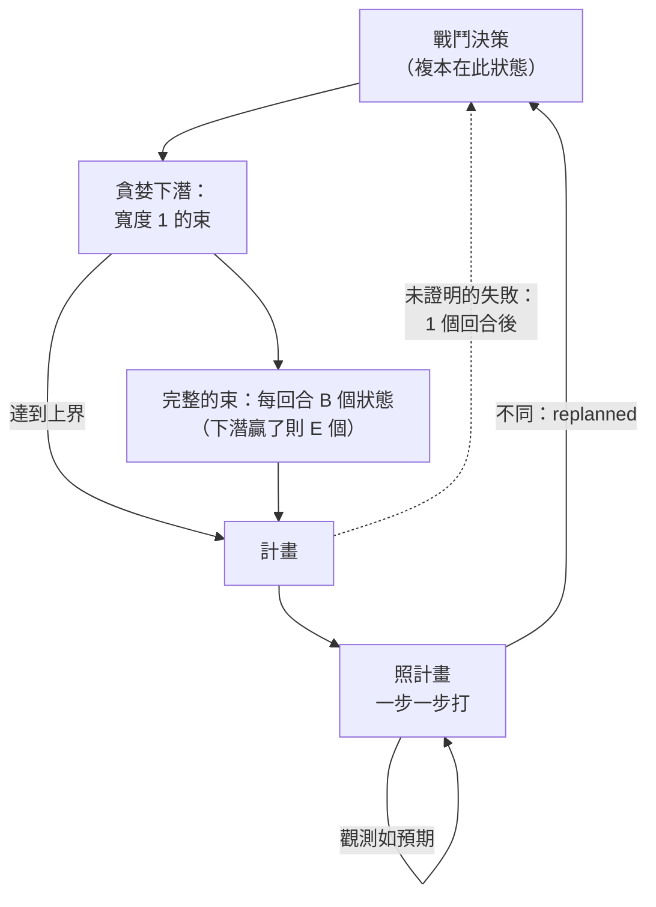

import PlanTimeline from '../../../../../components/combat/PlanTimeline.svelte';

在 SL 下，戰鬥大腦拿到戰鬥的一份精確副本：當前節點的複本，所有亂數流都在裡面。在那裡同樣的動作永遠得到同樣的結果，所以一場戰鬥是一個確定性規劃問題，沒有東西要猜，也沒有東西要平均。**SL 規劃器**（`SlPlanner`）在上面搜尋到戰鬥結束的最好路線，只搜一次，然後戰鬥一步一步地照這條路線打。

下面是它在一局真實對局裡的樣子。在一局後來被目前的冠軍打贏的對局（種子 `E91KLB4BRWB4`，來自 v6-3-2 的 300 局評估）的第 17 層，第 1 幕頭目是墨影幻靈：173 點生命值和 8 層滑溜，所以每次命中只造成 1 點傷害，並去掉一層。在這場戰鬥的第一個決策處，玩家有 65/70 點生命值，規劃器搜尋了 5.2 秒，回傳一條 6 個回合、22 個動作的路線。戰鬥照著它打完，沒有再搜尋。

<PlanTimeline client:visible lang="zh-TW" />

這條路線是一個中毒計畫。中和與打擊花掉兩層滑溜，各只造成 1 點傷害。精算一搏棄掉手牌、再抽同樣張數的牌，而規劃器已經知道抽到的會是腎上腺素、毒霧、衝刺和彈跳藥瓶：SL 可以看到抽牌順序，規劃器也已經在複本上試過這張精算一搏。毒霧和蛇咬在第 1 回合開始上毒。第 3 回合硬吃墨影幻靈 26 點傷害的一擊（生命值 60 → 34），去打匕首雨、第二張精算一搏和另一張蛇咬，而不是格擋。第 6 回合，計畫不打任何牌就結束回合：墨影幻靈有 35 點生命值和 42 層中毒，在它自己的回合開始時死去。計畫的估值 0.4914，就是葉節點對以 34/70 點生命值獲勝的定價（$0.2 + 0.6 \times 34/70$），而戰鬥結束時正好剩 34 點生命值。

## 1. SL 可以看到什麼

SL 是 NoSL 加上**當前節點**內任何動作序列的真實結果；當前節點就是當前的地圖點，從到達開始，直到選定下一個點為止（[環境：資訊與節點 §3](/zh-tw/arch/environments/information/#sec-3)）。在戰鬥裡，這意味著抽牌順序和每次重新洗牌、怪物的招式、生成的牌、隨機目標，以及動作的順序如何改變這一切：允許在節點內操縱亂數流。關於後面的節點則什麼都不能看：一個 `?` 結果是什麼、接下來的遭遇、獎勵或商店。

戰鬥的副本是**節點複本**（[模擬器：世界與 SL 複本 §7](/zh-tw/arch/simulator/worlds/#sec-7)）。到達一個點時遊戲會儲存這一局；節點的檢查點就是這份存檔，加上存檔丟掉的每個遺物的普通欄位。到達以來的每個決策都記錄成一條軌跡。像遊戲的「繼續」那樣載入檢查點，再重播軌跡，就得到當前決策處的真實戰鬥，連亂數流也包括在內。**封存**（seal）讓搜尋留在房間之內：複本在節點出口處停下，拒絕之後的任何一步，SL 世界也拒絕打過它那場戰鬥的結束，所以沒有任何路線能偷看後面發生的事。

## 2. 為什麼最好的路線就是正確答案

只有一個世界時，取最好的路線是正確的。搜尋取樣世界的陷阱，策略融合（strategy fusion），需要好幾個世界才融合得起來（[NoSL PIMC：搜尋 §4](/zh-tw/arch/pimc/search/#sec-4)）：在單一的精確世界裡，知道未來不是錯誤，而是 SL 的規則。

把戰鬥寫成一個確定性系統：狀態 $s_t$，合法動作中的一個動作 $a_t$，以及遊戲的轉移 $s_{t+1} = f(s_t, a_t)$。一條路線 $a_1, \dots, a_T$ 在戰鬥結束處結束，它的價值是葉節點對結束狀態的估值 $L(s_T)$（[葉節點](/zh-tw/arch/combat-brain/leaf/)）。規劃器要找的是

$$
\max_{a_1, \dots, a_T} \; L\big(s_T\big), \qquad s_{t+1} = f(s_t, a_t).
$$

一場戰鬥的路線是有限的，所以最好的路線存在，嘗試所有路線的搜尋一定能找到它。它是相對於戰鬥結束處的 $L$ 而言最好的：一條路線一旦到達結束，戰鬥裡就再沒有任何東西需要估計，剩下的唯一誤差，在於 $L$ 認為一場贏下的戰鬥的生命值和藥水值多少。

把它們全部試一遍是做不到的。在能量限制下選擇一個回合要打的牌，本身就是一個背包問題；手牌、能量和回合數都不設上限時，這個問題是 NP 困難的。真實的戰鬥有上限（手牌最多 10 張，3–15 個回合），但很大：每回合最多約 $10^4$ 個序列（[戰鬥大腦 §2](/zh-tw/arch/combat-brain/#sec-2)），一個回合接一個回合。所以規劃器以最好的路線為目標，能證明時就證明它是最好的（[束搜尋 §5](/zh-tw/arch/sl-planner/beam/#sec-5)），不能證明時就不要證明。

## 3. 一張圖看懂規劃器

1. **每個回合完整搜尋**。從一個狀態出發，對本回合的動作做深度優先搜尋，找出回合可能結束的各個不同狀態，敵方回合真實地打完（[回合搜尋](/zh-tw/arch/sl-planner/turn-search/)）。
2. **跨回合的束**（beam）。在所有保留狀態的回合結束狀態中，按葉節點估值最好的 B 個進入下一回合（[束搜尋 §1](/zh-tw/arch/sl-planner/beam/#sec-1)）。
3. **上界剪枝**。一條結束戰鬥的路線設下一個下限；一個狀態即使以它現有的生命值獲勝也勝不過這個下限時，就被丟掉（[束搜尋 §2](/zh-tw/arch/sl-planner/beam/#sec-2)）。
4. **先做貪婪下潛**，在完整的束開始之前找到這個下限；下潛已經獲勝時，完整的束縮窄為簡易束 E（[束搜尋 §3–§4](/zh-tw/arch/sl-planner/beam/#sec-3)）。
5. **挑選，能證明就證明**。選結束戰鬥的最好路線；不可能存在更好的路線時，它就是已證明的（[束搜尋 §5](/zh-tw/arch/sl-planner/beam/#sec-5)）。
6. **失敗的計畫**一次只打一個回合，然後重新規劃，最多連續三個（[束搜尋 §6](/zh-tw/arch/sl-planner/beam/#sec-6)）。
7. **worker**。每個束狀態的回合是送給 worker 行程池的一個請求（[預算 §4](/zh-tw/arch/sl-planner/budget/#sec-4)）。

## 4. 規劃一次，照著計畫打

世界是精確的，所以計畫只算一次，算出來怎樣就怎樣打。計畫是路線上的動作，加上每個動作之前預期的觀測雜湊。在這場戰鬥之後的每個決策處，只要戰鬥顯示預期的觀測、而且動作合法，Harness 的路由就不經搜尋打出計畫的下一步（`TurnPlan`）。對不上的一步說明複本和真實戰鬥不同：路由重新規劃，在決策日誌裡把這個決策標為 `replanned`，對局記錄統計重新規劃的次數（[Harness：決策日誌 §6](/zh-tw/arch/harness/decision-log/#sec-6)）。

重新規劃是複本錯誤顯露出來的方式。在用規劃器的前 40 局 SL 對局裡，38 局沒有重新規劃，另外兩局分別有 148 次和 120 次。兩局都拿著熔岩石，這個遺物在第 1 幕頭目的獎勵之後把自己停用，卻只儲存它觸發過。此後做的每個複本都把這個遺物顯示為正常，所以計畫的每一步都遇不到它預期的觀測，每個戰鬥決策都從頭重新規劃。現在檢查點帶著每個遺物的普通欄位，載入時把它們放回去（[模擬器：世界與 SL 複本 §6](/zh-tw/arch/simulator/worlds/#sec-6)）。在 v6-3-2 評估的 300 局（5,375 場戰鬥）裡沒有一步失敗：0 次重新規劃，95.6% 的戰鬥恰好規劃一次（[預算 §3](/zh-tw/arch/sl-planner/budget/#sec-3)）。其餘的是計畫預期會輸的戰鬥，它們是有意重新規劃的（[束搜尋 §6](/zh-tw/arch/sl-planner/beam/#sec-6)）。

`selftest` 專門檢查同一件事：一局裡的一場戰鬥在節點複本上規劃，在對局裡一步一步打出，每個觀測都如計畫預期，結束時的生命值和藥水必須正是計畫的估值所說的；放到 worker 池裡的規劃器必須規劃出單一行程規劃出的計畫。

## 5. 本章內容

| 節 | 解釋什麼 |
|---|---|
| [回合搜尋](/zh-tw/arch/sl-planner/turn-search/) | 完整搜尋一個回合：深度優先、每一步都可以結束回合、以完整隱藏狀態為鍵的置換、在各個第一動作之間分享節點 |
| [束搜尋](/zh-tw/arch/sl-planner/beam/) | 跨回合的束、上界及其剪枝、貪婪下潛、簡易束、挑選和證明一條路線、失敗的計畫 |
| [預算](/zh-tw/arch/sl-planner/budget/) | 力度等級和低預算、時間花在哪裡、worker、實測結果、弱點和未決問題 |
