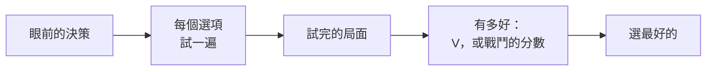

AI 做每一個決策，用的都是同一招：把每個選項在遊戲的複本裡真的試一遍，看試完之後的局面，問這個局面有多好，然後選最好的。戰鬥之外，回答的是一個學出來的函數，說這一局有多大機會贏下來；戰鬥裡，回答的是玩家能帶出這場戰鬥的東西。沒有任何一條「這種情況該出這張牌」的規則是人寫的。

## 試：讓遊戲自己說結果

AI 不需要懂每張牌的效果。它手上有遊戲本身：同一套程式，不開畫面地跑。想知道打出一張牌會怎樣，就真的打出去看。所以遊戲的規則一條都不用重寫，也就不會寫錯。

戰鬥裡，一個回合有上萬種打法，試不完，所以要**搜尋**：有系統地試，記住走過的局面，只沿著有希望的方向往下。戰鬥之外，選項通常只有幾個，每個都試得起。

## 問：一把尺量一局，一把尺量一場戰鬥

試完之後的局面好不好，由 **V** 回答。V 讀一局的現況：牌組、遺物、藥水、生命、金幣、前面的地圖。它只回答一個數字：這一局最後贏下來的機率。

戰鬥之外的所有決策都用這一把尺。在事件裡掉 5 點血、多拿一張牌、少一瓶藥水、走有菁英的那條路，全都換算成同一個數字，可以直接比大小。沒有人規定一件遺物值幾點血。這個換算是 V 自己學到的。

一場戰鬥用一把更樸素的尺，它的**分數**：玩家能帶出這場戰鬥的東西。也就是生命 + 最大生命，再加上每瓶留著的藥水在之後的戰鬥裡能省下的生命，由一個小網路 **f** 來估。戰死是 0 分。這裡不問 V：它從整局學，而在整局裡，打完一場戰鬥剩下的生命也透露這局是怎麼走過來的，所以它可能把少一點的生命評得更高。

戰鬥中途還有一個網路幫忙。**戰鬥網路**讀一場戰鬥的現況，預測它會怎麼收場：死，或是贏下來、掉多少血。每一種收場再用同樣的方式算分數。

## 學：從自己打的對局裡學

V 和戰鬥網路一開始什麼都不會。AI 用手上的網路自己打上萬局，記下每個決策之後的局面。等一局打完，再給這一局的每個局面標上之後真正發生的事：V 看接下來四層，再往後用一個沒看過這一局的 V 的估計；戰鬥網路看每場戰鬥怎麼收場。網路從這些標好的局面學習，學完打得更好，再用新的網路打下一批。這叫**自我對弈**。

新網路要先過**門檻**才能取代舊的：新舊兩邊打同一批種子，新的贏得夠多才算數。

## 為什麼兩樣都要

只靠搜尋不夠。一局有 48 層，搜尋最多看到眼前這個房間結束，之後的事只能估計。

只靠學習也不夠。網路的估計總有誤差，而眼前這幾步真的試過，就不必猜。

所以近的地方用試的，遠的地方用學的。

## 三條不讓步的規則

- **策略不寫成規則。** 該不該拿一張牌、該不該打菁英，都由網路從結果裡學。人只寫怎麼和遊戲溝通、學習的目標，以及一場戰鬥怎麼算分。唯一的例外是幾條關於藥水的規則，用來補 V 把藥水評得太低的毛病；還有一條關於寶箱：寶箱裡的遺物一定拿。
- **不問語言模型。** 下決定的只有搜尋和這些網路，所以每一步都能重現、能追查。
- **不矇混。** 遇到沒有任何一部分負責的決策，這一局就報錯停下，絕不隨機選一個。隨機的一步會悄悄弄髒訓練資料和評估結果。
