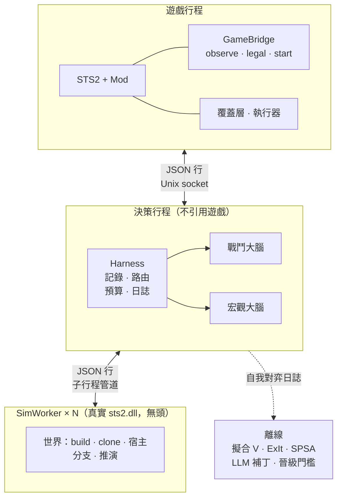

import { Badge, LinkCard } from '@astrojs/starlight/components';

這個專案為**殺戮尖塔 2**（Slay the Spire 2，簡稱 STS2）做一個 AI，以 Mod 的形式在遊戲裡執行。同一個大腦驅動兩種模式：

- **輔助模式**：標示出牌順序，並解釋原因。
- **自動遊玩**：自己打完整局。

策略從零開始自我提升，不是從使用者自己的對局裡學來的。第一個目標是 Silent（寂靜獵手），晉階等級 A0。只支援單人模式。

遊戲版本固定為 **v0.111.0**。遊戲基於 Godot 4.5.1 和 .NET 9.0.7；Mod 透過 Harmony 補丁在執行時修改它的程式碼。

## 1. 約束

所有設計決策都遵循這七條規則：

1. **不作弊**，不超出所在環境允許的範圍（[§2](#sec-2)）。決策行程不引用任何遊戲程式碼，由編譯器保證。
2. **線上決策 = 搜尋 + 學到的價值**，全部用同一個尺度：贏下這一局的機率 P(win run)。LLM 從不做決策，也從不用來打破平局。它只在離線時使用，用來提出補丁和潤色解說，並且只透過專案的 LLM 閘道器呼叫便宜的模型。
3. **訓練和真實遊戲走同一條程式碼路徑**：同一套 Protocol、GameBridge、Harness 和大腦。
4. **模擬器就是真實的 `sts2.dll`**，以無頭（headless，沒有畫面和視窗）方式執行，不重寫引擎。
5. **不設後備**：沒有任何模組負責的決策會讓遊戲暫停，絕不隨機亂選。
6. **Mod 從不寫存檔**，也沒有任何東西會讓真實遊戲讀檔（`NumReloads == 0`）。
7. **低耦合、簡單、清晰**：每個專案只做一件事，依賴單向（[§4](#sec-4)）；每個決策介面或元件只藏在一個小介面後面；沒有使用者的機制不做；遊戲 bug 不做檢查碼或後備，破壞我們自身正確性的，在它進入我們程式碼的地方修掉。例如：讀檔會丟掉連續執行時還在的遺物欄位，所以 SL 檢查點把它們帶上（[環境：資訊與節點 §7](/zh-tw/arch/environments/information/#sec-7)）。

## 2. 環境

AI 在兩種環境之一裡遊玩，定義見[環境](/zh-tw/arch/environments/)：

- **NoSL**：只用公開歷史。搜尋在 K 個確定化樣本（與公開資訊一致的隱藏狀態）上進行，再取平均。
- **SL**：NoSL 加上當前節點內的真實結果；節點就是當前地圖點，從到達到選擇下一個點為止。搜尋使用一個封存的精確複本。兩種環境都看不到後面的節點。
- 兩種環境共用一個宏觀大腦和一個價值函式 V，只有戰鬥大腦不同：NoSL 用 PIMC，SL 用對整場戰鬥的規劃器（[環境：世界 §5](/zh-tw/arch/environments/worlds/#sec-5)）。每種環境有自己的冠軍和排行榜。報告裡給出 SL − NoSL 的差值。

## 3. 行程

- **遊戲行程**：真實遊戲加上我們的 Mod。Mod 透過 GameBridge 讀取螢幕上的內容（observe）、列出合法動作（legal），並透過 UI 自己的入口執行動作（start）。它負責畫覆蓋層，在自動遊玩時執行動作。
- **決策行程**：不載入任何遊戲程式碼。Harness 儲存這一局的記錄，把每個決策路由給戰鬥大腦或宏觀大腦，設定搜尋預算，並寫決策日誌。
- **SimWorker 行程**：每個都以無頭方式執行真實的 `sts2.dll`。它們建構或複製供搜尋探索的世界，執行搜尋分支和推演（rollout），也可以自己作為宿主跑完整一局。
- **離線**：一條獨立的管線，把自我對弈的日誌變成更好的價值函式，每次改動都要通過晉級門檻（[學習](/zh-tw/arch/learning/)）。

自我對弈時，這一局的宿主換成一個 SimWorker，而不是真實遊戲。Harness 和大腦完全不變：「換世界，不換大腦」。

遊戲把當前這一局放在單例裡，所以一個行程只能有一局在執行。因此搜尋必須分散到多個行程上。這正好符合「決策行程不載入遊戲程式碼」的規則。

## 4. 程式碼

所有專案都在 `src/` 下，屬於解決方案 `Sts2Ai.sln`。依賴單向：從表格上方指向下方，最終指向 Protocol。

| 專案 | 引用 | 內容 |
|---|---|---|
| `Sts2Ai.Protocol` | 只有框架 | 通訊型別；這些型別合起來就是觀測白名單 |
| `Sts2Ai.GameBridge` | 遊戲 + Protocol + Harmony | observe、legal、start（UI 入口） |
| `Sts2Ai.Brain` | Protocol | 戰鬥大腦 v0（PIMC）、佔位策略 |
| `Sts2Ai.SimWorker` | 遊戲 + 以上全部 | 無頭宿主、戰鬥和整局工作階段、CombatBuilder、戰鬥世界、worker（`serve`）、命令列 |
| `Sts2Ai.Mod`（規劃中） | 遊戲 + GameBridge + Protocol | 遊戲內宿主 |
| `Sts2Ai.Harness` | Protocol + Brain | 排程行程：路由、大腦種子、決策日誌、worker 行程池和池化的 PIMC 大腦；記錄在規劃中 |

## 5. 文件地圖

本手冊像一本書那樣閱讀：一篇概覽、四部和兩個附錄，順序與側邊欄相同。每頁旁邊的徽章表示它的狀態。

**第一部　問題**

| 頁面 | 範圍 | 狀態 |
|---|---|---|
| [環境](/zh-tw/arch/environments/) | NoSL/SL 定義、節點邊界、資訊表、守護測試 | <Badge text="已定" variant="success" /> |

**第二部　決策**

| 頁面 | 範圍 | 狀態 |
|---|---|---|
| [戰鬥大腦](/zh-tw/arch/combat-brain/) | 一章三節：戰鬥決策是什麼、兩種演算法、葉節點（`LeafValue` 與戰鬥網路）、選牌提示、敵人招式與 worker | <Badge text="部分實作" variant="tip" /> |
| [SL 規劃器](/zh-tw/arch/sl-planner/) | 一章四節：在複本上規劃整場戰鬥、回合搜尋、束搜尋及其上界、預算與結果 | <Badge text="已實作" variant="success" /> |
| [NoSL PIMC](/zh-tw/arch/pimc/) | 一章三節：取樣的世界、每個世界裡的搜尋與平均、預算與結果 | <Badge text="已實作" variant="success" /> |
| [宏觀大腦](/zh-tw/arch/macro-brain/) | 一章七節：它決定什麼、後狀態與單一 V、SL 複本上的搜尋、價值網路、從風險值到價值、菁英連戰裡的自我對弈、弱點與下一步 | <Badge text="部分實作" variant="tip" /> L0、純 V 和它的自我對弈已有 |

**第三部　學習與評估**

| 頁面 | 範圍 | 狀態 |
|---|---|---|
| [學習](/zh-tw/arch/learning/) | V 的定義、自我對弈循環、功勞分配、特權訓練、局部最佳解、基礎設施 | <Badge text="規劃中" variant="caution" /> |
| [評估](/zh-tw/arch/evaluation/) | R1–R4 階梯、排行榜、指標、種子、晉級門檻、基線 | <Badge text="規劃中" variant="caution" /> |

**第四部　機器**

| 頁面 | 範圍 | 狀態 |
|---|---|---|
| [模擬器](/zh-tw/arch/simulator/) | 無頭宿主、戰鬥工作階段、CombatBuilder、效能、整局工作階段、NoSL 世界、SL 複本、worker 池 | <Badge text="部分實作" variant="tip" /> 戰鬥與整局工作階段、NoSL 戰鬥世界、worker 行程池已有 |
| [Harness](/zh-tw/arch/harness/) | 記錄與信念、路由、預算、決策日誌、故障處理 | <Badge text="部分實作" variant="tip" /> 路由、決策日誌和 worker 行程池已有 |
| [協定](/zh-tw/arch/protocol/) | 通訊格式、觀測聯合型別、選擇上下文、事件、推薦、世界 API | <Badge text="部分實作" variant="tip" /> 觀測與選牌上下文已有 |
| [GameBridge](/zh-tw/arch/gamebridge/) | 觀測來源、各介面的動作、選牌提示上下文、決策點、uid | <Badge text="部分實作" variant="tip" /> 每個決策介面都已有 |
| [Mod](/zh-tw/arch/mod/) | 載入、主執行緒迴圈、空閒檢測、轉接器、SL 匯出、自動開局驅動、安全 | <Badge text="規劃中" variant="caution" /> |
| [輸出層](/zh-tw/arch/output/) | 面板、標示錨點、自動迴圈、解說 | <Badge text="規劃中" variant="caution" /> |

附錄：進度、已知缺口和實施順序見[進度與路線圖](/zh-tw/status/)；術語解釋見[術語表](/zh-tw/glossary/)。

背景筆記（中文）只儲存在本地 `tmp/notes/` 下，不在儲存庫裡：`plan.md`（計畫 v1，里程碑 M0–M5）、`fair-play-spec.md`、`output-design.md`、`testmode-audit.md`、`mod-research.md`。

<LinkCard title="從這裡開始：環境" description="NoSL 和 SL 分別允許 AI 知道什麼。其他每一頁都建立在它之上。" href="/zh-tw/arch/environments/" />

## 關於本手冊

**怎麼讀**

- <Badge text="已核實" variant="success" /> 表示這條說法已在遊戲原始碼裡核對過。<Badge text="推斷" variant="caution" /> 表示它是推斷出來的，在依賴它之前必須先核實。
- 像 `Runs/RunManager.cs:670-709` 這樣的原始碼位置，是反編譯後 `MegaCrit.Sts2.Core` 組件裡的路徑。反編譯程式碼只儲存在本地（`tmp/decompiled/sts2/`），不在儲存庫裡。Godot 節點類別（`N*`）按檔名查詢，檔名是唯一的。
- 「Harness §3」這樣的引用指向某頁的編號小節。它的錨點在三種語言裡都是 `#sec-3`（`/zh-tw/arch/harness/#sec-3`）。程式碼註解寫作 `docs: harness §3`。
- 由好幾頁組成的一章（例如宏觀大腦）引用時也寫出頁名：「宏觀大腦：搜尋 §2」就是 `/zh-tw/arch/macro-brain/search/#sec-2`，程式碼註解寫作 `docs: macro-brain/search §2`。

**怎麼維護**

- 英文頁是參考版本，Claude 把它當作設計手冊來讀；簡體和繁體中文頁內容與之相同。三種語言在同一次提交裡一起修改。
- 小節編號保持穩定：程式碼註解會引用它們。
- 提交前在 `docs/` 下執行 `pnpm check`：它會建置網站，並檢查每個內部連結和錨點。
