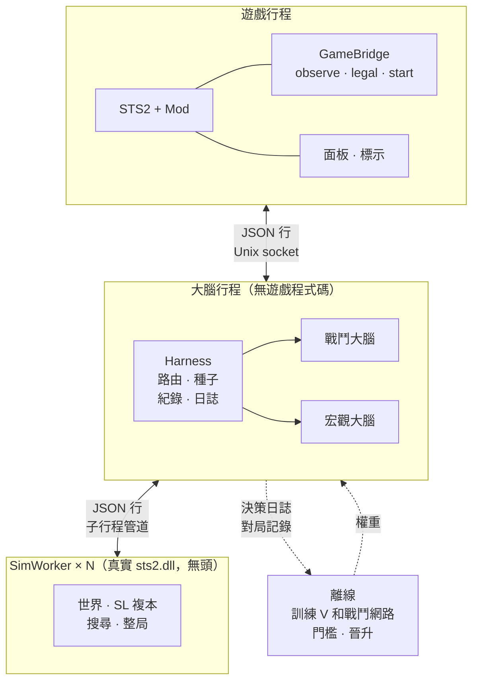

import { Badge, LinkCard } from '@astrojs/starlight/components';

這個專案做一個玩**殺戮尖塔 2**（Slay the Spire 2，簡稱 STS2）的 AI，STS2 是一款單人牌組構築 roguelike 遊戲；這個 AI 以 Mod 的形式在遊戲裡執行。同一個大腦服務兩種模式：

- **輔助**：Mod 向玩家顯示 AI 會怎麼做、它這一回合的計畫，以及它權衡過的選項。這部分已經做好（[Mod](/zh-tw/arch/mod/)、[輸出](/zh-tw/arch/output/)）。
- **自動遊玩**：AI 在真實遊戲裡自己打完整局。這部分在規劃中。

策略透過自我對弈從零學起；它不是從任何人錄下的對局建構的，也不是手寫的。第一個目標是寂靜獵手，只限單人：先晉階 0，再晉階 10。遊戲版本固定在 **v0.111.0**；遊戲執行在 Godot 4.5.1 和 .NET 9.0.7 上，Mod 用 Harmony 補丁在執行時修改它的程式碼。

**它現在打得多好**：在 SL 中，AI 可以重播它所在的房間，冠軍贏下 **5.0%** 的寂靜獵手 A10 整局（200 個種子中 10 個，95% 區間 2.7–9.0%），平均到達第 28.8 層；在 A0，一對較早的網路在它們的門檻打完的 150 個種子中贏了 88 個。在 NoSL 中，AI 只看得到玩家看得到的，還沒有冠軍贏過一局；最好的報告平均到達第 26.2 層，用的是一個較舊的價值函數（[評估](/zh-tw/arch/evaluation/)）。

如果你從沒玩過這款遊戲，請先讀[遊戲](/zh-tw/arch/game/)。

## 1. 五個想法

1. **搜尋加上學到的價值**：每個決策都在線上做出：搜尋各個選項，並用一個學到的價值函數評判它們通往哪裡，全都在同一個尺度上。在戰鬥中，搜尋把這場戰鬥往下打；在戰鬥外，宏觀大腦用 V 給每個選項的結果估值（[戰鬥大腦](/zh-tw/arch/combat-brain/)、[宏觀大腦](/zh-tw/arch/macro-brain/)）。策略不寫成規則：它存在於網路學到的東西裡。
2. **兩種環境**：遊戲充滿隱藏資訊。在 **NoSL** 中，AI 只知道玩家知道的。在 **SL** 中，它還可以看到當前地圖點內的真實結果，就像一個會存檔讀檔的玩家能做到的那樣；兩種環境裡，之後的房間都仍然隱藏。每種環境有自己的冠軍和排行榜（[環境](/zh-tw/arch/environments/)）。
3. **換世界，不換大腦**：同樣的大腦在自我對弈時回答模擬器，在真實遊戲裡回答 Mod，用的是同樣的訊息（[協定](/zh-tw/arch/protocol/)、[Harness](/zh-tw/arch/harness/)）。只有宿主會變。
4. **真實的遊戲，無頭執行**：模擬器不是遊戲的模型：它在一個普通的 .NET 行程裡執行遊戲自己的 `sts2.dll`，沒有圖形，規則原封不動（[模擬器](/zh-tw/arch/simulator/)）。
5. **不設後備**：沒有任何大腦負責的決策會讓這一局帶著錯誤停下；它從不被隨機做出。一個隨機決策會讓一次評估作廢。

## 2. 七條規則

每個設計決策都遵循這些規則，每條都有它的理由：

| 規則 | 理由 |
|---|---|
| **不作弊，不超出環境允許的範圍**：決策行程不持有任何對遊戲程式碼的引用，由編譯器強制；傳給它的東西是一份協定型別的白名單 | 這樣 AI 知道的正好是環境允許的，而且可以檢查（[環境：資訊與節點 §8](/zh-tw/arch/environments/information/#sec-8)） |
| **線上決策是搜尋加上學到的價值**：LLM 從不做決策，也從不打破平手；它只能在離線時使用，而且用便宜的模型 | 這樣遊玩可以重現，每個選擇都能追溯到一次搜尋和一個價值 |
| **訓練和真實遊戲共用一條程式碼路徑**：同樣的 Protocol、GameBridge、Harness 和大腦 | 這樣訓練過、過了門檻的，就是實際在打的 |
| **模擬器就是真實的 `sts2.dll`**，無頭執行，沒有改寫任何引擎 | 改寫會與遊戲漸行漸遠；真實的程式碼按定義就是對的 |
| **不設後備**：沒有被負責的決策會停下；它從不被隨機做出 | 一個悄悄的隨機動作會掩蓋缺少的部分，並同時污染訓練資料和結果 |
| **Mod 從不寫存檔，也沒有任何東西讓真實遊戲讀檔**（`NumReloads == 0`） | SL 的重播發生在模擬器裡、在一個複本上；真實遊戲是一路直接打下去的 |
| **低耦合、簡單、清楚**：每個專案只做一件事，依賴單向（[§4](#sec-4)）；每個決策畫面或元件都在一個小介面後面；在有東西用到之前不建任何東西；遊戲的怪癖不加檢查碼或後備，而破壞我們自身正確性的怪癖，在它進入我們程式碼的地方修掉 | 這樣每個部分都能單獨閱讀、測試和替換。例如：載入的存檔會丟掉連續遊玩時保留的遺物欄位，所以 SL 檢查點帶上它們（[模擬器：世界與 SL 複本 §6](/zh-tw/arch/simulator/worlds/#sec-6)） |

## 3. 行程與資料

- **遊戲行程**：真實遊戲加上 Mod。Mod 用 GameBridge 讀取畫面上的決策（observe、列出合法動作；模擬器也用它開始動作），詢問大腦，並畫出答案（[Mod](/zh-tw/arch/mod/)）。
- **大腦行程**：SimWorker 的 `brain` 指令，或在 `run` 裡面的同一批物件。它不載入任何遊戲程式碼。Harness 給每一局一個 dispatcher，把每個決策路由給一個大腦，抽出它的種子，檢查它的答案並記錄下來（[Harness](/zh-tw/arch/harness/)）。
- **SimWorker 行程**：每個都以無頭方式執行真實的 `sts2.dll`。它們建構供搜尋在其中進行的世界、載入 SL 複本、執行搜尋，並在自我對弈和評估中擔任整局的宿主（[模擬器](/zh-tw/arch/simulator/)）。遊戲把它的一局放在單例裡，所以一個行程只持有一局活的遊戲：搜尋分散到許多行程上（[模擬器：工作行程池](/zh-tw/arch/simulator/pool/)）。
- **離線**：`learn/` 下的 Python 從決策日誌和對局記錄訓練 V 和戰鬥網路，並由一個晉級門檻決定新網路是否取代冠軍（[學習](/zh-tw/arch/learning/)、[評估](/zh-tw/arch/evaluation/)）。

自我對弈時，由一個 SimWorker 而不是遊戲來擔任這一局的宿主；Harness 和大腦都不變。

## 4. 程式碼

所有 .NET 專案都在 `src/` 下，屬於解決方案 `Sts2Ai.sln`。依賴單向，一路往下指向 Protocol：

| 專案 | 引用 | 內容 |
|---|---|---|
| `Sts2Ai.Protocol` | 只有框架 | 訊息和觀測型別：合起來就是能傳過去的東西的白名單（[協定](/zh-tw/arch/protocol/)） |
| `Sts2Ai.GameBridge` | 遊戲、Protocol | observe、legal、start：所有讀取或驅動遊戲的東西（[GameBridge](/zh-tw/arch/gamebridge/)） |
| `Sts2Ai.Brain` | Protocol | 戰鬥大腦（PIMC、SL 規劃器、葉節點和戰鬥網路）、帶 V 的宏觀大腦 L0、佔位策略 |
| `Sts2Ai.Harness` | Brain | dispatcher、大腦伺服器、工作行程池和池化的大腦、對局記錄、報告和門檻 |
| `Sts2Ai.SimWorker` | 遊戲、GameBridge、Brain、Harness | 無頭宿主、戰鬥和整局工作階段、世界和複本、worker（`serve`）、命令列（[模擬器：參考](/zh-tw/arch/simulator/reference/)） |
| `Sts2Ai.Mod` | 遊戲；把 GameBridge 和 Protocol 編譯進來 | 遊戲內宿主（[Mod](/zh-tw/arch/mod/)） |
| `Sts2Ai.Tests` | SimWorker | xUnit 測試（[模擬器：參考 §7](/zh-tw/arch/simulator/reference/#sec-7)） |

`src/` 之外：

- `learn/`：訓練 V（`learn/v/`）和戰鬥網路（`learn/combat/`）的 Python，以及門檻和連戰的腳本，用 uv 執行（[學習](/zh-tw/arch/learning/)）；
- `weights/`：訓練好的網路，每個一個 JSON 檔案，按角色分（`weights/silent/`）；
- `eval/`：種子集、報告、排行榜、冠軍檔案和帳本，按角色分（[評估](/zh-tw/arch/evaluation/)）；
- `docs/`：這本書；
- 資料目錄（`data/`）存放自我對弈和評估的日誌，保存在專案的儲存主機上，不在 git 裡。

## 5. 這本書

這本書有一篇前言、四部和兩個附錄，順序與側邊欄相同。頁面的徽章表示它的狀態。

**第一部：問題**

| 章 | 內容 | 狀態 |
|---|---|---|
| [遊戲](/zh-tw/arch/game/) | 一局、地圖、房間、戰鬥、角色、晉階、隨機性，以及隱藏了什麼 | |
| [環境](/zh-tw/arch/environments/) | AI 在 NoSL 和 SL 中能知道什麼、節點、世界和兩種戰鬥演算法 | <Badge text="已定" variant="success" /> |

**第二部：決策**

| 章 | 內容 | 狀態 |
|---|---|---|
| [戰鬥大腦](/zh-tw/arch/combat-brain/) | 戰鬥決策是什麼、兩種演算法、葉節點和戰鬥網路、選牌提示、敵人招式 | <Badge text="部分實作" variant="tip" /> |
| [SL 規劃器](/zh-tw/arch/sl-planner/) | 在複本上規劃整場戰鬥：回合搜尋、束搜尋、預算與結果 | <Badge text="已實作" variant="success" /> |
| [NoSL PIMC](/zh-tw/arch/pimc/) | 取樣的世界、每個世界裡的搜尋、平均、預算與結果 | <Badge text="已實作" variant="success" /> |
| [宏觀大腦](/zh-tw/arch/macro-brain/) | 戰鬥外的決策：後狀態與單一 V、SL 複本上的搜尋、價值網路、自我對弈、下一步 | <Badge text="部分實作" variant="tip" /> |

**第三部：學習與評估**

| 章 | 內容 | 狀態 |
|---|---|---|
| [學習](/zh-tw/arch/learning/) | 學什麼、價值函數、戰鬥網路的訓練、循環、參考 | <Badge text="部分實作" variant="tip" /> |
| [評估](/zh-tw/arch/evaluation/) | 模擬到實機的階梯、指標、種子與報告、門檻、冠軍與基線 | <Badge text="部分實作" variant="tip" /> |

**第四部：機器**

| 章 | 內容 | 狀態 |
|---|---|---|
| [模擬器](/zh-tw/arch/simulator/) | 無頭執行的遊戲、戰鬥、整局、世界與 SL 複本、工作行程池、命令列 | <Badge text="部分實作" variant="tip" /> |
| [Harness](/zh-tw/arch/harness/) | 路由、預算與種子、決策日誌 | <Badge text="部分實作" variant="tip" /> |
| [協定](/zh-tw/arch/protocol/) | 線路、觀測與動作、世界與工作行程訊息 | <Badge text="部分實作" variant="tip" /> |
| [GameBridge](/zh-tw/arch/gamebridge/) | 讀取遊戲、各決策介面的動作 | <Badge text="部分實作" variant="tip" /> |
| [Mod](/zh-tw/arch/mod/) | 遊戲內宿主：主迴圈、SL 紀錄、自動遊玩與安全 | <Badge text="部分實作" variant="tip" /> |
| [輸出](/zh-tw/arch/output/) | 面板、標示、規劃中的自動迴圈和解說 | <Badge text="部分實作" variant="tip" /> |

**附錄**：[狀態與路線圖](/zh-tw/status/)和[詞彙表](/zh-tw/glossary/)。

**閱讀路線**：

- *想在遊戲裡使用 AI*：[遊戲](/zh-tw/arch/game/)、[環境](/zh-tw/arch/environments/)，然後是 [Mod](/zh-tw/arch/mod/) 和[輸出](/zh-tw/arch/output/)。
- *想訓練一個網路*：[宏觀大腦](/zh-tw/arch/macro-brain/)、[學習](/zh-tw/arch/learning/)、[評估](/zh-tw/arch/evaluation/)，然後是[模擬器：整局](/zh-tw/arch/simulator/runs/)。
- *想加一個決策畫面，或跟上遊戲更新*：[協定：觀測與動作](/zh-tw/arch/protocol/observation/)、[GameBridge](/zh-tw/arch/gamebridge/)、[模擬器：整局 §4](/zh-tw/arch/simulator/runs/#sec-4)、[Mod：主迴圈 §4](/zh-tw/arch/mod/loop/#sec-4)。
- *想看它有多強*：[評估](/zh-tw/arch/evaluation/)和[狀態](/zh-tw/status/)。

<LinkCard title="從這裡開始：遊戲" description="殺戮尖塔 2 的一局是什麼，其中又隱藏了什麼。其他每一頁都建立在它之上。" href="/zh-tw/arch/game/" />

## 6. 關於這本書

**怎麼讀這些頁面**

- <Badge text="已核實" variant="success" /> 表示這條說法已在遊戲原始碼裡核對過。<Badge text="推斷" variant="caution" /> 表示它是推斷出來的，在任何東西依賴它之前必須先核對。
- 像 `Runs/RunManager.cs:670-709` 這樣的遊戲原始碼位置，是反編譯遊戲裡的路徑，省去了其資料夾名稱的 `MegaCrit.Sts2.Core.` 前綴。反編譯程式碼留在本地（`tmp/decompiled/sts2/`），不在儲存庫裡。Godot 節點類別（`N*`）按檔名查找，檔名是唯一的。
- 我們自己的程式碼按它在 `src/` 或 `learn/` 下的路徑引用；在章節已經清楚指明是哪個專案時，常常省去 `src/Sts2Ai.` 前綴。
- 「Harness §3」指向某一頁的一個編號小節。它的錨點在三種語言裡都是 `#sec-3`（`/zh-tw/arch/harness/#sec-3`）。由好幾頁組成的一章還要寫出頁名：「宏觀大腦：搜尋 §2」就是 `/zh-tw/arch/macro-brain/search/#sec-2`。程式碼註解也用同樣的方式引用小節：`docs: harness §3`、`docs: macro-brain/search §2`。
- 中文的背景筆記保存在本地 `tmp/notes/` 下，不在儲存庫裡。

**怎麼維護**

- 英文頁是參考版本，Claude 把它們當作設計手冊來讀。簡體和繁體中文頁說的是同一件事。三種語言在同一次提交裡一起修改。
- 保持小節編號穩定：程式碼註解會引用它們。
- 提交前在 `docs/` 下執行 `pnpm check`：它會建置網站，並檢查每個內部連結和錨點。
