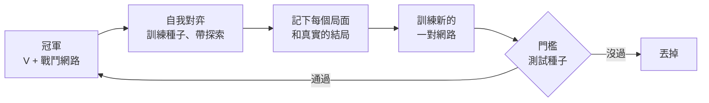

兩個網路都靠自我對弈學習。冠軍用現在的網路在模擬器裡打整局，故意把一部分決策改成隨機抽，並記下每個決策和每場戰鬥的結局。每個記下的局面，標上之後真正發生的事：V 看接下來四層，再往後用一個沒看過這一局的 V 的估計。新的一對網路從冠軍的網路接著學這些對局，過了門檻才取代冠軍。整個過程沒有人類的對局，沒有手寫的策略，也沒有語言模型。

## 誰來打

打的是冠軍那一對網路，用的是它上場評估時同樣的搜尋力度。

這是因為 V 的意思是「照冠軍這樣打下去，贏的機率」。標籤要是來自一個比較弱、或搜尋比較淺的玩家，V 學到的就是另一個問題的答案。

## 探索：故意不選最好的

永遠選 V 認為最好的選項，就永遠不知道其他選項會帶來什麼。V 看錯了，也沒有機會發現。所以自我對弈要**探索**。

戰鬥之外的每個決策，有 ε 的機率從所有選項裡平均抽一個，不管 V 怎麼想；其餘時候照 V 自己的估值抽，抽得很陡，V 的最佳幾乎總是勝出，只有 V 評得差不多高的選項偶爾被選上。

- **為什麼平均抽。** 抽哪一個既不看 V，也不看這一局打得順不順。這樣得到的結局，才是每個選項乾淨的證據。照 V 的喜好加權去抽，只會一再重試 V 本來就喜歡的。
- **為什麼還要陡陡地抽。** V 把兩個選項評得差不多時，它分不出哪個比較好，試試另一個也幾乎沒有代價。
- **為什麼分三檔。** 一批對局平分成三檔，SL 的 ε 分別是 0.06、0.03 和 0.01，NoSL 的是兩倍。ε 大的看得到更多選項，ε 小的才能像冠軍一樣常打到後面幾層。
- **代價。** 探索會輸：探索得越多的那一檔，贏得越少。

戰鬥裡不探索，搜尋找到什麼就打什麼。

## 標籤：之後發生的事

- **V 的標籤**：每個戰鬥之外的決策，接下來四層標上實際的經過，再往後標上一個沒看過這一局的 V 在四層之後的局面估計這一局會在哪裡結束。離這一局結束不到四層的決策，標上這一局實際結束在哪一層，或是贏了。
- **戰鬥網路的標籤**：每個回合的開始，標上這場戰鬥實際怎麼收場。

給一局標籤的 V，一定沒看過這一局。V 學一遍就會記住訓練對局的結局，拿它去估這種對局後來的局面，等於把結局又交回來。所以訓練的對局分成兩半，每一半各訓練一個從沒看過另一半的 V，每一半由另一半的 V 來標。留下來檢查的對局，照樣用真實的結局。

## 幾百個決策，一個結局

範例對局裡有 207 個戰鬥之外的決策，它們共用同一個結局。這樣的標籤沒有偏差，但雜訊很大：單看一局，說不出是哪個決策造成了輸贏。目前做了五件事來應付：

- **按層給標籤。** 活過的每一層都是資訊，不只最後的輸贏。
- **四層實際的經過，之後用估計。** 一個決策四層之後的運氣不進它的標籤，所以相隔四層的兩個決策，雜訊幾乎不共用：一局能給出約 9.6 個獨立的標籤，只看結局時約 1.2 個。代價是四層之後的標籤，只能和給它的那個 V 一樣準。
- **一局只算一票。** 每筆樣本的權重是「1 除以這一局的樣本數」。
- **多一個練習用的目標。** 訓練時 V 還要預測接下來六場戰鬥各掉多少血，讓它在一局裡有更多能對答案的地方。
- **戰鬥交給搜尋。** 一局約四分之三的決策在戰鬥裡，那些靠搜尋解決。要靠結局來分功過的，只剩戰鬥之外的那一小部分。

## 從冠軍接著學

訓練從冠軍的權重接著往下，不從零開始。在同一批資料上，接著學的網路在留下來檢查的對局上誤差更低。

舊的幾批對局有得有失。比較弱的冠軍打出來的對局，給局面的標籤偏低：換現在的冠軍接著打，會贏得更多。可是只學最新一批的網路，會忘掉只有舊對局走得到的那些局面。

SL 的冠軍的兩個網路，是從最新一批連同之前三批、約 125,000 局學來的。NoSL 的一對從 SL 的出發，只從 NoSL 自己最新的一批、約 72,000 局學。

## 訓練種子和測試種子不相見

自我對弈用的種子和評估用的種子來自兩個不同的來源，不會重疊。兩頭都有檢查：訓練程式遇到含有評估對局的資料就拒絕，評估只能打事先登記好的測試種子。這樣門檻量到的，才是網路在沒學過的對局上的表現。

## 從零開始

搜尋需要兩個網路才能動。還沒有任何網路的時候，可以用兩個不需要網路的佔位玩家打出第一批對局：一個在戰鬥之外隨機選，一個在戰鬥裡隨機出牌。之後的每一批，都是上一批學出來的網路打的。
