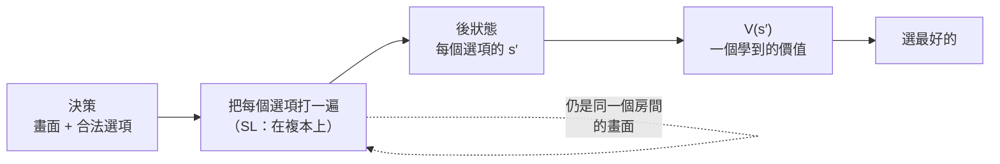

import MapRoute from '../../../components/book/MapRoute.svelte';

戰鬥之外的每個決策都歸這一章：下一步去地圖上哪個點、領哪些獎勵、拿哪張牌、買什麼，以及在事件、休息處和寶箱前選哪個選項。方法一句話就能說完：把每個選項都打一遍，看看打完之後當下的局面，問一個學到的價值函式 V 這個局面有多好，然後選最好的。

1. **選項**：這個畫面上遊戲允許的動作。
2. **後狀態**：每個選項都執行一遍，執行完、還沒有任何隨機的事發生時的局面，就是它的*後狀態*。SL 下，選項在當前房間的複本上、在真實遊戲裡打出；如果遊戲接著顯示同一個房間的另一個畫面，例如購買之後的商店、事件的下一頁，搜尋就繼續穿過它。
3. **一個價值**：V 讀一個後狀態，回傳一個數字。同一個 V 給每個畫面的每個選項評分，所以一張牌、一件遺物、一次升級、一次回血和地圖上的一條路，都在同一個尺度上比較，不需要手寫的換算率。
4. **最好**：選價值最高的選項，打平時選第一個。自我對弈有時故意抽另一個，為了學到它會帶來什麼。

藥水的估值記著遊戲的一條規則：藥水隨時可以白白丟掉。所以問 V 的是這條腰帶留下哪幾瓶最好，拿著一瓶藥水絕不會比空著一格差。

## 這些決策難在哪

這些決策的共同點是：選項少、影響遠、執行便宜、難以估值。一個戰鬥回合可能有上千種打法；這裡一個決策只有寥寥幾個選項，每個都能在複本裡試一遍。

難的是，一個選擇的效果要過很多層才顯現出來。第 2 層拿的一張牌，到第 3 幕頭目時還在牌組裡。第 43 層為了多打一場怪物戰而跳過的休息處，可能決定這一局能不能到達第 48 層。

本書的範例對局裡，這種決策有 193 個，它們全都共用同一個結果：這一局贏了。

## 為什麼估打完之後的局面

拿牌、買東西、選路，都是先發生一件確定的事：牌進了牌組、金幣付了、地圖點選定了。之後才輪到隨機的事，例如下一場戰鬥遇到誰。確定的部分做完、隨機的部分還沒開始，這個局面就是後狀態。

估後狀態而不估選項本身，有三個好處：

- **一個函式就夠。** 選項在每個畫面上意思都不同：一張牌、一個地圖點、一個貨位。局面卻總是同一種東西：一局的現況。
- **殊途同歸只學一次。** 從獎勵拿一張牌、在商店買同一張、從事件得到它，打完都是同一個局面，V 只要學一次它值多少。
- **每個決策都是訓練資料。** 不管來自哪個畫面，記下來的局面都拿去教同一個 V。

## 一把尺

V 的單位是贏下這一局的機率。兩個選項相差 0.02，意思是 V 認為選其中一個，獲勝機率高 2 個百分點。各個畫面問的事差很多，最後都歸到這個數字：

- **休息處**：回血，還是升級一張牌。V 比的是生命多的一局和牌組好的一局。
- **卡牌獎勵**：三張牌，或者都不拿。一張牌的價值可能比不拿還低：牌組多了一張弱牌，抽到好牌的次數就少了。
- **地圖**：頭目前幾層，走怪物戰還是走休息處。戰鬥給金幣和一張牌，卻要花生命。

下圖是範例對局第 14 層的地圖，生命 50/70。眼前有兩個點可以走：V 給通往菁英房的那一步 97.95%，通往敵人房的 97.00%，所以去打菁英，打贏還多一件遺物。紫線是它打算一路走到頭目的路線。

<MapRoute client:visible lang="zh-TW" />

有人會想把它拆成兩個網路，一個管牌組，一個管路線。但兩者之間沒有界線：遺物來自菁英和商店，它值多少卻要看牌組；休息處拿生命換升級；商店用同一袋金幣賣牌、遺物和刪牌。拆開之後，兩個分數之間的換算率只能由人來寫，而那就是手寫的策略。

## 在複本上把整個房間走完

很多房間不是一個決策，而是一串。商店是幾次購買再離開，獎勵畫面是幾次領取，事件可能有好幾頁。只估第一步，等於在不知道剩下的金幣還夠不夠刪一張牌的情況下，決定要不要買一件遺物。

所以在 SL 裡，搜尋在複本上一路往下走。每走一步，只留下 V 最高的 16 個局面繼續走；一個決策最多試 1,024 次。走到離開房間、開始戰鬥或這一局結束為止。停下的地方由 V 估值；要是選項引出一場戰鬥，就先讓戰鬥網路估這場戰鬥會怎麼收場。

複本上打出來的是真的結果：事件實際給了什麼，轉化變出哪張牌，買完之後商店還剩什麼。

選路是例外。走到下一個點就離開了這個房間，而複本只到房間的出口。所以地圖上的選擇只能預測：把那個點加進路線，讓 V 讀前面的地圖。

## 沒有複本的時候

在 NoSL 裡沒有複本，只能照畫面上寫的推算：加上這張牌，扣掉金幣，加上回復的生命。畫面沒寫的就看不到，例如事件選項真正的代價，或轉化會變出什麼。所以同一個 V，在 NoSL 裡做這些決策比較粗。
