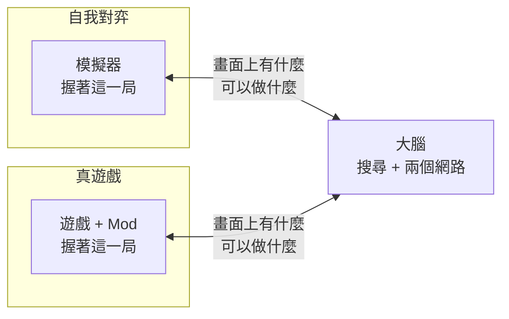

import PanelMock from '../../../components/book/PanelMock.svelte';

大腦從不碰遊戲，它只回答問題。自我對弈時，握著對局的是模擬器；在你的遊戲裡，握著對局的是 Mod。兩邊用同一套程式讀畫面，問同樣的問題，問的是同一個大腦。所以訓練過、過了門檻的，就是實際在你遊戲裡打的那一個。

## 模擬器就是遊戲本身

模擬器不是照著規則重寫的一個遊戲。它載入遊戲自己的規則程式，不開畫面地跑，由一段程式站在原本畫面的位置上按按鈕。

不重寫，是因為遊戲裡有幾百張牌、遺物、怪物和事件，每一個都插手回合的某個環節。重寫等於做第二個遊戲，每個細節都得一致，遊戲每更新一次就會走樣一次。在一個稍微不對的遊戲裡規劃，就會打出稍微不對的牌。

代價有兩個。它跑得和遊戲一樣慢。遊戲的狀態也沒辦法直接複製一份。

## 同樣的種子，同樣的選擇，同樣的一局

模擬器只用一條執行緒，按固定的順序跑，不看時鐘。這樣一局才真的只由種子和每個答案決定。

這一點不是假設，而是檢查出來的：檢查模式會把每一局打兩遍，再把每個房間從存檔重新載入一遍，有一處不同就算失敗。

因為狀態不能複製，在遊戲本身上搜尋，要回到先前的局面時，就從頭重開、把走過的動作重播一遍。一個局面其實是一份食譜：怎麼開始，加上之後的每一步。SL 的複本也是這樣來的。

遊戲把正在打的一局放在整個程式共用的地方，所以一個程式一次只能有一局。真正的那一局必須留著，在複本上的搜尋就分到另外幾個程式裡去跑。

## 戰鬥在翻譯出來的引擎裡搜尋

規劃一場戰鬥，一個決策就要走過上萬個局面。每個局面都從房間開頭重播，太慢。所以不論是自我對弈還是在你的遊戲裡，戰鬥都另外放進一個引擎裡搜尋。

這個引擎也不是照規則重寫的。一個翻譯程式把遊戲裡和戰鬥有關的程式一句一句、機械地翻成另一種語言，手寫的只有讓它跑起來的底層，和少數幾個銜接的地方。翻出來的局面是單純的資料，複製一份只要一步。遊戲每更新一次，就從新版的程式重新翻一次。

每次要規劃，握著這一局的那一方把眼前的戰鬥整個抄進引擎：牌、能力、敵人，連亂數走到哪裡都一樣。搜尋在引擎裡跑，交回計畫；真的那一局照著打，每一步都和計畫記的局面比對。翻譯要是有一處不對，就會有一步對不上，AI 從眼前重新規劃，打的始終是真遊戲。

引擎和遊戲一致，也是檢查出來的：同一場戰鬥在兩邊各打一遍，每一步之後比對整個局面，再從每個決策點岔出去打到底。同一批種子在同一台機器上用兩種方式打完整局，每一個決策都相同。在引擎裡搜尋，一局自我對弈比在複本上重播快十幾倍。

## 一個決策，從畫面到答案

在真遊戲裡，一個決策這樣走：

1. **看畫面。** Mod 每一幀都問遊戲現在最上層是哪個畫面。
2. **等它靜下來。** 畫面連續 3 幀沒有變化，才算一個可以問的決策。一個動作的兩個步驟之間，畫面會空一幀，等 3 幀才不會問早了。
3. **讀成觀測。** 用和模擬器同一套程式，把畫面讀成兩樣東西：畫面上有什麼，以及現在可以做什麼。
4. **問大腦。** 大腦是 Mod 自己啟動的另一個程式。思考全在那一邊，遊戲不會因此卡住。
5. **顯示答案。** 大腦回答下一步、之後的計畫，以及每個選項的勝率。Mod 用遊戲裡的名字把它們寫在面板上，並在地圖和牌上畫記號。
6. **玩家決定。** 玩家自己點，或者請 AI 代打。

答案只屬於它被問的那個畫面。畫面先變了，Mod 就取消這次詢問，晚到的答案直接丟掉。

## 真遊戲從不讀檔

SL 需要當前房間的複本，但 Mod 不讓真遊戲讀檔，也不寫任何存檔。它做的是記錄：抵達一個房間時，遊戲自己會存檔，Mod 在那一刻把存檔的內容留在記憶體裡；之後玩家或 AI 走的每一步，都在遊戲確認的地方記下來。每次要問 SL 的決策之前，Mod 把這份紀錄交給大腦，大腦那一邊載入、重播，得到複本。

到了戰鬥，Mod 還會像模擬器那樣把活的戰鬥寫出來，計畫在引擎裡搜尋。引擎就裝在 Mod 裡，有 Linux、macOS 和 Windows 的版本。它是從某一版遊戲翻譯來的，所以 Mod 只在那一版遊戲上跑。

紀錄要是斷了，例如出現一步模擬器沒辦法重播的操作，這個房間就不再給建議。寧可不答，也不在一個錯的複本上估值。

## 玩家看到什麼

面板上有這一局的勝率、AI 會走的下一步、之後的計畫，以及最多五個選項各自的勝率。下圖是面板的樣子，內容來自範例對局。

<PanelMock client:visible lang="zh-TW" />

AI 可以代打，範圍由玩家指定：一步、打完這個回合、打完這個房間，或一直打到被暫停。每一步都照玩家點擊的方式執行，遊戲的畫面照常跟著走。

代打守幾條規矩：

- 只在玩家要求時才動手。
- 只打眼前這個畫面的答案，同一個畫面最多打一次。
- 遇到菁英和頭目先停下。
- 一個動作沒有產生任何效果，就停下。

多人遊戲裡 Mod 不提供協助。
